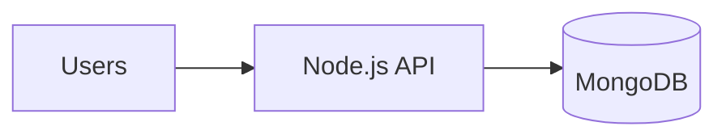
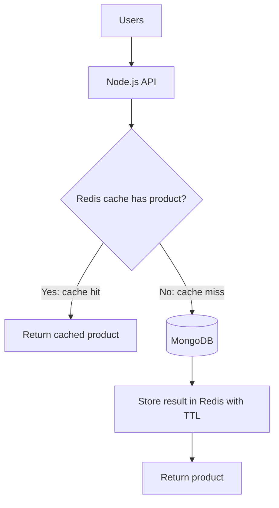
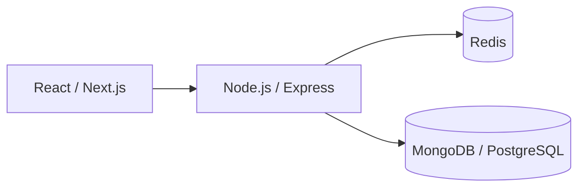
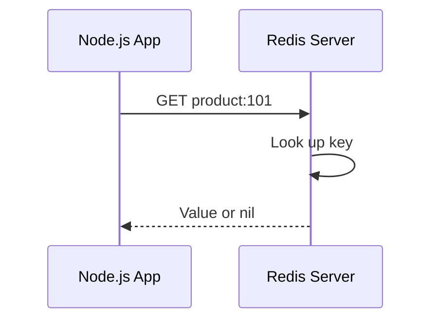

# Lesson 001 — What Is Redis?

> **Level:** Beginner | **Goal:** Understand what Redis is, how it works, where it fits, and how it differs from a primary database.

## 1. What is Redis?

**Redis** is a fast data store that keeps frequently accessed data primarily in **memory (RAM)**. It is often used as a **cache**, but it can also support counters, sessions, leaderboards, messaging, and other workloads.

Redis stands for **Remote Dictionary Server**. Imagine a giant JavaScript `Map` shared by many application servers:

```js
const cache = new Map();
cache.set("user:42:name", "Asha");
console.log(cache.get("user:42:name")); // Asha
```

This is only a mental model. Redis is a separate server process with a network protocol, multiple data structures, expiration, optional persistence, replication, and other features that a local JavaScript Map does not provide.

### Three important ideas

1. **Key-value access:** A key identifies data, for example `user:42`.
2. **In-memory speed:** Working data is kept in RAM, so many operations avoid disk access.
3. **Network service:** Multiple applications or instances can access the same Redis server.

**Important:** Redis is not automatically a safe replacement for PostgreSQL or MongoDB. Persistence and durability depend on configuration, deployment, and failure conditions.

## 2. Why do applications need Redis?

Suppose an e-commerce product page receives 10,000 requests for the same product. Each request may ask MongoDB for identical product information.

Without caching:



With Redis:



On a **cache hit**, the application can avoid a database query. On a **cache miss**, it fetches data from the database and can populate Redis for future requests.

**TTL (time to live)** is the period after which a cached key expires. Example: 60 seconds.

## 3. Where Redis sits in a real application



Typical responsibilities:

| Component | Responsibility |
| --- | --- |
| React / Next.js | User interface and requests |
| Express API | Authentication, validation, business logic |
| Redis | Fast cache, sessions, counters, rate limits |
| MongoDB / PostgreSQL | Primary durable application data |

**Redis does not magically intercept database calls.** Your application must explicitly use Redis or integrate a library that does.

## 4. What does in-memory mean?

RAM is temporary working memory used by running processes. Redis normally stores its active dataset in RAM. That often makes key lookups very fast, but it has consequences:

- RAM is relatively expensive and limited.
- Large datasets can create memory pressure.
- Restarting without suitable persistence can lose data.
- A network request to Redis still has latency; it is not the same as reading a local variable.

**Not every Redis operation is O(1).** Performance depends on the command and data size. For example, fetching a large list or scanning many keys requires more work.

## 5. How does a Redis request work?

A simplified flow:



Redis clients typically send commands using **RESP (Redis Serialization Protocol)** over a TCP connection. Redis processes the command and sends back a response.

Many Redis commands execute on its main command-processing thread. This is often described as a *single-threaded command execution model*. However, Redis is **not literally single-threaded in every respect**: some I/O and background activities can use other threads or processes. We will explore this properly in Lesson 004.

## 6. Basic Redis commands

The following examples run in `redis-cli` against a Redis server:

```redis
SET greeting "Hello Redis"
GET greeting
EXISTS greeting
DEL greeting
GET greeting
```

Expected ideas:
- `SET` stores a value.
- `GET` retrieves a string value.
- `EXISTS` checks whether a key exists.
- `DEL` deletes a key.
- After deletion, `GET` returns `(nil)` in the CLI.

### Expiring keys

```redis
SET otp:42 "654321" EX 60
TTL otp:42
```

`EX 60` sets a 60-second expiration. `TTL` reports remaining time in seconds (which decreases). **Do not store real OTPs in plaintext in production without appropriate security controls.** This is only a command example.

### Atomic counters

```redis
SET article:10:views 0
INCR article:10:views
INCR article:10:views
GET article:10:views
```

Final value: `"2"`. `INCR` is atomic as a single Redis command; that does **not** make an entire multi-step business workflow automatically atomic.

## 7. Real example: Cache a product

Assume product 101 is stored in MongoDB.

First request:
1. API checks `product:101` in Redis.
2. No value is present: cache miss.
3. API queries MongoDB.
4. API caches the serialized product for 60 seconds.
5. API returns the product.

Second request within 60 seconds:
1. API checks Redis.
2. Value exists: cache hit.
3. API returns the cached product without querying MongoDB.

Later, when product price changes, **you must invalidate or update the cached entry**, or users may temporarily see an old price. TTL alone does not guarantee freshness.

## 8. Redis vs a JavaScript object or Map

| Property | JavaScript Map | Redis |
| --- | --- | --- |
| Accessible from other processes | Not directly | Yes, over network |
| Built-in key expiration | No | Yes |
| Rich server-side data types | No | Yes |
| Persistence | Not built in | Configurable |
| Shared across app replicas | No | Yes |
| Network overhead | No | Yes |

If your application has only one process and a tiny short-lived local cache, a Map may be sufficient. Redis becomes useful when shared state, eviction/expiration, or specialized data structures matter.

## 9. When not to use Redis

Avoid adding Redis just because it is popular.

- If your database is already fast enough and traffic is low, caching may add unnecessary complexity.
- If strong transactional guarantees are central, a relational database may be more suitable as the source of truth.
- If data is sensitive, plan authentication, network isolation, TLS, access control, and retention.
- If data must always be fresh, a cache requires careful invalidation and consistency design.

## 10. Common misconceptions

**Myth: Redis is only a cache.** No. Redis supports many data structures and messaging patterns.

**Myth: Redis is always faster than every database query.** No. Network latency, payload size, command complexity, and workload all matter.

**Myth: Redis never writes to disk.** No. Redis supports persistence mechanisms including RDB and AOF.

**Myth: Data in Redis is always permanent.** No. Keys can expire, be evicted, or be lost during failures depending on configuration.

**Myth: Using Redis automatically reduces database load.** No. Your application needs an appropriate access and invalidation strategy.

## 11. Practice exercises

1. Explain Redis in your own words without saying “just a cache.”
2. Create a `user:1:name` key, read it, and delete it.
3. Set a key with a 30-second TTL and observe `TTL` changing.
4. Design keys for `product:101`, `cart:42`, and `rate-limit:user:42`.
5. Draw a cache-hit and cache-miss flow for a Next.js product API.

## 12. Interview questions

**Q1. What is Redis?**  
An in-memory data store with multiple data types, commonly used for caching, sessions, counters, messaging, and more.

**Q2. Is Redis a database or a cache?**  
It is a data store that can be used as a database, cache, or messaging component depending on requirements.

**Q3. Why is Redis often fast?**  
It primarily operates on in-memory data and uses efficient structures and command execution; exact latency depends on workload.

**Q4. What is a cache miss?**  
When the requested key is absent or expired, requiring a fallback source or computation.

**Q5. What can go wrong with caching?**  
Stale data, invalidation bugs, memory exhaustion, stampedes, failures, and added operational complexity.

## 13. Quick revision

- Redis = remote in-memory data store.
- Key-value is the starting point, not its only capability.
- Redis usually complements, rather than replaces, a primary database.
- Cache hit avoids fallback work; cache miss needs a fallback.
- Expiration, persistence, eviction, and consistency are different concepts.

**Next:** [Lesson 002 — Why Redis? Use Cases and Trade-offs](002-why-redis.md).
