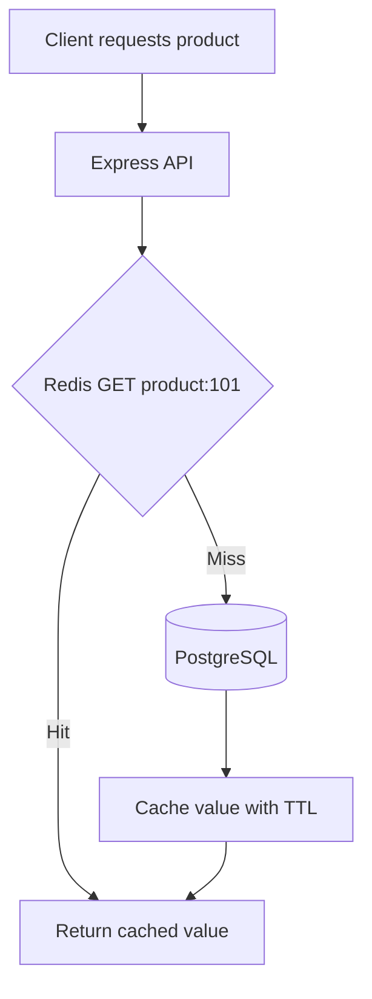
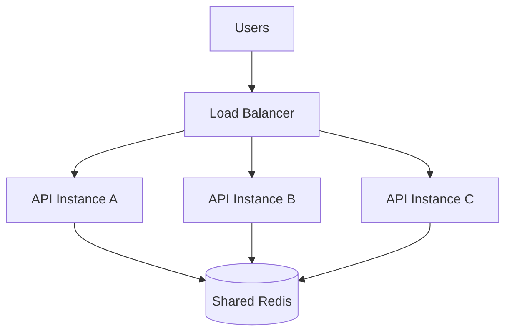
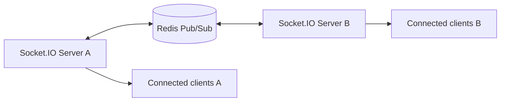
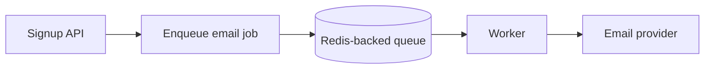

# Lesson 002 — Why Redis? Use Cases and Trade-offs

> **Level:** Beginner | **Goal:** Know when Redis solves a real problem, when it does not, and what engineering trade-offs it introduces.

## 1. Start with the problem, not the technology

Imagine your Node.js e-commerce API:

```text
GET /api/products/101
```

The API queries PostgreSQL for the same popular product thousands of times. Database load grows, and the application repeatedly computes the same response.

One possible solution is to keep a **temporary copy** in Redis.

But before using Redis, ask:
1. Is the database query actually slow or expensive?
2. Is the data requested repeatedly?
3. Can the application tolerate a short period of stale data?
4. What happens if Redis becomes unavailable?
5. Is the extra infrastructure worth maintaining?

Redis is a tool for specific problems, **not a mandatory layer in every backend**.

## 2. Primary benefits

### A. Reduce repeated database work



**Why useful:** Popular product pages, configuration data, public profiles, frequently requested summaries.

**Trade-off:** Cache invalidation and freshness become your responsibility.

### B. Share state between server instances

Suppose an application runs three Express instances behind a load balancer.



A local JavaScript Map in instance A cannot automatically be read by instance B. Redis gives all three instances access to shared data.

**Example:** A shared rate-limit counter or session lookup.

**Trade-off:** Redis is now a network dependency. Its failure and latency must be handled.

### C. Atomic operations on individual keys

```redis
SET page:home:views 0
INCR page:home:views
GET page:home:views
```

Redis can safely increment a counter with one command even when multiple clients issue increments concurrently.

**Caution:** A multi-command workflow needs additional design for atomicity and correctness.

### D. Useful data structures

| Redis type | Example |
| --- | --- |
| String | Cached JSON, counters |
| Hash | User profile fields |
| List | Ordered work items |
| Set | Unique online user IDs |
| Sorted Set | Game leaderboard |
| Stream | Event processing with consumer groups |
| Bitmap | Compact yes/no activity flags |
| HyperLogLog | Approximate unique visitor count |
| Geospatial | Nearby driver coordinates |

The right data type can avoid writing complex application-side logic.

## 3. Real use case: API response caching

A simple cache-aside example using the official `redis` npm client and Express:

```bash
npm install express redis
```

```js
import express from "express";
import { createClient } from "redis";

const app = express();
const redis = createClient({ url: "redis://localhost:6379" });

redis.on("error", (error) => console.error("Redis error:", error));
await redis.connect();

// Demo data source. Replace with a real database query in production.
async function getProductFromDatabase(id) {
  return { id, name: "Keyboard", price: 1999 };
}

app.get("/products/:id", async (req, res) => {
  const key = `product:${req.params.id}`;

  try {
    const cached = await redis.get(key);

    if (cached !== null) {
      return res.json({ source: "cache", product: JSON.parse(cached) });
    }

    const product = await getProductFromDatabase(req.params.id);
    await redis.set(key, JSON.stringify(product), { EX: 60 });

    return res.json({ source: "database", product });
  } catch (error) {
    console.error("Cache request failed:", error);

    // A cache outage should not necessarily make this endpoint unavailable.
    try {
      const product = await getProductFromDatabase(req.params.id);
      return res.json({ source: "database-fallback", product });
    } catch {
      return res.status(500).json({ error: "Unable to load product" });
    }
  }
});

app.listen(3000, () => console.log("API listening on port 3000"));
```

Run with a running Redis server and a Node.js project configured for ESM (`"type": "module"` in package.json). Try requesting `http://localhost:3000/products/101` twice.

**Expected behavior:** First request uses the demo data source. Second request within 60 seconds reads Redis.

**Important production details:** This is an intentionally minimal teaching example, not a complete production template. In a real API, validate the product ID, handle missing records, avoid caching private data under shared keys, set appropriate connection timeouts, and invalidate the key when the product changes. A real database query can fail independently of Redis.

## 4. Session storage

A login session might be stored under:

```text
session:random-session-id -> userId + session metadata
```

The server can look up the session on later requests, even if requests land on different API instances.

**Why Redis?** Shared access and expiration.

**Security:** Use cryptographically strong session IDs, secure cookies, appropriate TTL, and avoid storing sensitive secrets unnecessarily. Do not confuse session storage with JWT verification: stateless JWTs do not inherently require Redis.

## 5. Rate limiting

Example rule: **Allow up to 100 API requests per user in a 60-second window.**

Redis can store a counter and expiration:

```text
rate:user:42:window:12345 -> 37
```

But this simplified design has important details:
- Decide whether to limit per user, API key, IP, or a combination.
- Use an atomic approach to set/increment the counter and expiration correctly.
- Fixed windows can permit bursts at window boundaries.
- Sliding-window, token-bucket, and leaky-bucket designs offer different trade-offs.
- Define what to do when Redis is down: fail open or fail closed.

We will implement these algorithms properly in **Lesson 042**.

## 6. Leaderboards

For a coding challenge platform, Redis **Sorted Sets** can store scores:

```redis
ZADD leaderboard 120 alice 180 bob 150 charlie
ZREVRANGE leaderboard 0 2 WITHSCORES
```

Expected order: bob (180), charlie (150), alice (120).

**Why Redis?** Sorted sets maintain score-based ordering and support efficient rank-related operations.

**Trade-off:** You must decide how scores are validated, persisted, and reconciled with the authoritative system.

## 7. Chat and real-time applications

Consider a Socket.IO chat app with multiple Node.js instances.

Redis Pub/Sub can distribute real-time events across instances through an appropriate Socket.IO adapter.



**Crucial distinction:** Pub/Sub does **not** provide durable message history. Offline subscribers miss published events. Save important chat messages in a durable database; use Redis to help deliver live notifications. Redis Streams have different delivery semantics and are covered later.

## 8. Background jobs

Imagine a user signs up, and your API needs to send a welcome email.

Instead of waiting for email delivery inside the HTTP request:



BullMQ uses Redis to coordinate queued jobs, retries, and workers.

**Trade-offs:** Workers can crash; jobs may retry or be processed more than once depending on conditions. Design handlers to be **idempotent** and monitor failures. Redis Pub/Sub alone is not a durable job queue.

## 9. Redis is not always the right choice

| Situation | Consider |
| --- | --- |
| Low-traffic CRUD API | Start with database indexes and query optimization |
| Strongly consistent financial ledger | Transactional database as source of truth |
| Very large cold dataset | Disk-backed database or object storage |
| Tiny single-process temporary state | Local in-process cache |
| Durable event history and complex event pipelines | Evaluate dedicated messaging/event platforms |
| High repeated reads with acceptable staleness | Redis cache is a strong candidate |
| Shared expiring sessions or counters | Redis can be a good fit |

### Important architecture trade-offs

**Cost:** Redis memory, hosting, monitoring, and backups cost money.

**Complexity:** Another service introduces deployment, security, network, and operational work.

**Consistency:** Cached data can become stale after the source of truth changes.

**Durability:** Redis supports persistence, but persistence settings do not guarantee zero data loss under every failure.

**Availability:** Redis downtime can affect login, rate limiting, queues, or other functionality if you depend on it.

**Scalability:** A single Redis node has finite memory, network capacity, and command-processing capacity. Replication and clustering help with some workloads but introduce their own constraints.

## 10. How to decide whether to add Redis

Use this practical checklist:

1. **Measure:** Record current API latency, DB load, and request frequency.
2. **Identify:** Find hot reads, expensive computations, or shared state needs.
3. **Classify:** Determine freshness, durability, and consistency requirements.
4. **Design:** Choose Redis keys, data types, TTL, invalidation, and fallback behavior.
5. **Secure:** Restrict network access, use ACLs/TLS where needed, and protect credentials.
6. **Test:** Compare latency and load before/after under realistic traffic.
7. **Observe:** Track hit ratio, Redis latency, memory, evictions, errors, and database fallback load.

Do not invent performance promises. A cache's value must be measured on your workload.

## 11. Common mistakes

**Mistake 1: Cache everything.** Caching low-reuse data wastes RAM and may reduce performance.

**Mistake 2: No invalidation strategy.** Updating the database without refreshing or deleting stale cache keys creates incorrect results.

**Mistake 3: Treat Redis as permanently durable by default.** Persistence and recovery require deliberate configuration and testing.

**Mistake 4: Store sensitive data without access controls.** Redis is a network service and needs proper security.

**Mistake 5: Ignore failure handling.** Decide whether each feature should degrade gracefully or reject requests when Redis is unavailable.

**Mistake 6: Use Pub/Sub as durable messaging.** Pub/Sub messages are not stored for offline subscribers.

**Mistake 7: Assume all commands are constant time.** Some commands scan or return large collections and can block useful work.

## 12. Practical exercises

1. For a job application tracker, identify three things worth caching and two things you would keep only in PostgreSQL.
2. Draw a 3-instance Express deployment using Redis for shared rate limiting.
3. Explain what happens if a cached product price is not invalidated after an update.
4. Compare Redis Pub/Sub with saving chat messages in MongoDB.
5. Add a 30-second TTL to the demo API and test cache hit/miss behavior.
6. Decide what your API should do when Redis is unavailable, and explain why.

## 13. Interview questions

**Q1. Why use Redis when PostgreSQL already exists?**  
Redis can reduce repeated reads and provide efficient shared ephemeral state, counters, and specialized data structures. PostgreSQL remains the authoritative store when transactional durability is needed.

**Q2. What is cache-aside?**  
The application checks the cache first, loads missing data from the primary source, then populates the cache.

**Q3. Can Redis replace MongoDB?**  
Sometimes Redis can be the primary store for a suitable workload, but the data model, querying, memory costs, durability, and consistency requirements must be evaluated. It is not a drop-in replacement.

**Q4. Why use Redis for rate limiting?**  
It provides shared counters and atomic primitives across multiple application instances.

**Q5. Why is Redis Pub/Sub insufficient for chat history?**  
It is ephemeral messaging: offline subscribers do not receive previously published messages.

**Q6. What metrics prove caching helps?**  
Measure cache hit ratio, end-to-end latency, database query rate, resource usage, errors, and cost.

## 14. Quick revision

- Redis is useful when a **specific measured need** justifies it.
- Main use cases: caching, sessions, counters, leaderboards, real-time messaging, and queues.
- Redis often complements MongoDB/PostgreSQL rather than replacing them.
- Design freshness, durability, security, failure behavior, and observability before production.
- Optimize your database first when a simpler solution is sufficient.

**Previous:** [Lesson 001 — What Is Redis?](001-what-is-redis.md)  
**Next:** [Lesson 003 — Redis vs Traditional Databases](003-redis-vs-databases.md) (planned).
