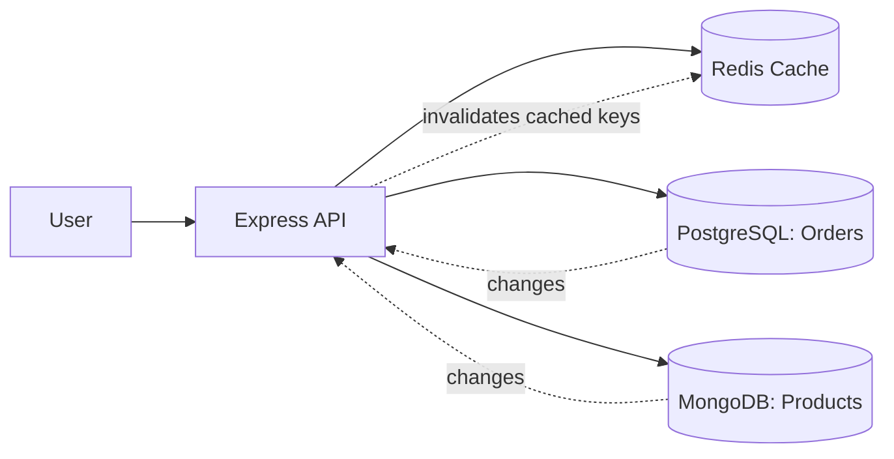
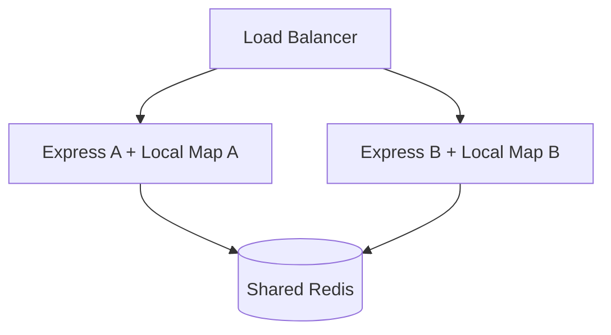
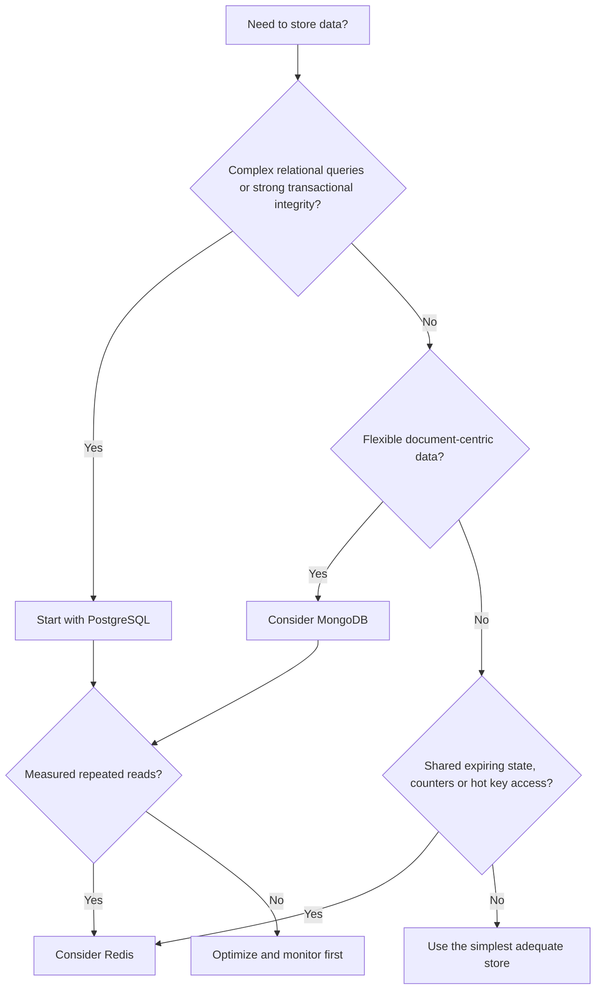

# Lesson 003 — Redis vs Traditional Databases

> **Goal:** Understand exactly how Redis compares with PostgreSQL, MongoDB, and local caches; choose the right storage for real applications.

## 1. First understand the question

Redis, PostgreSQL, and MongoDB are all data stores, but they solve different problems. **Redis is not just a faster version of MongoDB.** Choosing a database requires thinking about data access, consistency, durability, memory, cost, and query requirements.

Think of a shop:
- **PostgreSQL:** official accounting and order records.
- **MongoDB:** flexible product/catalog documents.
- **Redis:** fast-access counter, cache, expiring session, leaderboard.

These are examples, not strict limitations. Each product supports more than one workload.

## 2. Core comparison

| Feature | Redis | PostgreSQL | MongoDB |
| --- | --- | --- | --- |
| Typical model | Keys with specialized data structures | Relational tables | BSON documents |
| Primary working storage | RAM | Disk-backed with memory caching | Disk-backed with memory caching |
| Query style | Commands by key/type; optional search capabilities | SQL, joins, rich aggregations | Document queries, aggregation |
| Transactions | MULTI/EXEC, WATCH, scripting/functions; distinct semantics | Full relational ACID transactions | ACID transactions, including multi-document |
| Persistence | Configurable RDB/AOF | WAL and durable storage | Journal and durable storage |
| TTL | Native key expiration | Usually application/job logic | TTL indexes for eligible documents |
| Joins | No general SQL-style joins in core commands | Yes | $lookup and modeling strategies |
| Typical strengths | Fast key access, counters, caching, shared ephemeral state | Constraints, relational queries, strong transactional workflows | Flexible documents and document-centric queries |

**Nuance:** PostgreSQL and MongoDB also cache data in memory; Redis can persist data to disk. “RAM vs disk” is an oversimplified distinction.

## 3. What does “source of truth” mean?

The **source of truth** is the authoritative location for a piece of data. A cache is a *derived copy*, not necessarily authoritative.

For an e-commerce application:
- Order `#1001` and payment status: PostgreSQL is authoritative.
- Product description: MongoDB might be authoritative.
- Cached product response: Redis contains a temporary copy.



**Rule:** Never decide authority based solely on speed. Decide based on business correctness, durability, and recovery needs.

## 4. Why not put everything in Redis?

### 4.1 RAM is finite and relatively expensive
Keeping a huge, rarely used dataset in RAM may be wasteful. Redis can be memory-efficient for suitable data structures, but a large dataset still consumes resources.

### 4.2 Complex queries may not fit
Suppose a hiring tracker needs:

> Show companies in Bengaluru where an application was submitted this month, grouped by status, with recruiter contact information.

A relational schema with indexed SQL queries and joins is often a natural fit. Redis key/value commands do not automatically provide relational querying.

### 4.3 Durability and failure recovery matter
Redis can save snapshots (**RDB**) or log writes (**AOF**), but different configurations expose different windows of possible data loss. Even replication does not inherently guarantee zero loss.

For payment and inventory correctness, you generally want an authoritative transactional data store and careful concurrency design.

### 4.4 Data consistency gets more complex
If a product price changes in PostgreSQL, a cached price in Redis may remain stale until invalidation or expiration.

## 5. Why not just use PostgreSQL or MongoDB for everything?

Often, you should! A well-indexed database can handle many workloads efficiently.

But some patterns are especially convenient with Redis:

**Shared counter:**
```redis
INCR rate:user:42:window:123
EXPIRE rate:user:42:window:123 60
```

These are **two commands**, so this example is *not* a complete atomic rate limiter: expiration and increment must be coordinated safely for production. We'll build that in Lesson 042.

**Expiring session:**
```redis
SET session:abc "user:42" EX 1800
```

**Leaderboard:**
```redis
ZADD leaderboard 100 alice 150 bob 125 charlie
ZREVRANGE leaderboard 0 2 WITHSCORES
```

PostgreSQL/MongoDB can implement versions of these patterns too. Redis may simplify high-throughput shared state and expiration, but must be benchmarked for the workload.

## 6. Redis vs in-process cache

Consider:

```js
const localCache = new Map();
localCache.set("product:101", { name: "Mouse" });
```

This Map lives only inside one Node.js process. If the process restarts, its contents disappear. If you run four Express instances, each gets its own Map.



| Property | Local Map | Redis |
| --- | --- | --- |
| Same-process access | Very fast | Network round trip |
| Shared across app instances | No | Yes |
| TTL support | Manual/library | Built-in |
| Separate deployment | No | Yes |
| Failure domain | Application process | Additional network service |

Redis isn't necessarily faster than a local Map. Its value includes *sharing*, specialized commands, and lifecycle features.

## 7. Real example: a job application tracker

Imagine a Next.js + PostgreSQL application that tracks job applications.

| Data | Suggested store | Reason |
| --- | --- | --- |
| User accounts and application records | PostgreSQL | Relational constraints, durable history |
| Recruiter and company relations | PostgreSQL | Joins and integrity |
| Cached dashboard summary | Redis (optional) | Repeated, expensive aggregate reads |
| Login sessions | Redis or another suitable session store | Shared expiry and lookup |
| Temporary rate-limit counters | Redis | Shared atomic primitives |
| Audit log | Durable database | Recovery and traceability |
| Background notification jobs | Redis-backed queue (with durable job design) | Worker coordination |

**Don't add Redis on day one without evidence.** First measure whether dashboard queries are slow and whether simpler indexing or precomputed summaries are sufficient.

## 8. Cache-aside implementation

Suppose PostgreSQL holds the authoritative company record:

```js
async function getCompany(id, db, redis) {
  const key = `company:${id}`;
  const cached = await redis.get(key);
  if (cached !== null) return JSON.parse(cached);

  const company = await db.getCompanyById(id); // illustrative repository method
  if (company) {
    await redis.set(key, JSON.stringify(company), { EX: 120 });
  }
  return company;
}
```

**This is teaching pseudocode with real Redis client syntax:** `db.getCompanyById` is an application-defined method, not a built-in PostgreSQL API.

What if the company name changes?

```js
async function renameCompany(id, name, db, redis) {
  await db.renameCompany(id, name); // authoritative write first
  await redis.del(`company:${id}`); // invalidate cached copy
}
```

**Important race:** A concurrent reader can repopulate the cache with an old value while an update occurs. Write-then-delete reduces common stale-cache problems but does not provide strict consistency. We'll study versioned keys, double deletion caveats, and stronger designs in Lesson 032/036.

## 9. Redis as a primary database: is it possible?

Yes, for workloads whose data structures, query needs, durability requirements, and economics fit Redis. It is misleading to say Redis *can never* be a primary database.

But you must explicitly evaluate:
- Required durability under crashes and failovers
- Recovery point and recovery time objectives
- Dataset size, persistence overhead, and cost
- Query capabilities and indexing requirements
- Backup/restore procedures
- Replication and consistency expectations

For most ordinary CRUD applications, starting with PostgreSQL or MongoDB as the authoritative store is simpler.

## 10. Latency: avoid misleading numbers

People sometimes claim Redis is “always sub-millisecond” or “100x faster.” These are not universal guarantees.

Actual latency depends on:
- Client-server network distance
- Command time complexity
- Payload size
- Server CPU and memory pressure
- Connection pooling and pipelining
- Disk activity, persistence, and background work
- Application serialization/deserialization

**Measure end-to-end request latency**, not only the Redis command timing.

## 11. Decision guide



This is a **starting heuristic**, not an absolute rule. Many systems combine these technologies.

## 12. Common mistakes

1. Calling Redis “just a cache” and missing its other capabilities.
2. Assuming PostgreSQL/MongoDB always hit disk for every query.
3. Treating Redis persistence as an automatic guarantee of zero data loss.
4. Using Redis for complex relational querying without examining alternatives.
5. Caching sensitive user data under shared keys.
6. Forgetting that cache invalidation can race with database writes.
7. Adding Redis before measuring a real bottleneck.

## 13. Practice

1. Design storage choices for a shopping cart, product catalog, order history, and real-time leaderboard.
2. Explain why four local Maps do not create one shared cache.
3. For a job tracker, pick one dashboard query to cache and define its TTL/invalidation.
4. Explain what happens if PostgreSQL succeeds but Redis invalidation fails.
5. List three cases where Redis should *not* be your primary database.

## 14. Interview questions

**Q: Redis vs PostgreSQL?** Redis excels at specialized in-memory operations and shared ephemeral state; PostgreSQL offers SQL, relational integrity, and robust transactional workflows.

**Q: Redis vs MongoDB?** Redis organizes access around keys and specialized structures; MongoDB stores BSON documents and supports rich document queries and aggregation.

**Q: Can Redis replace a database?** Redis itself is a database, but whether it replaces another database depends on durability, data model, query, and cost requirements.

**Q: Why use Redis with a primary database?** To reduce repeated work and manage fast shared state while keeping authoritative records in the appropriate durable store.

**Q: Does adding Redis always make an app faster?** No. It introduces network calls, serialization, cache misses, consistency work, and operational cost.

## 15. Summary

**Choose by requirements, not popularity.** Redis, PostgreSQL, and MongoDB overlap but have different strengths. A common architecture keeps business records in a durable database and uses Redis selectively for caching or shared transient state.

**Previous:** [Lesson 002](002-why-redis.md) · **Next:** [Lesson 004 — Redis Architecture and Event Loop](004-architecture-event-loop.md)
