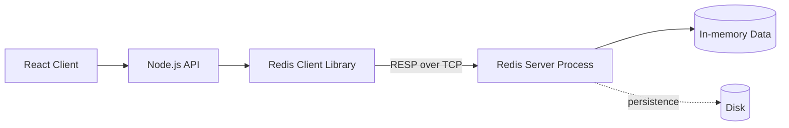
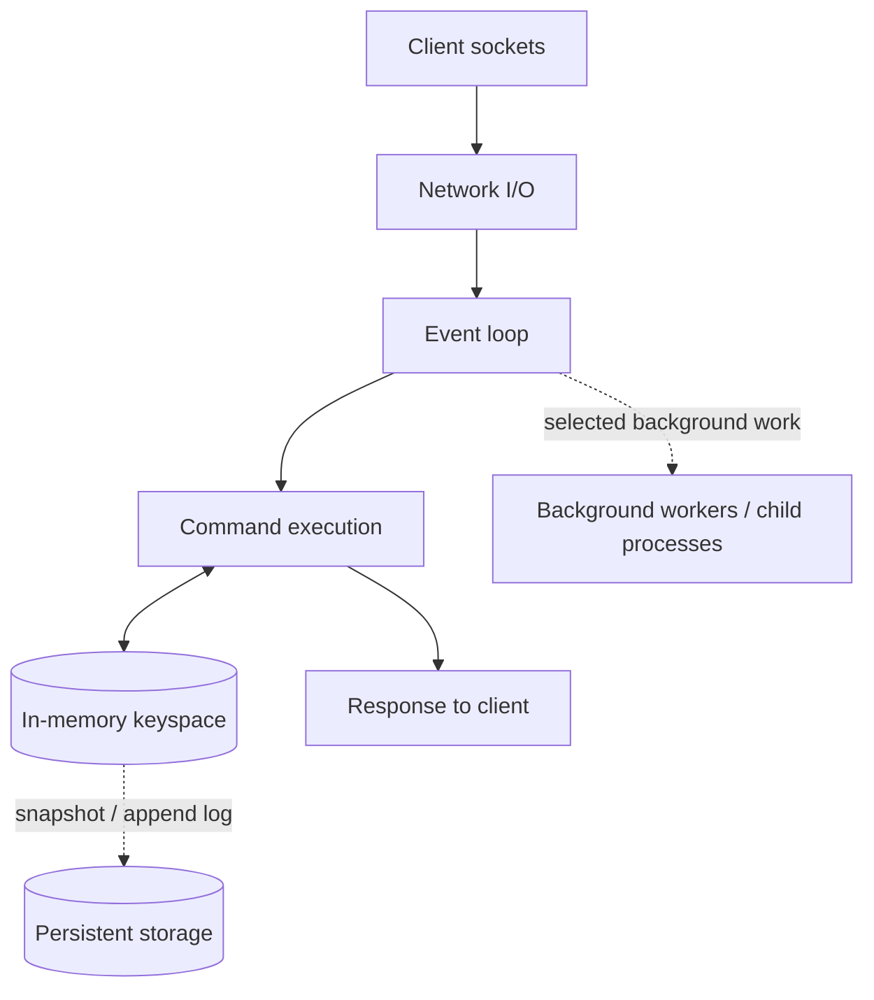
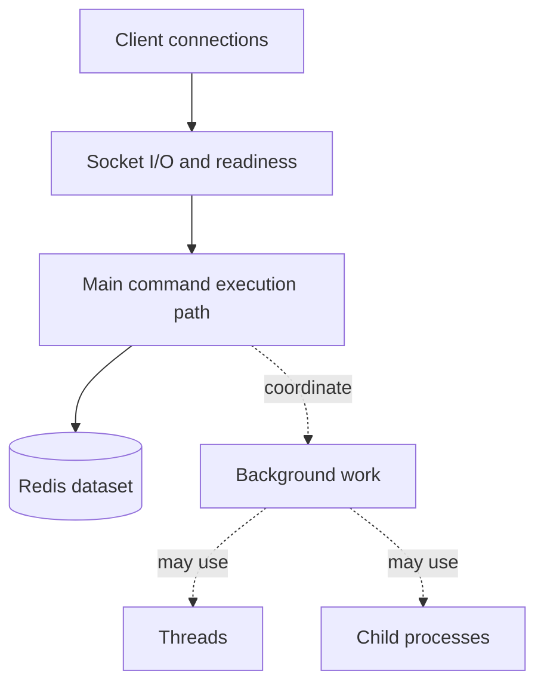
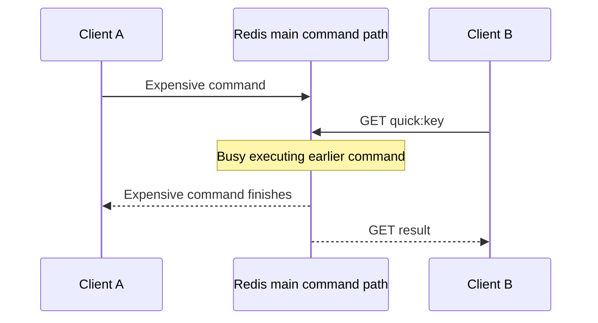
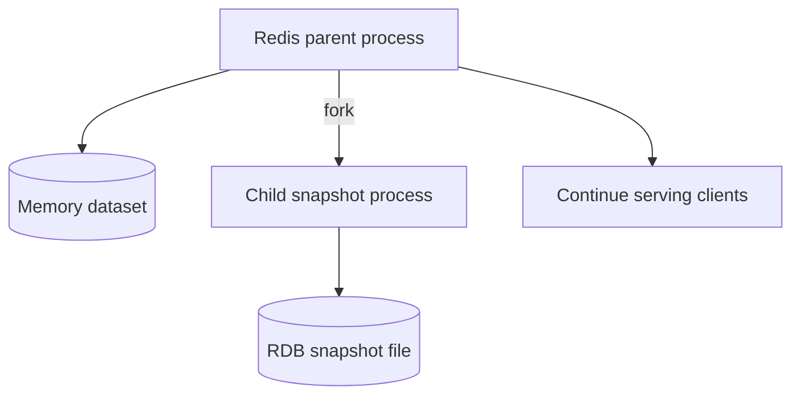

# Lesson 004 — Redis Architecture and Event Loop

> **Level:** Beginner → Intermediate | **Goal:** Build a correct mental model of Redis command processing, networking, memory, event loop, threads, blocking commands, and performance.

## 1. Big picture: what runs when you start Redis?

When you start a Redis server, an operating-system process runs and listens for client connections, typically on TCP port **6379** (configurable). A Node.js application uses a Redis client library to send commands over the network.



Redis is a **server**, not a JavaScript package storing data inside your Express process. The npm package `redis` is a **client** that communicates with the server.

## 2. Important internal components

A simplified Redis server contains:

1. **Network I/O:** Accepts connections and reads/writes protocol data.
2. **Event loop:** Coordinates readiness and scheduled work.
3. **Command execution:** Looks up keys, modifies structures, and produces results.
4. **In-memory dataset:** Stores keys and their associated Redis data types.
5. **Expiration and eviction:** Handles key lifetimes and memory limits.
6. **Persistence:** Optionally saves snapshots and/or append-only write history.
7. **Replication/cluster logic:** Supports other server instances and distributed topologies.
8. **Background tasks:** Some operations are delegated to threads or child processes.

This diagram is conceptual, not an exact thread-by-thread map of every Redis version.



## 3. What is an event loop?

An **event loop** repeatedly checks which activities are ready and runs the appropriate handlers.

Simple analogy: one cashier can serve many customers by quickly handling one ready request after another. The cashier does not need one dedicated cashier per customer.

But the analogy has a limit: if a customer requests a very long operation, everyone else may wait.

Redis commonly uses an event-driven design to handle many network connections without creating one command-execution thread per connection.

### Simplified lifecycle

1. A client opens a TCP connection.
2. The operating system reports that the socket has readable data.
3. Redis reads and parses a command.
4. Redis dispatches the command handler.
5. The handler reads/modifies in-memory data.
6. Redis prepares and writes a reply (possibly later when the socket is writable).
7. The loop continues handling ready work.

Actual implementation details, batching, and I/O threading vary by Redis version and configuration.

## 4. What does “Redis is single-threaded” actually mean?

This phrase is **partly true and often misunderstood**.

The key idea: **ordinary Redis command execution on a given server instance is predominantly serialized on the main execution thread.** A single command's operations can therefore be atomic relative to other commands on that instance.

However, Redis can also use:
- **I/O threads** for selected networking work (depending on version/configuration).
- **Background threads** for certain housekeeping operations.
- **Child processes** for operations such as RDB snapshot generation and some AOF rewrite work.
- Additional specialized execution paths depending on Redis version/features.

Therefore, **Redis is not “a program that uses exactly one OS thread for everything.”**

### Diagram: distinguish the responsibilities



**Do not confuse this with Node.js:** Node.js has its own event loop and libuv behavior. Redis is a separate process with its own implementation.

## 5. Why can Redis handle many clients?

Handling many clients does **not** mean executing all their commands simultaneously on different command threads.

A server can:
- Keep many sockets open.
- Use OS readiness notification to find sockets with pending work.
- Process short commands quickly.
- Avoid the overhead of one dedicated execution thread per connection.

**Concurrency** means many client interactions make progress over time. **Parallelism** means work actually executes at the same time on multiple execution resources.

A single Redis instance may serve many concurrent clients while serializing ordinary command execution.

## 6. Atomicity of a single command

Imagine two Node.js instances run:

```redis
INCR counter
```

Each `INCR` executes as a single Redis command, so updates are not lost through a client-side read-modify-write race.

Contrast with:

```text
Client A: GET counter -> 0
Client B: GET counter -> 0
Client A: SET counter 1
Client B: SET counter 1
```

The final value can be **1**, not 2. Each `GET` and `SET` is individually atomic, but the combined sequence is **not**.

**Takeaway:** Single-command atomicity does not make an arbitrary series of commands atomic. Use appropriate primitives, transactions, scripts, or functions when required.

## 7. Time complexity matters

Redis is fast in many common workloads, but not every command takes constant time.

| Command | Typical complexity | Why it matters |
| --- | --- | --- |
| `GET` | O(1) | Key lookup |
| `SET` | O(1) for typical usage | Store a string value |
| `INCR` | O(1) | Increment one counter |
| `HGET` | O(1) | Read one hash field |
| `LRANGE` | O(S + N) | Skip/start position and number of returned elements |
| `KEYS pattern` | O(N) | Scans all keys |
| `SMEMBERS` | O(N) | Returns all set members |

These complexity statements describe the command algorithms; payload transfer, memory allocation, and other work still affect wall-clock latency.

**Danger:** `KEYS *` on a large production dataset can delay other clients. Use `SCAN` for incremental iteration where appropriate; it is not a perfectly consistent snapshot and can return duplicates.

## 8. What happens if one command takes a long time?



Because ordinary commands are serialized on a given instance, long-running work can increase latency for other clients.

Examples:
- Returning enormous collections.
- Running an expensive Lua script.
- Scanning the full keyspace with `KEYS`.
- Large operations that allocate/free significant memory.

Some commands are deliberately **blocking** for the *calling client* (e.g., `BLPOP`), but that does **not** mean they freeze the entire Redis server while waiting. Redis registers the blocked client and can continue processing other clients. This distinction is crucial.

## 9. Network I/O vs command execution

A common confusion is: “If Redis supports I/O threads, are commands now running in parallel?”

**Not necessarily.** Threaded network I/O and parallel command execution are different things. Network I/O threads can help with reading/writing socket buffers; normal command processing remains predominantly serialized on the main execution path.

Implementation and configuration details change across Redis versions, so do not memorize a fixed thread count or assume every Redis deployment has threaded I/O enabled.

## 10. Persistence and background processes

Redis primarily serves commands from memory. Persistence is optional and configurable.

### RDB snapshots

A common Redis design uses a **forked child process** to create a snapshot while the parent continues serving requests.



The fork itself and copy-on-write memory behavior can have resource/performance costs. Snapshots are **not** guaranteed to contain the very latest writes after the snapshot point.

### AOF

The append-only file records write operations for replay. Redis supports different AOF synchronization policies, which trade performance against potential data loss. AOF rewriting can involve background work.

**Important:** Redis persistence does not mean all commands wait for a disk write before replying. Durability guarantees depend on configuration and failure mode.

We will cover RDB/AOF in depth in Lessons 022–024.

## 11. Expiration: how do TTL keys disappear?

Redis uses more than one mechanism:

1. **Passive expiration:** When a key is accessed, Redis can discover that its TTL has passed and treat it as expired.
2. **Active expiration:** Redis periodically samples and removes expired keys, even if clients do not access them.

```redis
SET login:token "demo" EX 10
TTL login:token
```

After the expiration deadline, the key is logically expired; physical memory reclamation may occur through expiration work rather than exactly at the millisecond deadline.

**TTL is not the same as eviction.** Expiration is based on time; eviction occurs under configured memory pressure and policies.

## 12. Redis request from Node.js

Install the official Redis client:

```bash
npm install redis
```

Add `"type": "module"` to your package.json and ensure a Redis server is running.

```js
import { createClient } from "redis";

const client = createClient({ url: "redis://localhost:6379" });

client.on("error", (error) => {
  console.error("Redis client error:", error);
});

try {
  await client.connect();

  await client.set("lesson:4:counter", "0");
  const values = await Promise.all([
    client.incr("lesson:4:counter"),
    client.incr("lesson:4:counter"),
    client.incr("lesson:4:counter"),
  ]);

  console.log("INCR responses:", values);
  console.log("Final counter:", await client.get("lesson:4:counter"));
} finally {
  if (client.isOpen) await client.quit();
}
```

Expected final counter: `3`. Even though JavaScript issues asynchronous calls, Redis applies each increment atomically.

**Nuance:** `Promise.all` does not mean Redis executed all three commands in parallel. It means the client awaits multiple promises concurrently.

## 13. Redis vs Node.js event loop

| Question | Node.js | Redis |
| --- | --- | --- |
| Main purpose | Run JavaScript application code | Execute data-store commands |
| Main event loop | Node.js/libuv integration | Redis event-processing implementation |
| Network I/O | OS readiness + Node runtime | OS readiness + Redis runtime |
| Background execution | libuv pool, OS, workers, child processes | Background threads/processes and optional I/O threading |
| Main application data | JavaScript objects, buffers | Redis keys and data structures |

They are **two independent processes** connected through the network, even if they run on the same computer.

## 14. Common misconceptions

**“Single-threaded means one client at a time.”** False. Redis can keep many client connections active.

**“Redis is fully parallel because it has I/O threads.”** False. Networking and ordinary command execution are distinct.

**“An atomic INCR makes GET+SET atomic.”** False. Atomicity applies to the single command.

**“Blocking pop blocks the entire server.”** False. It generally blocks the waiting client while other clients continue.

**“Redis never touches disk.”** False. Persistence and background disk work exist.

**“Every Redis command is O(1).”** False. Check each command's documented complexity.

**“Node.js event loop and Redis event loop are the same.”** False. Separate processes and implementations.

## 15. Production thinking

Watch for:
- Slow commands and large payloads.
- CPU saturation on the Redis instance.
- Memory usage, fragmentation, and eviction.
- Network latency and connection counts.
- Persistence stalls and fork overhead.
- Hot keys concentrating traffic.
- Redis version-specific behavior.

Useful commands to learn later:

```redis
INFO
SLOWLOG GET 10
LATENCY LATEST
MEMORY STATS
CLIENT LIST
```

These are diagnostic tools. Be careful with operationally expensive commands and avoid exposing diagnostic output containing sensitive metadata.

## 16. Practice exercises

1. Draw the path from Express `await redis.get()` to Redis and back.
2. Explain how one Redis instance can serve 5,000 open connections without 5,000 command threads.
3. Why is `INCR` safer than `GET` followed by `SET`?
4. Why is `KEYS *` dangerous on a huge production dataset?
5. Does `BLPOP` freeze Redis for other clients? Explain.
6. What is the difference between network I/O threads and command-execution threads?
7. Describe why a background RDB snapshot does not guarantee every newest write is saved.

## 17. Interview questions

**Q1. Is Redis single-threaded?** Ordinary command execution is predominantly serialized on a main thread, but Redis also uses other threads/processes for certain I/O and background tasks.

**Q2. Why is Redis fast?** In-memory operations, efficient data structures, event-driven networking, and avoiding unnecessary per-command overhead. Actual performance depends on command and workload.

**Q3. How does Redis handle concurrent clients?** With event-driven socket readiness and rapid command processing, rather than a command thread per connection.

**Q4. Can a command block Redis?** Expensive command execution can delay others. Client-blocking commands such as `BLPOP` generally park the requesting client instead of blocking the server.

**Q5. Is `INCR` atomic?** Yes, as one command on an instance. A separate read-modify-write sequence is not.

**Q6. Why can Redis persistence cause latency spikes?** Forking, copy-on-write memory overhead, I/O pressure, and synchronization/rewrite activity can affect resources.

## 18. Revision checklist

- [ ] Redis server vs Redis client library
- [ ] Event loop and network readiness
- [ ] Concurrency vs parallelism
- [ ] Main command execution vs I/O/background work
- [ ] Atomic commands vs multi-command races
- [ ] Blocking client vs blocking server
- [ ] Command time complexity
- [ ] Expiration vs eviction
- [ ] Persistence and child processes
- [ ] Redis event loop vs Node.js event loop

**Previous:** [Lesson 003 — Redis vs Traditional Databases](003-redis-vs-databases.md)  
**Next:** [Lesson 005 — Redis Installation and Setup](005-installation.md) (planned).
