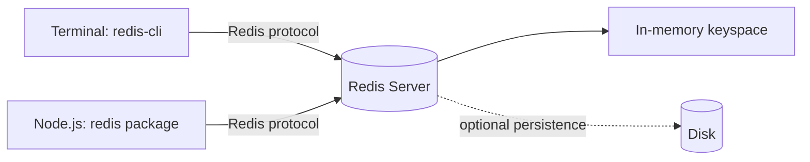
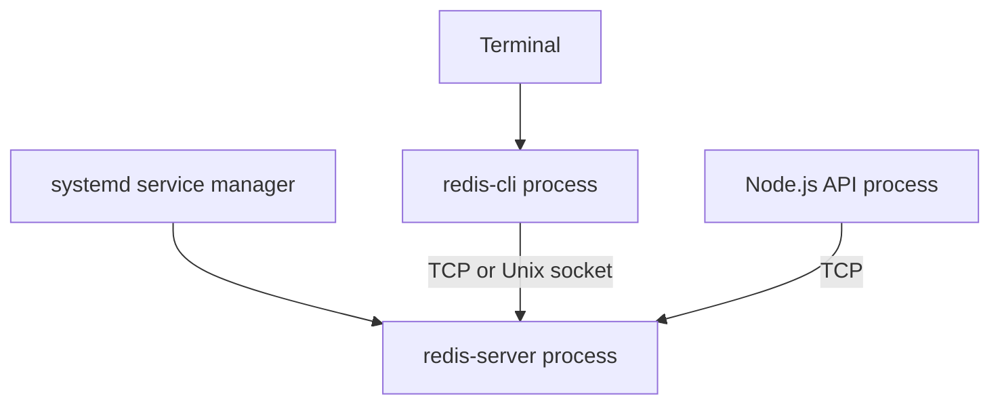
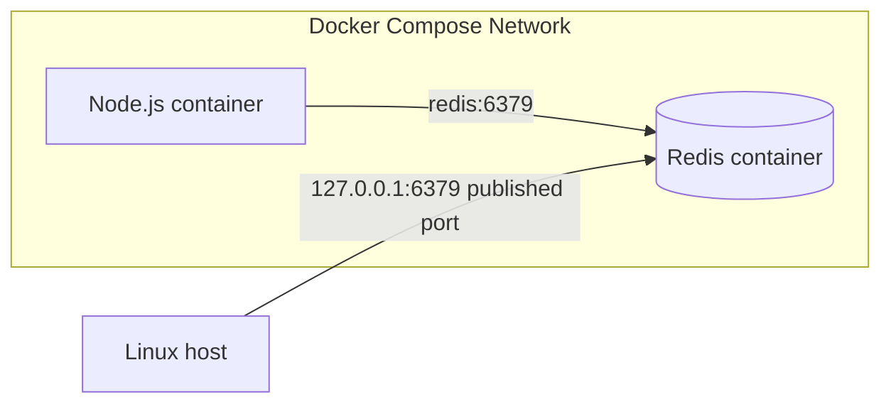

# Lesson 005 — Redis Installation and Setup

> **Level:** Beginner | **Goal:** Install Redis, start and stop the server, connect with redis-cli, verify persistence and networking basics, and prepare a clean Node.js development environment.
>
> **Learning style:** Simple English, practical Linux and Docker commands, diagrams, explanations, troubleshooting, and exercises.

## 1. What exactly are we installing?

Redis has two different parts:

1. **Redis server:** A separate process that stores and manages data.
2. **Redis client:** A program or library that sends commands to the server.

For example, `redis-cli` is a command-line client. The `redis` npm package is a Node.js client. **Installing the Node.js package alone does not install or start the Redis server.**



The default Redis TCP port is **6379**, but it is configurable. A local connection commonly uses `127.0.0.1:6379`.

## 2. Choose an installation method

| Method | Best for | Things to remember |
| --- | --- | --- |
| Native Linux packages | Learning system services, local development | Package versions vary by distribution |
| Docker container | Reproducible development, isolated setup | Understand volumes, ports, and container lifecycle |
| Managed Redis | Deployed applications | Provider networking, credentials, TLS, pricing and service limits |
| Build from source | Version-specific experiments, advanced learning | More maintenance and build prerequisites |

**Recommended:** If you are already comfortable with Ubuntu, learn the native setup first, then try Docker. Both are valuable for production understanding.

### Check what is already installed

```bash
redis-server --version
redis-cli --version
command -v redis-server
```

If the command is missing, it may not be installed or may not be on your `PATH`.

## 3. Install Redis on Ubuntu / Debian

### Option A: Distribution packages

```bash
sudo apt update
sudo apt install redis-server redis-tools
```

Depending on the distribution release, the package may install a Redis version older than the latest upstream release. That is fine for learning fundamentals; check the actual version before using version-specific features.

```bash
redis-server --version
redis-cli --version
```

To inspect available package versions:

```bash
apt policy redis-server
```

**Note:** The exact package and service names can differ across distributions or installation methods. If your distribution does not offer these packages, use the official Redis installation documentation or Docker rather than blindly copying commands from another operating system.

### Start the service

On Ubuntu installations that provide the `redis-server` systemd unit:

```bash
sudo systemctl start redis-server
sudo systemctl status redis-server
```

If you want it to start at boot:

```bash
sudo systemctl enable redis-server
```

These are different operations:
- `start` starts it **now**.
- `enable` configures startup at **boot**.
- `status` displays current service information.

If the unit does not exist, check:

```bash
systemctl list-unit-files | grep redis
```

Some installations use a different unit name.

### Test the connection

```bash
redis-cli PING
```

Expected response:

```text
PONG
```

**What does PONG prove?** The CLI reached a Redis server and received a response. It does **not** prove the server is configured securely, persistence is enabled, or your production application can connect.

## 4. Understand the running process

A native Redis service typically runs independently from your Node.js application.



Inspect the process and listening port:

```bash
ps aux | grep '[r]edis-server'
ss -ltn | grep ':6379'
```

`ss` shows listening TCP sockets. If Redis is configured to use only a Unix socket, or a non-default port, you may not see port 6379.

### Stop or restart

```bash
sudo systemctl stop redis-server
sudo systemctl restart redis-server
```

Stopping Redis makes it unavailable to clients. Whether data survives a restart depends on persistence settings, whether the shutdown is clean, and where files are stored.

## 5. Run Redis manually (for experiments)

You can start a standalone server in a terminal:

```bash
redis-server --port 6380 --save "" --appendonly no
```

Here:
- `--port 6380` uses a separate port to avoid clashing with a service on 6379.
- `--save ""` disables automatic RDB save rules for this temporary instance.
- `--appendonly no` disables AOF persistence.

**Warning:** This is a deliberately non-durable **local learning instance**. Data may disappear when the process exits. Do not use these flags for valuable production data.

Open another terminal:

```bash
redis-cli -p 6380 PING
redis-cli -p 6380 SET course redis
redis-cli -p 6380 GET course
```

To stop this instance gracefully:

```bash
redis-cli -p 6380 SHUTDOWN NOSAVE
```

`NOSAVE` explicitly skips saving an RDB snapshot on shutdown. Use it only for disposable learning data.

## 6. Docker installation

If Docker is installed, you can run Redis without installing Redis packages on your host.

### Start a disposable development container

```bash
docker run -d \
  --name redis-learning \
  -p 127.0.0.1:6379:6379 \
  redis:7
```

**Why bind to `127.0.0.1`?** It limits the published host port to the loopback interface rather than exposing it on all host interfaces. This is appropriate for a local, non-authenticated learning server.

**Version note:** `redis:7` is a major-version image tag. For reproducible deployments, pin a tested exact version or image digest. Features and defaults can differ by Redis version.

Check:

```bash
docker ps
docker logs redis-learning
docker exec -it redis-learning redis-cli
```

Inside the CLI:

```redis
PING
SET hello "from Docker"
GET hello
```

Exit `redis-cli` with `QUIT` or Ctrl+D.

### Stop, restart, and delete

```bash
docker stop redis-learning
docker start redis-learning
docker rm -f redis-learning
```

A stopped container keeps its writable filesystem; a **removed** container loses data stored only in that filesystem. For important data, use a volume and an appropriate persistence configuration.

### Avoid a port conflict

If a native Redis server already uses host port 6379, Docker cannot publish that same host address/port combination.

Choose another host port:

```bash
docker run -d --name redis-learning-alt \
  -p 127.0.0.1:6380:6379 redis:7
```

Connect from the host:

```bash
redis-cli -p 6380 PING
```

Inside the container, Redis still listens on port **6379**. The mapping is **host 6380 → container 6379**.

## 7. Docker Compose: a reusable development setup

Create `compose.yaml`:

```yaml
services:
  redis:
    image: redis:7
    restart: unless-stopped
    ports:
      - "127.0.0.1:6379:6379"
    volumes:
      - redis_data:/data
    command: ["redis-server", "--appendonly", "yes"]

volumes:
  redis_data:
```

Start:

```bash
docker compose up -d
docker compose ps
docker compose exec redis redis-cli PING
```

Stop containers without deleting the named volume:

```bash
docker compose down
```

**Be careful:** `docker compose down -v` removes the named volume too and can delete stored Redis data.

### Why both a volume and AOF?

- The **volume** keeps the files outside the container's disposable writable layer.
- **AOF** records write operations to support recovery.
- A volume **alone** does not make all Redis writes durable.
- AOF durability depends on synchronization policy and failure conditions.

We will study RDB and AOF in Lessons 022–024.

## 8. Hostnames: localhost is relative

This is one of the most common Docker mistakes.

### Node.js on your Linux host, Redis in Docker

Use:

```text
redis://127.0.0.1:6379
```

This works when the container publishes that host port.

### Node.js and Redis in the same Compose network

Use the Compose service name:

```text
redis://redis:6379
```



**Important:** Inside the Node.js container, `localhost` means **that Node.js container**, not the Redis container.

## 9. Your first Redis CLI session

Run:

```bash
redis-cli
```

Then:

```redis
PING
SET app:name "CareerLoop"
GET app:name
EXISTS app:name
TYPE app:name
DEL app:name
GET app:name
```

Expected concepts:

| Command | Purpose |
| --- | --- |
| `PING` | Check server response |
| `SET` | Store a string |
| `GET` | Retrieve a string |
| `EXISTS` | Check key existence |
| `TYPE` | Check the Redis data type |
| `DEL` | Delete a key |

`GET` after `DEL` returns a nil/null response.

### Try TTL

```redis
SET demo:otp "123456" EX 30
TTL demo:otp
PTTL demo:otp
```

`TTL` returns seconds; `PTTL` returns milliseconds. The values decrease over time.

The OTP value here is **dummy learning data**, not a production OTP implementation.

## 10. Redis configuration basics

Find the Redis server version:

```redis
INFO server
```

Read a specific configuration:

```redis
CONFIG GET maxmemory
CONFIG GET maxmemory-policy
CONFIG GET appendonly
CONFIG GET save
```

Possible configuration sources include command-line flags, a Redis config file, or container command arguments.

**Do not assume** `CONFIG SET` automatically persists every change across restarts. Runtime and persisted configuration behavior depend on how Redis is launched and managed.

### Default database indexes

A standalone Redis deployment may support logical databases selected with `SELECT`:

```redis
SELECT 0
SET lesson:5 "hello"
```

Do **not** treat logical database numbers as strong security or isolation boundaries. Redis Cluster supports only database 0, so prefer meaningful key prefixes and separate deployments where isolation matters.

## 11. Security before production

A local lab can use a loopback-only Redis instance. Production requires deliberate security controls.

- Never expose an unauthenticated Redis server directly to the public internet.
- Restrict network access with private networking and firewall rules.
- Use appropriate authentication and **ACLs**.
- Use **TLS** where traffic crosses untrusted networks.
- Store secrets in environment/secret-management systems, not source control.
- Keep Redis updated and monitor vulnerabilities.
- Do not use a local tutorial configuration as a production configuration.

**Protected mode is not a substitute for proper network isolation and access control.**

For real deployments, also plan memory limits, eviction policies, monitoring, backups, and disaster recovery.

## 12. Connect from Node.js

Create a project:

```bash
mkdir redis-node-demo
cd redis-node-demo
npm init -y
npm pkg set type=module
npm install redis
```

Create `index.js`:

```js
import { createClient } from "redis";

const client = createClient({
  url: process.env.REDIS_URL ?? "redis://127.0.0.1:6379",
});

client.on("error", (error) => {
  console.error("Redis error:", error.message);
});

try {
  await client.connect();

  console.log("Connected to Redis");
  await client.set("lesson:5:message", "Hello from Node.js");

  const message = await client.get("lesson:5:message");
  console.log("Result:", message);
} catch (error) {
  console.error("Connection or command failed:", error.message);
  process.exitCode = 1;
} finally {
  if (client.isOpen) {
    await client.quit();
  }
}
```

Run:

```bash
node index.js
```

Expected output:

```text
Connected to Redis
Result: Hello from Node.js
```

The Node.js Redis client is **asynchronous**. `await client.get(...)` waits for a network-backed Redis operation; it is not equivalent to reading a local JavaScript object.

**Production improvement:** Configure connection timeouts, retry/backoff policy, graceful shutdown, and failure handling. Never create a fresh Redis connection for every incoming HTTP request.

## 13. Common installation errors

### Error: `ECONNREFUSED 127.0.0.1:6379`

**Meaning:** No service is accepting TCP connections at that address and port.

Check:

```bash
redis-cli PING
sudo systemctl status redis-server
docker ps
ss -ltn | grep 6379
```

Check the correct port, container state, and whether the service is running. Avoid assuming a firewall is the cause without evidence.

### Error: `bind: Address already in use`

Another process is already listening on the requested port.

```bash
ss -ltnp | grep ':6379'
```

Stop the conflicting local instance if appropriate, or choose a different port.

### Error: `NOAUTH Authentication required`

The server requires authentication. Obtain credentials through your authorized configuration or secret store.

Example CLI with a username and an interactive password prompt:

```bash
redis-cli --user app-user --askpass
```

Avoid typing production passwords directly in shell command arguments because they can appear in process listings or shell history.

### Error: `WRONGPASS`

Credentials or ACL permissions may be incorrect. Check the correct Redis endpoint, username, and credential.

### Docker container keeps restarting

Inspect logs:

```bash
docker logs redis-learning
```

Possible causes include invalid config, incompatible permissions, storage issues, or resource constraints. Read the actual log before changing configuration.

### `redis-cli` works on host but Node.js container cannot connect

Usually a hostname/network mismatch. In Compose, connect to `redis:6379` using the service name, not `localhost:6379`.

## 14. Verify your setup end to end

Use this checklist:

- [ ] `redis-server --version` or the container image identifies your server version.
- [ ] `redis-cli PING` returns `PONG`.
- [ ] `SET` and `GET` work.
- [ ] A key created with `EX` expires.
- [ ] Node.js can connect and read/write a test key.
- [ ] You know which process owns port 6379.
- [ ] You understand where your Redis data files live.
- [ ] Redis is not unintentionally exposed on a public interface.

## 15. Real-world setup: CareerLoop development

Suppose your stack is:

```text
Next.js app → PostgreSQL (Neon)
           ↘ Redis (optional cache / rate limits)
```

Start with PostgreSQL as the authoritative application database. Use local Redis for learning shared rate limiting or caching expensive dashboard summaries.

For development:
- Run Redis in Docker Compose.
- Keep `REDIS_URL` in `.env.local` (and out of Git).
- Reuse a single Redis client connection per application process where appropriate.
- Do not require Redis for every feature unless the architecture truly needs it.

When deployed to Vercel or other serverless platforms, local Docker Redis is **not reachable as `localhost` from cloud functions**. You need a reachable managed Redis endpoint or a compatible service integration, and should account for connection lifecycle and provider limitations.

## 16. Exercises

1. Install Redis natively or in Docker and record the version.
2. Run `PING`, `SET`, `GET`, `EXISTS`, and `DEL`.
3. Start a second Redis instance on port 6380 without conflicting with 6379.
4. Create a 15-second TTL key and observe it disappear.
5. Run the Node.js demo.
6. Explain the difference between `docker stop`, `docker rm`, and `docker compose down -v`.
7. Explain why `localhost` fails when a Node.js container tries to reach another Redis container.
8. Find the configuration for persistence and explain what you observed.

## 17. Interview questions

**Q1. What is the difference between Redis server and Redis client?**  
The server owns the data and executes commands. A client sends commands and receives responses.

**Q2. What is Redis's default port?**  
TCP 6379 by default, though it can be changed.

**Q3. Does `PING → PONG` prove Redis is production-ready?**  
No. It only demonstrates that the command reached a responding server.

**Q4. Why use a Docker volume?**  
To preserve files beyond the lifecycle of an individual container. Persistence still must be configured and tested.

**Q5. Why doesn't `localhost` work between containers?**  
Each container has its own network namespace; use the service hostname on the shared Docker network.

**Q6. What happens when Redis is restarted?**  
Connections drop; data recovery depends on persistence and storage configuration. Clients must reconnect appropriately.

**Q7. Is exposing Redis on `0.0.0.0:6379` safe?**  
Not by itself. Use private networking, firewalls, authentication, TLS as appropriate, and least-privilege access.

## 18. Quick revision

- Redis server and Redis client are separate.
- Native packages, Docker, and managed Redis are different deployment approaches.
- Default Redis port: 6379.
- `redis-cli PING` is a connectivity check.
- Docker host port and container port can differ.
- Containers use service names to communicate on Compose networks.
- Volumes and Redis persistence solve different problems.
- Local setup is not automatically secure or production-ready.

---

**Previous:** [Lesson 004 — Redis Architecture and Event Loop](004-architecture-event-loop.md)  
**Next:** [Lesson 006 — Redis CLI and First Commands](006-cli.md) (planned).

**Reference:** [Redis documentation](https://redis.io/docs/latest/) · [Redis Node.js client guide](https://redis.io/docs/latest/develop/clients/nodejs/) · [Docker documentation](https://docs.docker.com/)
