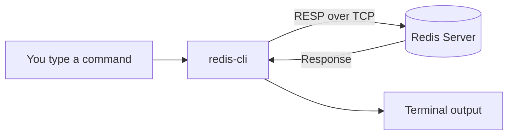
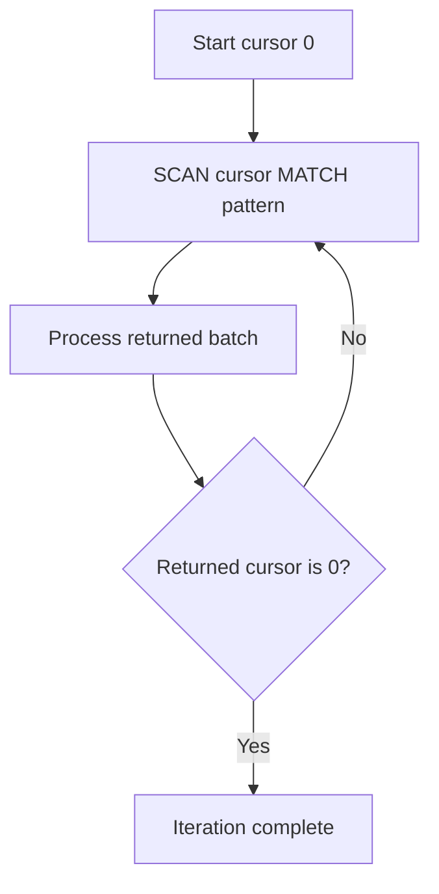
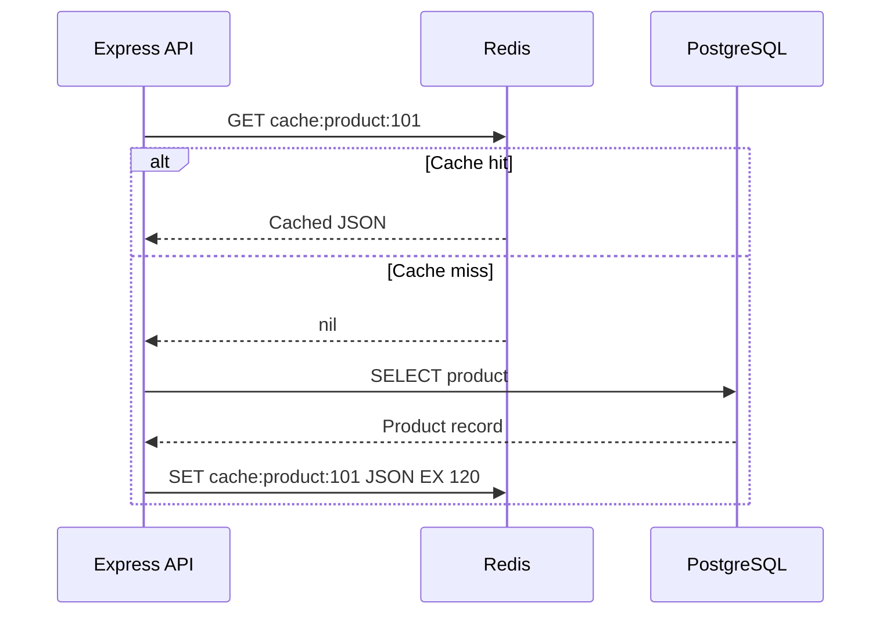

# Lesson 006 — Redis CLI and First Commands

> **Level:** Beginner | **Goal:** Learn how to work confidently with Redis from the terminal, understand responses and data types, and avoid dangerous production commands.
>
> **Prerequisite:** [Lesson 005 — Redis Installation and Setup](005-installation.md). You should have a running Redis server.

## 1. What is redis-cli?

**redis-cli** is the official Redis command-line client. It connects to a Redis server, sends commands, and displays the server's responses.

A simple mental model:



Redis CLI is **not the Redis database**. It is only one way to communicate with the server. A Node.js application can send the same commands through a client library.

## 2. Open the CLI

### Interactive mode

```bash
redis-cli
```

You may see a prompt similar to:

```text
127.0.0.1:6379>
```

Now enter Redis commands without writing `redis-cli` each time:

```redis
PING
SET course "Redis"
GET course
```

Exit with:

```redis
QUIT
```

### Non-interactive mode

You can run a command directly from your Linux shell:

```bash
redis-cli PING
redis-cli SET course Redis
redis-cli GET course
```

This is useful for simple scripts and quick diagnostics.

**Important difference:** In the shell, `redis-cli GET course` invokes the program. Inside the interactive Redis prompt, type only `GET course`.

## 3. Connection options

### Custom host and port

```bash
redis-cli -h 127.0.0.1 -p 6379 PING
```

- `-h`: Redis hostname/IP.
- `-p`: Redis TCP port.

For a disposable Redis instance running on port 6380:

```bash
redis-cli -p 6380 PING
```

### Docker

If Redis is running inside a container named `redis-learning`:

```bash
docker exec -it redis-learning redis-cli
```

If Redis is exposed on host loopback port 6379, you can also use `redis-cli` installed on your host.

### Authentication

When a Redis server requires credentials:

```bash
redis-cli --user app-user --askpass
```

Use credentials provided by your authorized administrator or development setup. **Avoid embedding production passwords directly in terminal commands**, where they may appear in shell history or process information.

TLS-enabled servers may require `--tls` and suitable certificate settings. Never assume an arbitrary remote Redis endpoint is safe to connect to without TLS and access controls.

## 4. Understand Redis replies

Redis commands return different kinds of values. The CLI renders them in a readable form.

Try:

```redis
PING
SET demo:name "Vikash"
GET demo:name
EXISTS demo:name
DEL demo:name
GET demo:name
```

Typical output concepts:

| Command | Typical response | Meaning |
| --- | --- | --- |
| `PING` | `PONG` | Server responded |
| `SET` | `OK` | Command succeeded |
| `GET` | `"Vikash"` | String value |
| `EXISTS` | `(integer) 1` | Key exists |
| `DEL` | `(integer) 1` | One key removed |
| `GET` after deletion | `(nil)` | Key is absent |

**Note:** Display formatting differs between interactive CLI, raw output, and client libraries. In Node.js, a missing `GET` result is typically `null`, not the literal text `"(nil)"`.

## 5. Redis keys and values

Redis organizes data by **keys**. Each key is associated with a value of a particular Redis data type.

Example key names:

```text
user:42:name
product:101
cart:42
rate-limit:user:42
session:abc123
```

Colon-separated names are a **convention**, not nested directories. Redis does not automatically create a hierarchy for `user:42:name`.

### Strings: SET and GET

```redis
SET user:42:name "Asha"
GET user:42:name
```

Expected value:

```text
"Asha"
```

### Overwriting a value

```redis
SET user:42:name "Riya"
GET user:42:name
```

By default, `SET` replaces the existing string value. Redis does not preserve a history of old values for you.

### Store JSON as a string

```redis
SET user:42 '{"name":"Asha","city":"Bengaluru"}'
GET user:42
```

This is **serialized JSON stored in a Redis string**. Core `GET` returns the entire string; it does not automatically query individual JSON properties. Redis JSON functionality is a separate feature whose availability depends on your Redis distribution/version.

## 6. Check whether keys exist

```redis
SET product:101 "Keyboard"
EXISTS product:101
EXISTS product:999
```

Expected:

```text
(integer) 1
(integer) 0
```

You can also pass multiple keys:

```redis
EXISTS product:101 product:999
```

This counts how many of the supplied keys exist. With repeated key arguments, the same existing key can be counted more than once.

## 7. Delete and rename keys

### DEL

```redis
SET temp:key "hello"
DEL temp:key
GET temp:key
```

`DEL` returns the number of keys removed.

### UNLINK

```redis
SET temp:large "example"
UNLINK temp:large
```

`UNLINK` removes a key from the keyspace and can reclaim memory asynchronously. It is often preferable when deleting large values because synchronous memory reclamation may cause latency.

### RENAME

```redis
SET old:name "demo"
RENAME old:name new:name
GET new:name
```

**Be careful:** `RENAME` can overwrite an existing destination key. Use `RENAMENX` if you need to avoid overwriting.

## 8. Inspect a key's type

```redis
SET demo:string "hello"
TYPE demo:string
TYPE missing:key
```

Expected type names include:

- `string`
- `hash`
- `list`
- `set`
- `zset`
- `stream`
- `none` for a missing key

Why does type matter? Because different commands expect different data types.

For example:

```redis
SET demo:value "hello"
LPUSH demo:value "item"
```

The second command produces a `WRONGTYPE` error. `LPUSH` requires a list, but `demo:value` currently stores a string.

## 9. Expiration: EX, TTL, PTTL and PERSIST

### Set a value with expiration

```redis
SET login:code "123456" EX 60
```

The key expires after approximately 60 seconds.

```redis
TTL login:code
PTTL login:code
```

- `TTL`: remaining expiration in seconds.
- `PTTL`: remaining expiration in milliseconds.

### Understand TTL special results

| Result | Meaning |
| --- | --- |
| Positive integer | Remaining lifetime |
| `-1` | Key exists but has no expiration |
| `-2` | Key does not exist |

These special values are easy to forget and frequently appear in interviews.

### Add expiration to an existing key

```redis
SET demo:session "user:42"
EXPIRE demo:session 30
TTL demo:session
```

### Remove expiration

```redis
PERSIST demo:session
TTL demo:session
```

After `PERSIST`, TTL returns `-1` while the key exists.

### Important trap: SET can remove an existing TTL

```redis
SET temp:token "first" EX 60
SET temp:token "second"
TTL temp:token
```

The second `SET` removes the previous expiration by default. If you need to retain it, Redis supports `KEEPTTL`:

```redis
SET temp:token "third" KEEPTTL
```

This behavior is important for session and cache correctness.

## 10. Conditional writes: NX and XX

Sometimes you want to write only if a key is missing or already exists.

### NX — only when absent

```redis
DEL demo:lock
SET demo:lock "worker-A" NX EX 30
SET demo:lock "worker-B" NX EX 30
GET demo:lock
```

The first `SET` succeeds. The second does not overwrite it while it exists.

### XX — only when present

```redis
SET demo:profile "updated" XX
```

This succeeds only if the key already exists.

**Production warning:** `SET key token NX EX ttl` is a useful building block for a lease, but a safe distributed lock requires ownership-aware release, lease-expiry handling, and additional failure analysis. Do not implement a production distributed lock using `DEL` alone. See Lesson 044.

## 11. Counters: INCR, DECR and INCRBY

```redis
SET article:101:views 0
INCR article:101:views
INCRBY article:101:views 5
DECR article:101:views
GET article:101:views
```

Expected final value: `"5"`.

Walkthrough:

```text
Start 0
INCR   -> 1
INCRBY -> 6
DECR   -> 5
```

`INCR` is an atomic command. This avoids the classic client-side race:

```text
Client A: GET count -> 0
Client B: GET count -> 0
Client A: SET count 1
Client B: SET count 1
```

In that sequence, one update can be lost.

**Important:** Redis integer commands work on string values containing valid integers. Attempting `INCR` on `"hello"` produces an error.

## 12. Multiple keys: MSET and MGET

```redis
MSET config:theme dark config:language en
MGET config:theme config:language config:missing
```

`MGET` returns values in the same order as the requested keys, including nil for missing keys.

Why useful? A multi-key command can reduce client-server round trips compared with separate commands.

**Caution:** In Redis Cluster, multi-key operations can be restricted by hash-slot placement. We will study that in Lesson 058.

## 13. Other data types: a quick preview

We will study each data type in depth in Section 02. For now, learn their basic command shapes.

### Hash: fields inside a key

```redis
HSET user:42 name "Asha" city "Bengaluru"
HGET user:42 name
HGETALL user:42
```

### List: ordered sequence

```redis
LPUSH tasks "write docs"
LPUSH tasks "review code"
LRANGE tasks 0 -1
```

### Set: unique members

```redis
SADD online:users "42" "99" "42"
SMEMBERS online:users
SCARD online:users
```

Sets do not guarantee a particular display order.

### Sorted set: score-based ranking

```redis
ZADD leaderboard 120 alice 180 bob 150 charlie
ZREVRANGE leaderboard 0 -1 WITHSCORES
```

Sorted sets order members by score, with defined tie-breaking behavior.

## 14. Redis CLI vs JavaScript client

The same operation looks slightly different in Node.js:

```redis
SET product:101 "Keyboard" EX 60
GET product:101
```

```js
import { createClient } from "redis";

const client = createClient({
  url: process.env.REDIS_URL ?? "redis://127.0.0.1:6379",
});

client.on("error", console.error);

try {
  await client.connect();

  await client.set("product:101", "Keyboard", { EX: 60 });
  const product = await client.get("product:101");

  console.log(product);
} finally {
  if (client.isOpen) await client.quit();
}
```

Redis CLI sends textual commands. The Node.js client exposes JavaScript methods and returns promises. Both ultimately communicate with the Redis server.

**Tip:** In a long-running Express app, reuse an appropriately managed client rather than opening a connection on every request.

## 15. How to discover commands

The Redis CLI provides command help:

```bash
redis-cli --help
```

Inside interactive mode:

```redis
HELP
HELP SET
HELP @string
```

Server-side command metadata is also available:

```redis
COMMAND INFO SET
```

The official command reference is [redis.io/commands](https://redis.io/commands/). It lists syntax, time complexity, version availability, and behavior.

**Learning habit:** When using a new command, always check its time complexity and whether it modifies data.

## 16. KEYS vs SCAN — an important production warning

You may see tutorials using:

```redis
KEYS *
```

It returns matching keys, but it examines the keyspace and can delay other commands on a large server. **Avoid `KEYS *` on large production databases.**

Prefer incremental iteration with `SCAN`:

```redis
SCAN 0 MATCH user:* COUNT 100
```

The response includes a new cursor and a batch of keys. Continue with the returned cursor until it becomes `0`.



Important details:
- `COUNT` is a **hint**, not a guaranteed number of returned keys.
- A scan may return zero keys before iteration is complete.
- Duplicates can appear; handle them if necessary.
- Changes to the keyspace during iteration affect what is seen.
- A complete scan is not a consistent point-in-time snapshot.

### Safe local practice

```redis
SET user:1 "A"
SET user:2 "B"
SET product:1 "C"
SCAN 0 MATCH user:* COUNT 10
```

## 17. Commands you should not run casually

| Command | Why caution is needed |
| --- | --- |
| `FLUSHDB` | Removes all keys from the selected database |
| `FLUSHALL` | Removes all keys from all databases |
| `KEYS *` | Can block other work on large keyspaces |
| `MONITOR` | Produces high-volume traffic and may expose sensitive command data |
| `CONFIG SET` | Can change server behavior |
| `SHUTDOWN` | Stops the Redis server |
| `DEBUG` family | Administrative/debug commands, potentially disruptive |

**Never practice destructive commands on shared, staging, or production Redis.** Use a disposable local instance with no valuable data.

## 18. Real-world example: simple API cache

Suppose a Next.js API returns product information. Redis stores a temporary serialized response:

```redis
SET cache:product:101 '{"id":101,"name":"Keyboard","price":1999}' EX 120
GET cache:product:101
TTL cache:product:101
```

When the product is updated in the authoritative database, invalidate the cached copy:

```redis
DEL cache:product:101
```



This is the **cache-aside** pattern. It reduces repeated reads, but invalidation and consistency still require care.

## 19. Common mistakes and fixes

**Mistake 1: Running `redis-cli` inside the Redis prompt.**  
Use `redis-cli PING` in the shell; use `PING` inside interactive mode.

**Mistake 2: Confusing `(nil)` with an empty string.**  
Missing key and empty string are different states.

**Mistake 3: Assuming `SET` keeps the old TTL.**  
A normal `SET` resets the key's expiration unless you use an appropriate option.

**Mistake 4: Using `GET` for a hash or list.**  
Use commands matching the key's data type.

**Mistake 5: Using `KEYS *` for routine production enumeration.**  
Use incremental `SCAN` and design keys for predictable access.

**Mistake 6: Treating `GET` + `SET` as atomic.**  
Use a single atomic command such as `INCR` where possible.

**Mistake 7: Treating Redis as a nested folder structure.**  
Colon-separated key names are naming conventions.

**Mistake 8: Assuming a successful `SET` guarantees zero data loss.**  
Durability depends on persistence, replication, and failure conditions.

## 20. Hands-on practice lab

Use a **disposable local Redis database**, not production.

### Exercise A — User profile

Create `user:10:name` and `user:10:city`, read them, check their types, then delete only the city key.

### Exercise B — Temporary verification code

Create `demo:verification:10` with a 20-second expiration. Inspect its `TTL`, wait, and confirm the key disappears. Use dummy data.

### Exercise C — Article views

Start `article:5:views` at zero. Increment it three times, add five, subtract one. **Expected final value: 7.**

### Exercise D — Conditional write

Create `config:mode` using `NX`, then try to overwrite it with another `NX` command. Explain why the second write fails.

### Exercise E — Key scanning

Create `course:user:1`, `course:user:2`, and `course:product:1`. Use `SCAN` to find only user keys.

### Exercise F — JavaScript integration

Write a Node.js script that:
1. Connects to Redis.
2. Writes `lesson:6:completed` with a value of `yes`.
3. Reads the key.
4. Closes the connection.

## 21. Interview questions with answers

**Q1. What is redis-cli?**  
The command-line client used to send commands to a Redis server.

**Q2. What is the difference between `SET` and `MSET`?**  
`SET` stores one key, while `MSET` stores multiple string keys in one command.

**Q3. What does `TTL` return when the key has no expiration?**  
`-1`. It returns `-2` when the key does not exist.

**Q4. Does `SET` overwrite existing data?**  
Yes, by default. Options such as `NX` and `XX` change when a write is allowed.

**Q5. Why is `INCR` safer than `GET` followed by `SET`?**  
`INCR` is a single atomic command; a multi-command read-modify-write sequence can lose updates.

**Q6. Why prefer `SCAN` over `KEYS`?**  
`SCAN` iterates incrementally, avoiding a single full-keyspace command that can delay other work. It still requires correct cursor handling.

**Q7. What is `WRONGTYPE`?**  
An error indicating that a command is incompatible with the value's Redis data type.

**Q8. Does Redis store nested objects when a key contains colons?**  
No. The colon is just a naming convention.

**Q9. What is the difference between `DEL` and `UNLINK`?**  
Both remove keys from the keyspace, but `UNLINK` can free memory asynchronously.

**Q10. Why should you avoid `FLUSHALL` in production?**  
It removes all keys from all databases on the targeted Redis server, potentially causing serious data loss or outages.

## 22. Revision checklist

- [ ] Interactive vs non-interactive CLI
- [ ] Host, port, Docker and authentication options
- [ ] `PING`, `SET`, `GET`, `EXISTS`, `DEL`
- [ ] `TYPE` and `WRONGTYPE`
- [ ] `EX`, `EXPIRE`, `TTL`, `PTTL`, `PERSIST`
- [ ] TTL reset behavior of `SET`
- [ ] `NX` and `XX`
- [ ] `INCR`, `DECR`, `INCRBY`
- [ ] `MSET` and `MGET`
- [ ] Hash, list, set and sorted-set preview
- [ ] `SCAN` cursor handling and `KEYS` risks
- [ ] Dangerous administrative commands
- [ ] Node.js client vs CLI

---

**Previous:** [Lesson 005 — Redis Installation and Setup](005-installation.md)  
**Next:** [Lesson 007 — Keys, Namespaces and Expiration](007-keys-expiration.md) (planned)

**Official references:** [Redis CLI](https://redis.io/docs/latest/develop/tools/cli/) · [Redis commands](https://redis.io/commands/) · [Redis Node.js client](https://redis.io/docs/latest/develop/clients/nodejs/)
