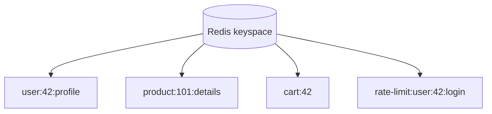
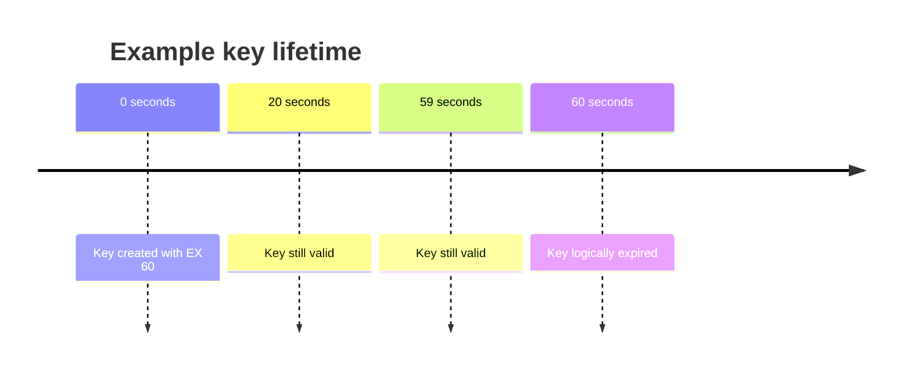
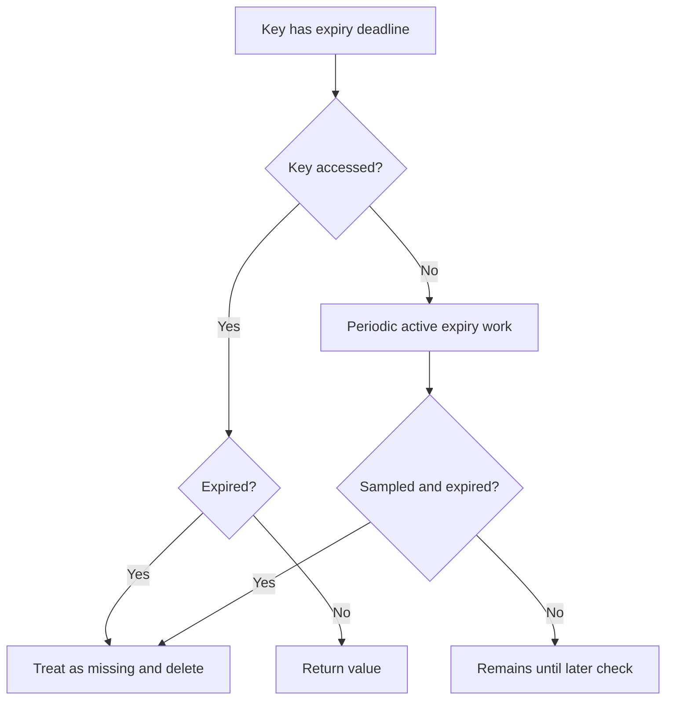
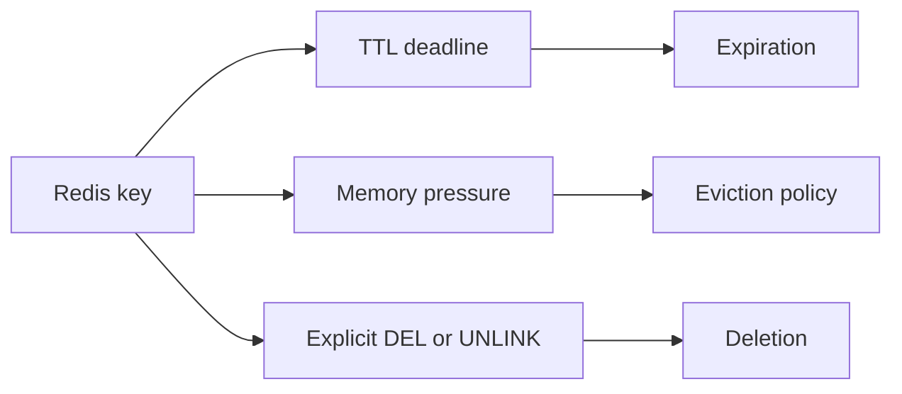
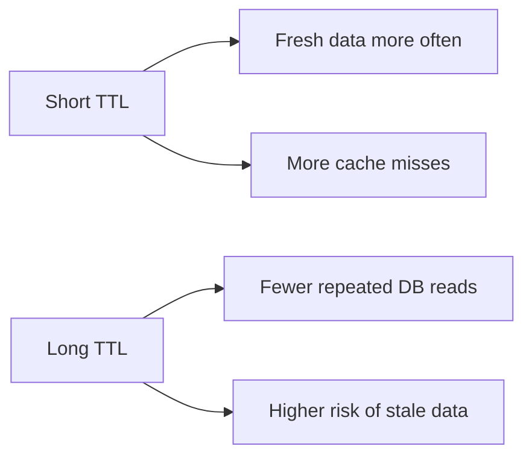

# Lesson 007 — Keys, Namespaces and Expiration

> **Level:** Beginner → Intermediate  
> **Goal:** Design clear Redis keys, understand key namespaces, TTL and expiration internals, and avoid common production bugs.
>
> **Prerequisite:** [Lesson 006 — Redis CLI and First Commands](006-cli.md)

## 1. Why key design matters

Redis stores data under **keys**. A good key name tells you what the value represents, who owns it, and sometimes which version of the data it belongs to.

For example:

```text
user:42:profile
product:101:details
cart:42
rate-limit:user:42:login
cache:v2:company:19
```

Redis does **not** treat colons as folders. Each is one complete key string.



The diagram groups names conceptually; Redis itself does not create a folder tree.

### What makes a good key?

- **Readable:** Other developers can understand its purpose.
- **Predictable:** Code can build the same key consistently.
- **Specific:** Different users and entities do not collide.
- **Secure:** Do not include passwords, tokens, or sensitive personal information in key names.
- **Maintainable:** You can invalidate related data when necessary.

## 2. Key naming conventions

A useful general pattern is:

```text
<application>:<environment>:<resource>:<identifier>:<purpose>
```

Example:

```text
careerloop:dev:user:42:dashboard
careerloop:prod:user:42:dashboard
shophub:prod:product:101:details
```

This is a convention, not a Redis requirement.

### When to include an environment prefix

Prefixes help prevent accidental collisions if environments share a Redis instance. **However, production and development should ideally use separately secured Redis deployments**, rather than relying on prefixes for isolation.

### Keep names concise but meaningful

Compare:

```text
x:42
cache:careerloop:user:42:dashboard:v2
```

The second is easier to maintain, but excessively long keys consume memory. Choose a balanced format and use it consistently.

### Build keys in one place

In Node.js:

```js
export const redisKeys = {
  product: (id) => `shophub:product:${id}:details`,
  userDashboard: (userId) => `careerloop:user:${userId}:dashboard`,
  loginAttempts: (userId) => `auth:login-attempts:user:${userId}`,
};
```

Using a helper avoids typos and mismatched key names across controllers and services.

**Important:** Validate identifiers before using them. A user-supplied ID must not allow access to another user's cached data.

## 3. Redis keys are binary-safe

Redis keys can contain arbitrary binary data, although human-readable UTF-8 names are much easier to operate and debug.

Key facts:

- Keys are not limited to letters and digits.
- Colons, hyphens and underscores are ordinary characters.
- An empty string can technically be a key, but is a poor application convention.
- Redis supports large keys, but huge key names waste memory and complicate operations.

**Practical rule:** Use short, descriptive, consistent names; avoid raw secrets and unnecessarily large identifiers.

## 4. Namespaces: logical grouping, not security

A **namespace** is a naming convention used to group related keys:

```text
auth:session:...
auth:rate-limit:...
catalog:product:...
catalog:category:...
chat:presence:...
```

Benefits:
1. Easier debugging.
2. Reduced accidental key collisions.
3. Consistent application-level invalidation patterns.
4. Easier metrics and operational understanding.

But namespaces **do not** automatically:
- Restrict access to keys.
- Create separate memory pools.
- Give separate persistence policies.
- Provide strong tenant isolation.

For multi-tenant applications, enforce authorization in your application and consider Redis ACLs or separate instances where needed. Never rely on a key prefix alone to protect tenant data.

## 5. Redis logical databases vs namespaces

Standalone Redis commonly supports numbered logical databases:

```redis
SELECT 0
SET demo:key "db0"

SELECT 1
GET demo:key
```

In database 1, the key is absent unless independently created there.

### Important limitations

- Logical databases share the same Redis server resources.
- They are **not** a strong security boundary.
- **Redis Cluster supports only database 0.**
- Some managed services or configurations restrict `SELECT`.

**Recommendation:** Prefer meaningful key prefixes and separate deployments for real isolation; do not build a scalable architecture that depends on many Redis logical databases.

## 6. What is TTL?

**TTL = Time To Live.** It tells Redis how long a key should remain valid.

Example: Cache a product for 60 seconds.

```redis
SET cache:product:101 '{"name":"Keyboard","price":1999}' EX 60
```

The key is set with an expiration deadline.



TTL is not a promise that Redis will physically free the key's memory at the exact millisecond of expiry. We will explain that distinction below.

### TTL units

| Command or option | Unit |
| --- | --- |
| `EX` | Seconds |
| `PX` | Milliseconds |
| `EXPIRE` | Seconds |
| `PEXPIRE` | Milliseconds |
| `TTL` | Remaining seconds |
| `PTTL` | Remaining milliseconds |
| `EXAT` / `EXPIREAT` | Unix timestamp in seconds |
| `PXAT` / `PEXPIREAT` | Unix timestamp in milliseconds |

## 7. Setting expiration

### Method A: Set value and TTL together

```redis
SET session:abc "user:42" EX 1800
```

This is preferable to two separate commands when creating a key that must have an expiration.

Why? The following two-command sequence can be interrupted:

```redis
SET session:abc "user:42"
EXPIRE session:abc 1800
```

If the client fails between the commands, the key may remain without a TTL.

### Method B: Add TTL to an existing key

```redis
SET temp:report "processing"
EXPIRE temp:report 120
```

### Method C: Millisecond TTL

```redis
SET demo:short "hello" PX 1500
```

This key expires after about 1.5 seconds.

### Method D: Expire at an absolute timestamp

```redis
EXPIREAT scheduled:key 1893456000
```

This example sets the expiry to a Unix timestamp (2030-01-01 00:00:00 UTC). The key must already exist.

**Note:** Expiration deadlines are based on wall-clock time. Significant clock changes can affect absolute expiration behavior.

## 8. Inspecting expiration

```redis
SET demo:ttl "hello" EX 90
TTL demo:ttl
PTTL demo:ttl
```

The numbers decrease as time passes.

### Special return values

| `TTL key` result | Meaning |
| --- | --- |
| Positive integer | Seconds remaining |
| `-1` | Key exists without expiration |
| `-2` | Key does not exist |

Try:

```redis
SET demo:permanent "hello"
TTL demo:permanent
DEL demo:permanent
TTL demo:permanent
```

Expected results: `-1` before deletion, `-2` after deletion.

## 9. Changing or removing expiration

### Extend a TTL

```redis
SET demo:job "running" EX 30
EXPIRE demo:job 120
```

The new expiration is based on the time the `EXPIRE` command runs.

### Remove expiration with PERSIST

```redis
SET demo:notice "hello" EX 60
PERSIST demo:notice
TTL demo:notice
```

Expected TTL: `-1` while the key exists.

### Conditional EXPIRE options

Redis supports conditions for expiration updates:

```redis
EXPIRE demo:job 300 NX
EXPIRE demo:job 300 XX
EXPIRE demo:job 300 GT
EXPIRE demo:job 60 LT
```

- `NX`: Set expiry only if the key currently has **no expiry**.
- `XX`: Set expiry only if the key **already has an expiry**.
- `GT`: Set expiry only if the new expiry is **later** than the existing expiry.
- `LT`: Set expiry only if the new expiry is **earlier** than the existing expiry.

These options are supported in modern Redis versions (introduced for `EXPIRE` in Redis 7.0). Check your server version.

**Subtle point:** For `GT` and `LT`, a key with no expiration is treated as having an infinitely distant expiration. Therefore, `GT` will not set a finite expiration on such a key.

## 10. The most important TTL trap: SET removes TTL

Run:

```redis
SET cache:user:42 "old" EX 60
TTL cache:user:42

SET cache:user:42 "new"
TTL cache:user:42
```

The second `SET` removes the existing expiration by default. The key now has no TTL.

### Preserve TTL with KEEPTTL

```redis
SET cache:user:42 "another" KEEPTTL
TTL cache:user:42
```

**But notice:** If the previous command already removed the TTL, `KEEPTTL` cannot recreate it. To see preservation correctly, first create a fresh expiring key:

```redis
SET demo:keep "old" EX 60
SET demo:keep "new" KEEPTTL
TTL demo:keep
```

Expected: a positive remaining TTL.

### Other mutations

Operations that update a value in place (such as `INCR` on a string counter or `HSET` on a hash) generally preserve the key's existing TTL. Commands that replace or delete a key may change its expiration. Always check the specific command's documented semantics.

## 11. How Redis expiration works internally

A common misconception is that Redis creates one timer for every key and deletes the key exactly when its timer fires.

That is **not** the general design.

Redis uses two complementary mechanisms:

### Passive (lazy) expiration

When a client accesses a key, Redis checks whether it has expired.

If it has expired, Redis treats it as missing and can remove it.

### Active expiration

Redis periodically samples keys with expiration deadlines and removes expired ones. This prevents expired, rarely accessed keys from occupying memory indefinitely.



### Logical expiration vs physical deletion

A key can be **logically expired** before its memory has been reclaimed by active expiration. Access to an expired key should behave as if the key is missing, even if background cleanup has not yet removed all internal state.

### Why not check every key every millisecond?

That would create unnecessary CPU work. Redis balances memory reclamation against CPU time through its expiration strategy.

## 12. Expiration vs eviction vs deletion

These three concepts are different:

| Mechanism | Trigger | Example |
| --- | --- | --- |
| **Expiration** | A key's TTL deadline passes | Session expires after 30 minutes |
| **Eviction** | Memory limit pressure plus eviction policy | Redis removes cache keys to free memory |
| **Deletion** | An explicit command or application action | `DEL cache:product:101` after update |



**Important:** A key without TTL can still be evicted under certain `maxmemory-policy` settings. A key with TTL can be removed before its deadline if the configured eviction policy selects it.

We will cover eviction policies and memory limits in Lesson 020.

## 13. Choosing the right TTL

There is **no universal best TTL**.

| Data | Illustrative TTL | Why |
| --- | --- | --- |
| Product description cache | 5–15 minutes | Often changes infrequently |
| Dashboard summary | 30–120 seconds | Can be moderately stale |
| Login session | Depends on session policy | Security and user experience |
| Rate-limit window | Matches algorithm/window design | Counter lifecycle |
| Temporary verification code | A few minutes | Short-lived credential |
| User online presence | Short TTL with refresh | Detect stale connections |

These are examples, **not security or performance guarantees**. Actual TTLs should follow business requirements, measurement, and threat models.

### Freshness vs cache efficiency



A longer TTL generally improves reuse but can increase staleness. A shorter TTL reduces stale-data duration but can increase database traffic.

## 14. TTL jitter: avoid many keys expiring together

Imagine caching 100,000 products at the same time with exactly 300 seconds of TTL. Many may expire together, causing a burst of database queries.

This is sometimes called a **cache avalanche**.

A simple mitigation is **TTL jitter**: add a small random variation.

```js
const BASE_TTL_SECONDS = 300;
const JITTER_SECONDS = 60;

function productCacheTTL() {
  return BASE_TTL_SECONDS + Math.floor(Math.random() * (JITTER_SECONDS + 1));
}
```

Each key gets a TTL between 300 and 360 seconds.

**Caution:** Jitter reduces synchronized expiration; it does not by itself solve cache stampedes on an individual hot key. We will cover stampedes, locking, and stale-while-revalidate in later caching lessons.

## 15. Real-world example: cache a product with Node.js

Install:

```bash
npm install redis
```

Use a Node.js project configured with `"type": "module"`.

```js
import { createClient } from "redis";

const redis = createClient({
  url: process.env.REDIS_URL ?? "redis://127.0.0.1:6379",
});

redis.on("error", (error) => console.error("Redis error:", error));

const keys = {
  product: (id) => `shophub:product:${id}:details`,
};

async function getProductFromDatabase(id) {
  // Demo only: replace with a real database repository call.
  return { id, name: "Mechanical Keyboard", price: 2499 };
}

async function getProduct(id) {
  const key = keys.product(id);

  const cached = await redis.get(key);
  if (cached !== null) {
    console.log("Cache hit");
    return JSON.parse(cached);
  }

  console.log("Cache miss");
  const product = await getProductFromDatabase(id);

  const ttl = 300 + Math.floor(Math.random() * 61);
  await redis.set(key, JSON.stringify(product), { EX: ttl });

  return product;
}

try {
  await redis.connect();

  console.log(await getProduct(101));
  console.log(await getProduct(101));

  console.log("Remaining TTL:", await redis.ttl(keys.product(101)));
} finally {
  if (redis.isOpen) await redis.quit();
}
```

Expected behavior for a previously absent key:
1. First call: **Cache miss**, database function runs.
2. Second call: **Cache hit**, Redis returns the cached product.
3. TTL is approximately 300–360 seconds, minus elapsed time.

If you have already run the demo, the first call may be a cache hit. Delete the demo key locally to repeat the initial miss.

### Invalidation after an update

When the product changes in the primary database:

```js
async function updateProduct(id, changes, database) {
  await database.updateProduct(id, changes); // Application-defined repository method.
  await redis.del(keys.product(id));
}
```

**Consistency warning:** Write-then-invalidate is common, but not strictly race-free. A concurrent reader may cache an old value around the update. Later lessons cover more robust cache consistency patterns.

## 16. Sliding expiration for sessions

Sometimes a session should expire after 30 minutes of **inactivity**, rather than 30 minutes after login.

A simplified approach:

```redis
SET session:demo "user:42" EX 1800
```

After successful authorized session access:

```redis
EXPIRE session:demo 1800
```

This refreshes the inactivity window.

But production session systems should also consider:
- Maximum absolute session lifetime.
- Session revocation and logout.
- Secure, unpredictable session identifiers.
- Avoiding a race between reading and refreshing.
- Authentication and authorization on every request.
- Protecting session values and Redis access.

**Never refresh a session TTL merely because an unauthenticated request presents an arbitrary key.**

## 17. Expiration events and notifications

Redis can publish keyspace/keyevent notifications for certain events, including expiration, when appropriately configured.

However, these notifications use Pub/Sub-style delivery and **are not a durable task scheduler**. If a subscriber is disconnected, it can miss events. Expiration timing is also not an exact scheduling guarantee.

**Do not** build critical billing, payment, or mandatory cleanup workflows solely on expired-key notifications. Use a durable queue, scheduler, or database-driven process when guaranteed execution matters.

## 18. Deleting groups of keys safely

You might want to delete all cache keys for a product category:

```text
cache:category:10:page:1
cache:category:10:page:2
cache:category:10:page:3
```

Avoid `KEYS cache:category:10:*` on a large production database. Use cursor-based `SCAN` and delete keys in controlled batches, or consider **versioned cache namespaces**:

```text
cache:category:10:v3:page:1
```

When the category changes, your application can switch to a new version prefix. Old keys expire naturally.

**Trade-off:** Versioned keys simplify broad invalidation but temporarily increase memory usage and require a reliable way to store/manage the current version.

## 19. Key design for Redis Cluster

In Redis Cluster, keys are distributed across **hash slots**. Some multi-key operations require keys to belong to the same slot.

Redis supports hash tags using braces:

```text
cart:{user:42}:items
cart:{user:42}:total
```

These keys share the same hash-tag portion and therefore map to the same cluster slot.

**Caution:** Do not put all keys under one identical hash tag; that would concentrate traffic and data in one slot, undermining distribution. We will cover this properly in Lesson 058.

## 20. Common mistakes

### Mistake 1: No consistent key format
Different modules use `user42`, `user:42`, and `users:42` for the same concept.

**Fix:** Centralize key builders and document naming rules.

### Mistake 2: Storing sensitive information in key names
Keys may appear in monitoring and diagnostics.

**Fix:** Use opaque IDs and protect access.

### Mistake 3: Assuming namespaces are folders or security boundaries
Prefixes are just part of the key string.

**Fix:** Enforce security separately.

### Mistake 4: Forgetting to set a TTL on temporary data
Sessions, OTPs, and caches may remain indefinitely.

**Fix:** Prefer atomic `SET ... EX` where applicable.

### Mistake 5: Accidentally removing TTL with SET
Overwriting a key can make it permanent.

**Fix:** Explicitly set a new TTL or use `KEEPTTL` when appropriate.

### Mistake 6: Confusing eviction with expiration
Keys can disappear because of memory policy, not just TTL.

**Fix:** Monitor memory, evictions, and expiration separately.

### Mistake 7: Using one TTL for every key
Synchronized expiry can overload the backing database.

**Fix:** Consider jitter, prewarming, and stampede protection.

### Mistake 8: Treating expiration notifications as guaranteed jobs
Notifications can be missed.

**Fix:** Use durable scheduling/queue infrastructure for critical work.

## 21. Hands-on exercises

Use a **disposable local Redis instance**.

1. Create `careerloop:dev:user:42:dashboard` with a TTL of 60 seconds.
2. Verify that `TTL` returns `-1` for an existing key without expiry and `-2` for a missing key.
3. Demonstrate that a second `SET` removes an existing TTL.
4. Repeat the experiment using `KEEPTTL`.
5. Use `PERSIST` to remove a TTL and explain the result.
6. Create two keys using the same Redis Cluster hash tag.
7. Write a `redisKeys` helper for products, carts, sessions, and rate limits.
8. Modify the Node.js cache example to use a TTL between 120 and 180 seconds.
9. Explain what happens if database update succeeds but Redis invalidation fails.
10. Explain why a short TTL is not a replacement for proper authorization.

## 22. Interview questions

**Q1. What is a Redis namespace?**  
A key-naming convention, usually using prefixes such as `user:` or `cache:`. It is not a real folder or security boundary.

**Q2. What is TTL?**  
Time To Live: the remaining lifetime before a key expires.

**Q3. What do TTL values -1 and -2 mean?**  
`-1`: existing key without expiration. `-2`: missing key.

**Q4. How does Redis expire keys?**  
Through passive expiration when keys are accessed and active expiration that periodically samples expiring keys.

**Q5. Does Redis delete a key at the exact millisecond its TTL reaches zero?**  
The key becomes logically expired, but physical cleanup may happen later.

**Q6. What is the difference between EXPIRE and PERSIST?**  
`EXPIRE` sets an expiration; `PERSIST` removes the expiration from an existing key.

**Q7. Does SET preserve an existing TTL?**  
No, not by default. Use `KEEPTTL` when appropriate.

**Q8. Expiration vs eviction?**  
Expiration is based on a deadline. Eviction is driven by memory pressure and the configured policy.

**Q9. Why add TTL jitter?**  
To reduce the chance that many cached keys expire at the same moment.

**Q10. Can Redis key prefixes isolate tenants securely?**  
No. They are naming conventions; authorization and isolation require separate controls.

**Q11. Can expired-key notifications replace a durable scheduler?**  
No. Notifications are not guaranteed durable delivery.

**Q12. What is a Redis Cluster hash tag?**  
A brace-delimited portion of a key used in hash-slot calculation so related keys can be placed in the same slot.

## 23. Revision checklist

- [ ] Key naming conventions and centralized key builders
- [ ] Namespace vs logical database vs separate deployment
- [ ] TTL units and absolute expiration
- [ ] `EXPIRE`, `PEXPIRE`, `EXPIREAT`, `PERSIST`
- [ ] `TTL` special return values
- [ ] `SET` resetting TTL and `KEEPTTL`
- [ ] Conditional expiration options `NX`, `XX`, `GT`, `LT`
- [ ] Passive and active expiration
- [ ] Logical expiration vs memory reclamation
- [ ] Expiration vs eviction vs deletion
- [ ] TTL selection and jitter
- [ ] Session sliding expiration
- [ ] Cache invalidation races
- [ ] Redis Cluster hash tags

---

**Previous:** [Lesson 006 — Redis CLI and First Commands](006-cli.md)  
**Next:** [Lesson 008 — Redis Configuration and INFO](008-configuration-info.md) (planned)

**Official references:** [Redis EXPIRE](https://redis.io/docs/latest/commands/expire/) · [Redis SET](https://redis.io/docs/latest/commands/set/) · [Redis keyspace](https://redis.io/docs/latest/develop/use/keyspace/) · [Redis SCAN](https://redis.io/docs/latest/commands/scan/)
