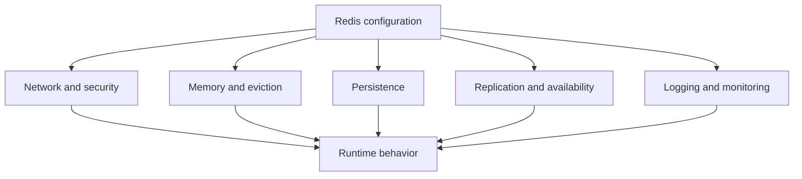
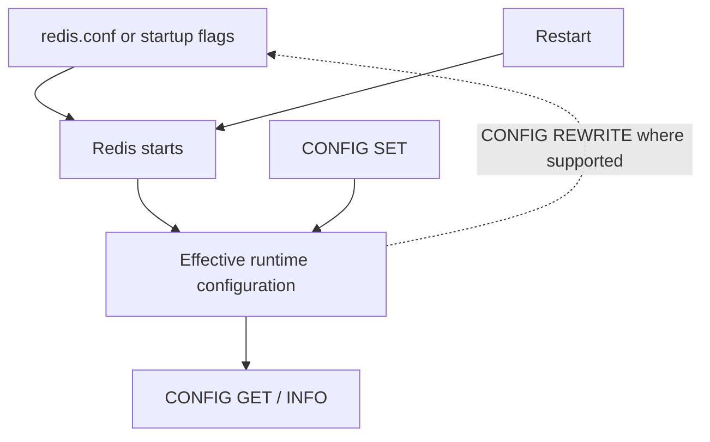
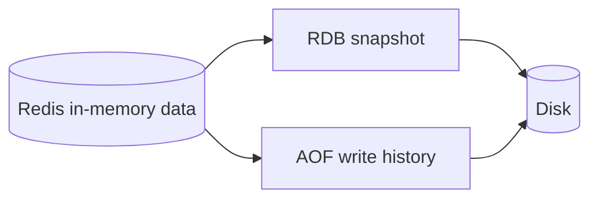
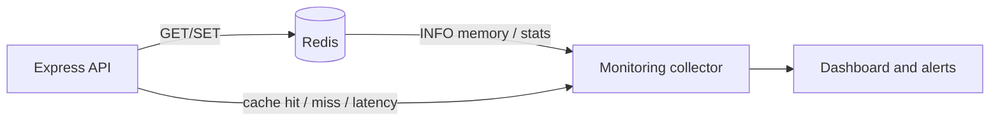

# Lesson 008 — Redis Configuration and INFO

> **Level:** Beginner → Intermediate | **Goal:** Learn how Redis configuration works, how to inspect a running server, how to interpret INFO, and how to change settings safely.
>
> **Prerequisite:** [Lesson 007 — Keys, Namespaces and Expiration](007-keys-expiration.md). Use a disposable local Redis instance for configuration experiments.

## 1. Why configuration matters

Redis is not just a program you start and forget. Configuration determines how it listens for clients, how much memory it may use, how it evicts keys, how it persists data, and how it behaves during failures.

Two Redis servers running the same application can behave very differently because their settings differ.

**Real example:** A Redis instance used purely as a disposable cache might use a memory limit and an eviction policy. A Redis instance coordinating important background jobs needs carefully designed persistence, recovery, and operational safeguards. You should not copy one configuration into the other without understanding the trade-offs.



## 2. Where does Redis configuration come from?

Redis settings can come from:

1. Built-in defaults.
2. A configuration file such as `redis.conf`.
3. Command-line arguments when starting the server.
4. Runtime changes through `CONFIG SET`, where permitted.
5. Provider-managed configuration when using a hosted Redis service.

**Important:** The effective configuration is what the running server is using, not necessarily what a file on disk says.

### Start with a configuration file

```bash
redis-server /path/to/redis.conf
```

On many Ubuntu package installations, a config file is located at `/etc/redis/redis.conf`. **Do not assume this path on every operating system or Docker image.** Inspect your installation.

### Start with command-line options

```bash
redis-server --port 6380 --save "" --appendonly no
```

This starts a **disposable, non-durable learning instance** on port 6380. It disables automatic RDB save rules and AOF. Do not use these persistence settings for important data.

### Inspect the process

```bash
ps aux | grep '[r]edis-server'
ss -ltn | grep ':6379\|:6380'
```

These commands help you determine which instance and port you are actually inspecting.

## 3. CONFIG GET — read the effective settings

Connect to your local instance:

```bash
redis-cli -p 6380
```

Then run:

```redis
CONFIG GET port
CONFIG GET bind
CONFIG GET maxmemory
CONFIG GET maxmemory-policy
CONFIG GET appendonly
CONFIG GET save
CONFIG GET timeout
CONFIG GET tcp-keepalive
```

`CONFIG GET` returns parameter names and current values. Some options are unavailable, renamed, or restricted depending on the Redis version, distribution, and access permissions.

### A useful habit

Before changing anything, write down:

- The Redis version.
- The host and port.
- The current value.
- The reason you want to change it.
- The expected effect.
- How to roll back.

**Never guess a setting's current value based on a tutorial.** Read it from your running server.

## 4. CONFIG SET — changing settings at runtime

Some Redis settings can be changed without restarting the server:

```redis
CONFIG SET maxmemory 64mb
CONFIG GET maxmemory
```

On a local learning server, this sets a memory limit of approximately 64 MiB as parsed by Redis. The displayed value may be in bytes.

### Does CONFIG SET survive restart?

**Not necessarily.** A runtime change does not automatically mean the startup configuration file has been updated. On supported setups, `CONFIG REWRITE` can write suitable current settings back to the server's configuration file:

```redis
CONFIG REWRITE
```

However:

- `CONFIG REWRITE` requires a writable configuration file and appropriate permissions.
- It may fail when Redis was started without a suitable configuration file.
- Managed Redis services may restrict both `CONFIG SET` and `CONFIG REWRITE`.
- Not every setting is runtime-changeable or rewriteable.
- Container deployments should normally manage desired configuration declaratively and redeploy/restart as appropriate.

**Safe workflow:** Change a setting in a disposable environment, verify it, then update your deployment's actual configuration source rather than relying on an undocumented runtime mutation.

## 5. Configuration file vs runtime configuration



**Example problem:** You run `CONFIG SET maxmemory 64mb` and see it working. Later, Redis restarts and the memory limit reverts. The startup source was never updated.

## 6. Network settings

### port

```redis
CONFIG GET port
```

Default Redis TCP port is commonly `6379`. A port can be changed.

### bind

`bind` controls which local network interfaces Redis listens on. For local development, binding to loopback is a good default.

### protected-mode

Redis protected mode can restrict unsafe connections under certain conditions, but **it is not a substitute for firewall rules, private networking, ACLs, and TLS**.

### timeout

The `timeout` server setting concerns idle client connections; it is **not** the same as the request timeout configured in your Node.js client.

### tcp-keepalive

TCP keepalive can help detect dead connections over time. It does not replace application-level timeouts and reconnect logic.

### Security rule

Do not expose a local unauthenticated Redis server on a public interface. Use an isolated development environment for experiments. Production configuration must include network restrictions and suitable authentication and encryption.

## 7. Memory settings

### maxmemory

`maxmemory` limits memory usage for the Redis dataset according to Redis's memory-management behavior. It is **not a strict cap on every byte of the process's resident memory**; overhead, buffers, replication, persistence, and allocator behavior also matter.

```redis
CONFIG GET maxmemory
```

An effective value of `0` typically means no Redis-configured dataset memory limit, though the operating system or hosting provider still imposes resource limits.

### maxmemory-policy

This setting controls what Redis does when the configured memory limit is reached.

Common policy names include:

| Policy | General behavior |
| --- | --- |
| `noeviction` | Reject writes that would require additional memory when over the limit |
| `allkeys-lru` | Approximate least-recently-used eviction across keys |
| `allkeys-lfu` | Approximate least-frequently-used eviction across keys |
| `allkeys-random` | Evict randomly selected keys |
| `volatile-lru` | Approximate LRU among keys with expiration |
| `volatile-ttl` | Prefer keys with nearer expiration among expiring keys |

Other policies exist; check your Redis version's documentation.

**Nuance:** Redis's LRU/LFU policies use practical approximations, not necessarily a perfect global ordering.

### Cache vs important data

- A cache may tolerate eviction if it can reconstruct missing values.
- Session loss can log users out.
- Queue or workflow state may require stronger safeguards and should not be treated as disposable cache data.

Do not assume one eviction policy is appropriate for every application.

### Example: disposable cache-only instance

```redis
CONFIG SET maxmemory 64mb
CONFIG SET maxmemory-policy allkeys-lru
```

Use only in a dedicated learning/cache instance. **Do not apply `allkeys-lru` to a shared instance that also stores important sessions or queue state.**

## 8. Persistence settings

Redis offers two main persistence mechanisms:

**RDB snapshots:** Periodically save a point-in-time representation of the dataset.

**AOF (Append Only File):** Record write operations so Redis can replay them during recovery.



### Inspect persistence configuration

```redis
CONFIG GET save
CONFIG GET appendonly
CONFIG GET appendfsync
```

`save` controls configured snapshot triggers. `appendonly` enables/disables AOF. `appendfsync` affects the trade-off between write performance and potential data loss.

**Do not conclude that a successful `SET` guarantees a durable disk write.** Durability depends on the persistence mode, sync policy, shutdown/crash scenario, and deployment.

We will cover RDB and AOF thoroughly in Lessons 022–024.

## 9. Introducing INFO

`INFO` returns operational statistics and server details.

```redis
INFO
```

This can produce a large response. You can request a particular section:

```redis
INFO server
INFO clients
INFO memory
INFO stats
INFO persistence
INFO replication
INFO cpu
INFO keyspace
```

Section availability and field names can vary by Redis version. Some values are cumulative counters since server startup; others are instantaneous gauges.

### How to read INFO output

Example **illustrative** fields:

```text
# Server
redis_version:7.x.x
uptime_in_seconds:3600

# Clients
connected_clients:12

# Memory
used_memory:10485760
used_memory_human:10.00M

# Stats
keyspace_hits:800
keyspace_misses:200
```

These numbers are **examples, not expected results on your machine**.

## 10. INFO server — version and uptime

```redis
INFO server
```

Useful fields can include:

- `redis_version`: Running Redis version.
- `uptime_in_seconds`: Time since the server process started.
- `process_id`: Server process ID where available.
- `tcp_port`: Listening TCP port.
- `redis_mode`: Standalone, sentinel, or cluster-related mode.

**Why useful:** A feature or command may behave differently across Redis versions. Always confirm the version before debugging compatibility.

## 11. INFO clients — connection health

```redis
INFO clients
```

Useful fields include:

- `connected_clients`: Number of connected clients.
- `blocked_clients`: Clients blocked waiting for suitable events, for example some blocking list operations.
- Other connection/buffer fields depending on version.

### Real-world scenario

Your Express application creates a new Redis client connection for **every HTTP request**. Under traffic, `connected_clients` may grow unexpectedly.

**Better design:** Manage and reuse an appropriate Redis client connection per long-lived application process, with explicit reconnection and shutdown behavior. Serverless runtimes need a deployment-specific connection strategy.

**Important:** A high `blocked_clients` value does not automatically mean Redis's main command thread is blocked. Commands such as `BLPOP` can block the *requesting client* while Redis continues serving other clients.

## 12. INFO memory — memory pressure

```redis
INFO memory
```

Common fields:

| Field | Meaning |
| --- | --- |
| `used_memory` | Memory Redis accounts for via its allocator |
| `used_memory_human` | Human-readable representation |
| `used_memory_rss` | Resident memory reported by the OS |
| `used_memory_peak` | Peak allocator-accounted memory |
| `mem_fragmentation_ratio` | A diagnostic ratio; interpretation requires context |
| `maxmemory` | Configured memory limit |
| `maxmemory_policy` | Configured eviction policy |

**Do not diagnose memory leaks from one field alone.** RSS, allocator fragmentation, replication buffers, and dataset size can behave differently.

### Example

If `used_memory` is approaching `maxmemory` and the policy is `noeviction`, writes may start failing with out-of-memory errors. A cache-focused instance using an eviction policy may instead evict keys, increasing cache misses.

## 13. INFO stats — hits, misses, evictions

```redis
INFO stats
```

Important counters include:

- `keyspace_hits`: Successful key lookups.
- `keyspace_misses`: Unsuccessful key lookups.
- `expired_keys`: Keys removed due to expiration.
- `evicted_keys`: Keys removed due to memory eviction.
- `total_commands_processed`: Commands processed since startup.

### Calculate a basic hit ratio

For a measured interval:

\[\text{Hit ratio} = \frac{\Delta hits}{\Delta hits + \Delta misses}\times 100\%\]

If the counters increased by 800 hits and 200 misses:

\[\frac{800}{800+200}\times 100 = 80\%\]

**Important nuance:** These Redis server counters are **not automatically your application's cache hit ratio**. They can include lookups from multiple applications and commands. Prefer application-level cache metrics when you need endpoint-specific hit rates. Use **counter differences over a time window**, not just cumulative totals since startup.

### Example interpretation

| Observation | Possible interpretation | Next check |
| --- | --- | --- |
| Rising `keyspace_misses` | Keys absent/expired, or lookup pattern changed | App cache-hit metrics, TTLs |
| Rising `evicted_keys` | Memory pressure and eviction | Memory usage and policy |
| Rising `expired_keys` | Keys naturally expiring | Expected TTL behavior |
| Rising commands and latency | Increased load or expensive commands | Latency, CPU, SLOWLOG |

None of these metrics alone proves a root cause.

## 14. INFO persistence — data safety signals

```redis
INFO persistence
```

Look for fields such as:

- `rdb_last_bgsave_status`: Status of the last background RDB save.
- `rdb_last_save_time`: Time of the last successful snapshot.
- `aof_enabled`: Whether AOF is enabled.
- `aof_last_write_status`: Status of recent AOF writes, where exposed.
- Other fields about current background save/rewrite activity.

**Production warning:** Seeing a successful save status does not mean zero possible data loss. You still need backup, restore tests, recovery objectives, and an understanding of persistence timing.

## 15. INFO replication and keyspace

### Replication

```redis
INFO replication
```

Useful for understanding whether a node is a primary or replica and whether replication connections are healthy. Exact fields depend on topology and version.

Replication is usually **asynchronous**. A connected replica is not proof that every recent write will survive a failover.

### Keyspace

```redis
INFO keyspace
```

Example illustrative output:

```text
# Keyspace
db0:keys=1200,expires=800,avg_ttl=145000
```

This tells you approximately how many keys exist in database 0, how many have expiration, and an average TTL measure in milliseconds. These are summary statistics, not an exact listing of all keys.

## 16. CONFIG GET vs INFO vs COMMAND

| Tool | Question it answers | Example |
| --- | --- | --- |
| `CONFIG GET` | What is the current setting? | `CONFIG GET maxmemory` |
| `CONFIG SET` | Can I change a supported runtime setting? | `CONFIG SET maxmemory 64mb` |
| `INFO` | What is happening in the running server? | `INFO memory` |
| `COMMAND INFO` | What are a command's properties? | `COMMAND INFO GET` |
| `SLOWLOG GET` | Which commands exceeded the slowlog threshold? | `SLOWLOG GET 10` |
| `LATENCY LATEST` | What latency events has Redis recorded? | `LATENCY LATEST` |

**Important:** `SLOWLOG` measures command execution time inside Redis, not full client/network round-trip latency. The latency monitor may need configuration before it records events.

## 17. Hands-on lab: inspect a disposable instance

**Never run configuration experiments on a shared or production instance.**

### Step 1 — Start a temporary Redis server

```bash
redis-server --port 6380 --save "" --appendonly no
```

Open a second terminal:

```bash
redis-cli -p 6380 PING
```

Expected: `PONG`.

### Step 2 — Inspect settings

```bash
redis-cli -p 6380 CONFIG GET maxmemory
redis-cli -p 6380 CONFIG GET maxmemory-policy
redis-cli -p 6380 CONFIG GET appendonly
```

### Step 3 — Set a small memory limit

```bash
redis-cli -p 6380 CONFIG SET maxmemory 64mb
redis-cli -p 6380 CONFIG SET maxmemory-policy allkeys-lru
redis-cli -p 6380 CONFIG GET maxmemory
```

This is a learning-only cache configuration. Do not apply it to important data.

### Step 4 — Create and inspect keys

```bash
redis-cli -p 6380 SET lesson:8:one hello EX 60
redis-cli -p 6380 GET lesson:8:one
redis-cli -p 6380 GET lesson:8:missing
redis-cli -p 6380 INFO keyspace
redis-cli -p 6380 INFO stats
```

### Step 5 — Observe counters

Run a few more `GET` commands for existing and missing keys. Compare `keyspace_hits` and `keyspace_misses` before and after.

**Do not expect exact counter totals**: Redis may process additional commands, and the server may already have previous activity.

### Step 6 — Inspect memory

```bash
redis-cli -p 6380 INFO memory
```

Find `used_memory`, `maxmemory`, and `maxmemory_policy`.

### Step 7 — Stop the disposable instance

```bash
redis-cli -p 6380 SHUTDOWN NOSAVE
```

This intentionally discards the non-durable lab data.

## 18. Real-world example: monitoring a Node.js cache

Suppose an Express application uses Redis to cache product pages. You want to know:

1. Is Redis reachable?
2. Is memory pressure growing?
3. Are cache keys expiring or being evicted?
4. Is the application actually benefiting from the cache?

Redis gives you server-side observations, while your application should track endpoint-specific cache behavior.



### Node.js example: inspect selected INFO sections

Install:

```bash
npm install redis
```

Use an ESM project (`"type": "module"` in `package.json`):

```js
import { createClient } from "redis";

const client = createClient({
  url: process.env.REDIS_URL ?? "redis://127.0.0.1:6379",
});

client.on("error", (error) => {
  console.error("Redis error:", error.message);
});

try {
  await client.connect();

  const memory = await client.info("memory");
  const stats = await client.info("stats");

  function findInfoValue(info, key) {
    const line = info.split(/\r?\n/).find((row) => row.startsWith(`${key}:`));
    return line ? line.slice(key.length + 1) : undefined;
  }

  console.log("Used memory:", findInfoValue(memory, "used_memory_human"));
  console.log("Cache lookups (hits):", findInfoValue(stats, "keyspace_hits"));
  console.log("Cache lookups (misses):", findInfoValue(stats, "keyspace_misses"));
  console.log("Evicted keys:", findInfoValue(stats, "evicted_keys"));
} catch (error) {
  console.error("Inspection failed:", error.message);
  process.exitCode = 1;
} finally {
  if (client.isOpen) await client.quit();
}
```

This is a diagnostic script, not a production monitoring agent. Production monitoring should sample metrics over time, compute rates/deltas, handle reconnections, and avoid publishing sensitive diagnostics.

## 19. Docker and Compose configuration

A reproducible development setup is often better than manually changing settings inside a container.

Create `compose.yaml`:

```yaml
services:
  redis:
    image: redis:7
    ports:
      - "127.0.0.1:6379:6379"
    volumes:
      - redis_data:/data
    command:
      - redis-server
      - --appendonly
      - "yes"
      - --maxmemory
      - 128mb
      - --maxmemory-policy
      - noeviction

volumes:
  redis_data:
```

**Why `noeviction` here?** This example is meant to demonstrate a conservative behavior: when memory is exhausted, memory-growing writes can fail rather than silently evicting arbitrary data. For a **dedicated disposable cache**, a suitable eviction policy may be more appropriate.

Start and inspect:

```bash
docker compose up -d
docker compose exec redis redis-cli INFO memory
docker compose exec redis redis-cli CONFIG GET maxmemory-policy
```

Stop without deleting the named volume:

```bash
docker compose down
```

**Do not use `docker compose down -v` unless you intend to remove the volume and its data.**

**Production note:** Pin a tested Redis image version/digest, secure access, and plan persistence and backup. A local Compose example is not a complete production deployment.

## 20. Common mistakes

### Mistake 1: Changing settings without checking the current values

**Fix:** Read `CONFIG GET`, note the server version, and plan rollback.

### Mistake 2: Assuming CONFIG SET permanently updates redis.conf

**Fix:** Manage startup configuration explicitly. Understand when `CONFIG REWRITE` is available.

### Mistake 3: Thinking maxmemory limits total process RAM exactly

**Fix:** Monitor Redis allocator memory, RSS, overhead, and the host's available memory.

### Mistake 4: Applying allkeys-lru to sessions and queues

**Fix:** Separate workloads or choose policies based on data-loss tolerance.

### Mistake 5: Treating a high hit ratio as proof of good performance

**Fix:** Also measure end-to-end latency, database load, cache correctness, and costs.

### Mistake 6: Reading cumulative counters as current rates

**Fix:** Measure changes over time and account for server restarts.

### Mistake 7: Assuming INFO persistence proves zero data loss

**Fix:** Test backup and restore; understand the persistence policy.

### Mistake 8: Exposing INFO and CONFIG to unauthorized users

**Fix:** Use ACLs, network restrictions, TLS as appropriate, and least-privilege access.

## 21. Production configuration checklist

- [ ] Confirm Redis version and deployment mode.
- [ ] Restrict network exposure.
- [ ] Configure ACLs/authentication and TLS as appropriate.
- [ ] Define memory limits with headroom.
- [ ] Choose an eviction policy based on workload.
- [ ] Choose and test persistence/backup strategy.
- [ ] Monitor clients, latency, CPU, memory, misses, and evictions.
- [ ] Monitor persistence and replication health.
- [ ] Define reconnect and failure behavior in application clients.
- [ ] Track configuration in deployment files/version control without secrets.
- [ ] Test restart, failover, and restore scenarios.

## 22. Practice exercises

1. Find your running Redis version using `INFO server`.
2. Read the current `maxmemory` and `maxmemory-policy`.
3. Explain the difference between `CONFIG GET` and `INFO memory`.
4. In a disposable instance, change `maxmemory` and confirm the new value.
5. Restart that instance and observe whether the setting persists. Explain why.
6. Calculate a hit ratio from counter deltas: 450 hits and 50 misses.
7. Inspect `INFO keyspace` after creating five keys, three with TTL.
8. Explain what happens when `noeviction` is configured and the server reaches its memory limit.
9. Explain why `connected_clients` may rise when an API creates a connection per request.
10. Explain why Redis `SLOWLOG` does not measure complete network latency.

## 23. Interview questions

**Q1. What is redis.conf?**  
A configuration file that can define Redis startup behavior and settings.

**Q2. What is CONFIG GET?**  
A command to inspect current configuration values.

**Q3. Does CONFIG SET persist after restart?**  
Not necessarily. Runtime configuration and startup configuration are different.

**Q4. What is INFO used for?**  
To inspect runtime statistics and details such as server version, memory, clients, persistence, and replication.

**Q5. What is maxmemory?**  
A configured memory limit used by Redis memory-management behavior; it is not a hard bound on all process RSS.

**Q6. What is noeviction?**  
A policy that rejects certain memory-growing writes rather than evicting keys when the memory limit is reached.

**Q7. What is the difference between expired_keys and evicted_keys?**  
Expired keys were removed due to TTL deadlines; evicted keys were removed due to memory-pressure policies.

**Q8. How do you calculate cache hit ratio?**  
Hits divided by hits plus misses, ideally using measurements for the relevant application and time interval.

**Q9. Does a successful RDB snapshot mean zero possible data loss?**  
No. Newer writes after the snapshot may not be included.

**Q10. Why is a Redis version check important?**  
Configuration options, fields, defaults, and supported features can vary across versions.

## 24. Quick revision

- `CONFIG GET` reads current settings.
- `CONFIG SET` changes supported settings at runtime.
- `CONFIG REWRITE` may persist suitable settings when supported.
- `INFO` shows what the server is doing.
- `maxmemory` and eviction policy must match the workload.
- Expiration and eviction are different.
- `keyspace_hits` and `keyspace_misses` are server counters, not automatically application cache metrics.
- RDB/AOF persistence must be configured and tested.
- Production Redis requires security, monitoring, and recovery planning.

---

**Previous:** [Lesson 007 — Keys, Namespaces and Expiration](007-keys-expiration.md)  
**Next:** [Lesson 009 — Redis Strings](../02-data-types/009-strings.md) (planned)

**Official references:** [Redis configuration](https://redis.io/docs/latest/operate/oss_and_stack/management/config/) · [INFO command](https://redis.io/docs/latest/commands/info/) · [CONFIG GET](https://redis.io/docs/latest/commands/config-get/) · [CONFIG SET](https://redis.io/docs/latest/commands/config-set/)
