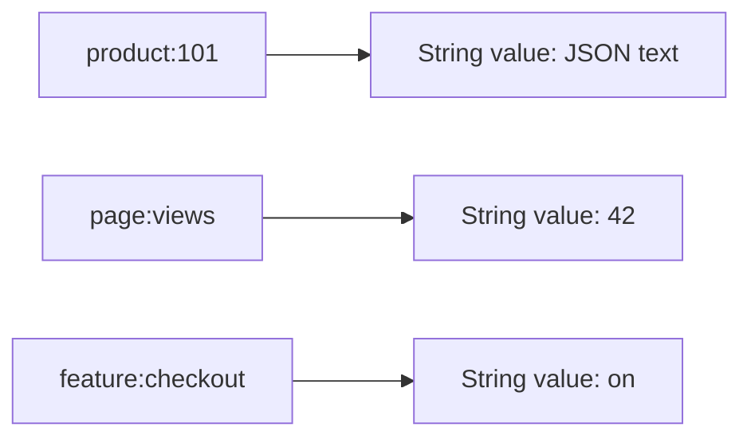
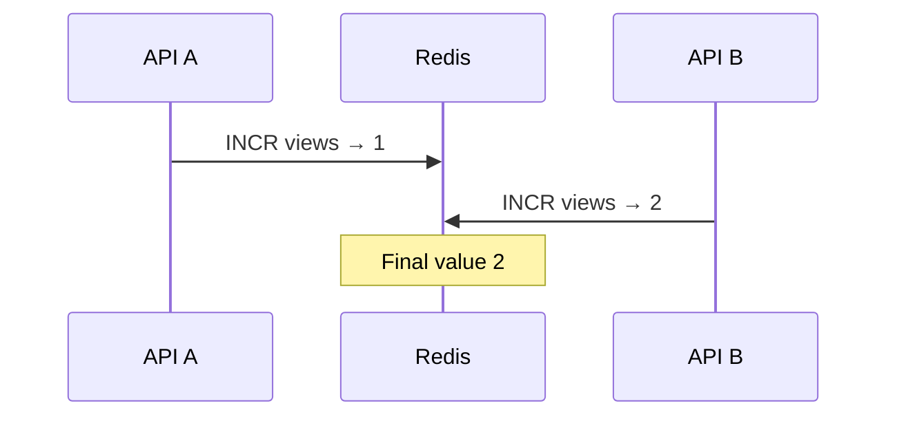

# Lesson 009 — Redis Strings

> **Section 02: Data Types and Commands** · **Level:** Beginner → Intermediate  
> **Goal:** Understand Redis Strings deeply: representation, commands, atomic counters, conditional writes, TTL, caching, concurrency, limits, and production use.

## 1. What is a Redis String?

A Redis **String** is a binary-safe sequence of bytes stored under a key. It can represent ordinary text, serialized JSON, an integer counter, or binary data.



**Do not confuse** the Redis String type with a JavaScript `string`. Redis stores bytes; your application decides how to encode and decode them.

Redis Strings can be up to **512 MiB** in size in the standard Redis model. That is a limit, not a recommendation to store giant values. Large values increase memory usage, network transfer, serialization cost, and latency.

## 2. Start with SET and GET

Run in `redis-cli`:

```redis
SET app:name "CareerLoop"
GET app:name
```

Typical response:

```text
OK
"CareerLoop"
```

Now overwrite it:

```redis
SET app:name "ShopHub"
GET app:name
```

By default, `SET` replaces the old value.

### Missing key vs empty string

```redis
DEL demo:missing
GET demo:missing
SET demo:empty ""
GET demo:empty
```

The first `GET` returns nil; the second returns an empty string. They are **not the same state**.

## 3. SET options you must know

| Option | Meaning | Example |
| --- | --- | --- |
| `EX seconds` | Expire after seconds | `SET k v EX 60` |
| `PX milliseconds` | Expire after milliseconds | `SET k v PX 1500` |
| `EXAT timestamp` | Expire at Unix seconds timestamp | `SET k v EXAT 1893456000` |
| `PXAT timestamp` | Expire at Unix milliseconds timestamp | `SET k v PXAT 1893456000000` |
| `NX` | Set only if key absent | `SET k v NX` |
| `XX` | Set only if key exists | `SET k v XX` |
| `GET` | Return old value when replacing | `SET k v GET` |
| `KEEPTTL` | Preserve existing expiration | `SET k v KEEPTTL` |

Some combinations are incompatible. Check the version-specific `SET` documentation rather than assuming every option can be combined.

### Why SET with EX is useful

```redis
SET cache:product:101 '{"id":101,"name":"Keyboard"}' EX 120
TTL cache:product:101
```

The value and expiration are set in **one command**, avoiding a gap between `SET` and `EXPIRE`.

### TTL trap

```redis
SET demo:ttl "first" EX 60
SET demo:ttl "second"
TTL demo:ttl
```

Result: `-1` — a plain `SET` removes the old TTL. Use `KEEPTTL` when you intentionally want to retain it.

## 4. Conditional writes: NX and XX

### NX: create only if absent

```redis
DEL signup:email:42
SET signup:email:42 "pending" NX EX 300
SET signup:email:42 "again" NX EX 300
GET signup:email:42
```

Only the first write succeeds while the key exists.

### XX: update only if present

```redis
SET app:mode "dark" XX
```

This updates `app:mode` only if the key already exists.

**Real use:** `NX` can help with one-time claims and lock *acquisition*. But a reliable distributed lock needs ownership-safe release, expiry handling, and failure analysis; a naive `DEL` is not enough.

## 5. GETSET vs SET GET

```redis
SET demo:status "queued"
SET demo:status "running" GET
GET demo:status
```

The `SET ... GET` response is the previous value (`queued`), while the subsequent `GET` returns `running`.

This can be useful for atomic value replacement. The older `GETSET` command exists, but modern code can often use `SET ... GET` (supported on Redis versions with that option).

## 6. Counters: INCR, DECR, INCRBY

Redis String values can represent signed integers:

```redis
SET article:101:views 0
INCR article:101:views
INCRBY article:101:views 5
DECR article:101:views
GET article:101:views
```

Expected final value: `"5"`.

`INCR` and related integer operations are atomic **single commands** on a Redis instance. They operate on values that represent integers and can fail for invalid values or integer overflow.

### Why GET then SET is unsafe

```mermaid
sequenceDiagram
  participant A as API A
  participant R as Redis
  participant B as API B
  A->>R: GET views → 0
  B->>R: GET views → 0
  A->>R: SET views 1
  B->>R: SET views 1
  Note over R: Final value 1; one update lost
```

Use `INCR` instead:



**Caution:** One atomic `INCR` does not make a complete multi-command workflow atomic.

### Floating-point counters

```redis
SET temperature:reading 20.5
INCRBYFLOAT temperature:reading 0.25
```

Do not use floating-point increments as a substitute for precise financial accounting. Monetary amounts should use appropriate integer minor units or decimal types in the authoritative system.

## 7. Multiple Strings: MSET and MGET

```redis
MSET app:theme dark app:locale en
MGET app:theme app:locale app:missing
```

Results are returned in the requested order, including nil for missing keys.

`MSET` sets multiple string keys in one command. In Redis Cluster, multi-key operations have hash-slot constraints, so do not assume arbitrary keys can always be combined.

## 8. Read/write part of a String

### APPEND

```redis
SET log:demo "Hello"
APPEND log:demo " Redis"
GET log:demo
```

Result: `"Hello Redis"`. `APPEND` returns the resulting string length in bytes.

### STRLEN

```redis
STRLEN log:demo
```

This returns **bytes**, not JavaScript Unicode code points or user-perceived characters. UTF-8 text with non-ASCII characters can use multiple bytes per character.

### GETRANGE

```redis
GETRANGE log:demo 0 4
```

Returns `"Hello"`. Indexes are byte offsets; negative indexes count from the end.

### SETRANGE

```redis
SET demo:word "Hello"
SETRANGE demo:word 0 "Y"
GET demo:word
```

Returns `"Yello"`.

**Important:** Byte-oriented slicing can split multi-byte UTF-8 characters. Avoid `GETRANGE` / `SETRANGE` for arbitrary Unicode text unless you understand the encoding.

## 9. Store JSON in a Redis String

```redis
SET cache:user:42 '{"id":42,"name":"Asha","city":"Bengaluru"}' EX 60
GET cache:user:42
```

This stores **serialized JSON as one String**. Core `GET` does not return just `city`.

To update one JSON field using only core String commands, the application often needs to:
1. Read the whole value.
2. Parse JSON.
3. Modify the object.
4. Serialize it.
5. Write the whole value.

That creates a **read-modify-write race** if multiple clients update concurrently. A Redis **Hash** can be better for independent fields; Redis JSON features are another option when available.

## 10. Real-world Node.js example: product cache

Install the official client:

```bash
npm install redis
```

Use ESM (`"type": "module"` in `package.json`):

```js
import { createClient } from "redis";

const redis = createClient({
  url: process.env.REDIS_URL ?? "redis://127.0.0.1:6379",
});

redis.on("error", (error) => console.error("Redis error:", error.message));

async function loadProductFromDatabase(id) {
  // Teaching stub: replace with your PostgreSQL/MongoDB query.
  return { id, name: "Mechanical Keyboard", price: 2499 };
}

async function getProduct(id) {
  const key = `cache:product:${id}`;
  const cached = await redis.get(key);

  if (cached !== null) {
    console.log("cache hit");
    return JSON.parse(cached);
  }

  console.log("cache miss");
  const product = await loadProductFromDatabase(id);
  await redis.set(key, JSON.stringify(product), { EX: 120 });
  return product;
}

try {
  await redis.connect();
  console.log(await getProduct(101));
  console.log(await getProduct(101));
} finally {
  if (redis.isOpen) await redis.quit();
}
```

First call normally misses if the key is absent. The next call within the TTL normally hits.

**Production considerations:**
- Validate IDs and authorize access before reading user-specific cache keys.
- Decide what happens when Redis is unavailable (often a database fallback for noncritical caches).
- Invalidate or version cached data after writes.
- Handle malformed serialized data.
- Use TTL jitter and stampede protection for hot keys.
- Reuse managed connections; do not connect per request.

## 11. Atomic rate-limit building block

A naive counter pattern:

```redis
INCR rate:user:42
EXPIRE rate:user:42 60
```

Each command is atomic, **but the pair is not**. A crash between them can leave a counter without an expiration.

For a production rate limiter, use an appropriate atomic script/function or a well-tested library, and choose the algorithm (fixed window, sliding window, token bucket) deliberately. We implement this in Lesson 042.

## 12. String vs Hash — choosing a type

| Requirement | String | Hash |
| --- | --- | --- |
| Cache one complete JSON response | Good fit | Possible but often unnecessary |
| Atomic integer counter | Excellent with `INCR` | `HINCRBY` can work per field |
| Read/update one profile field | Requires whole-value handling for JSON | Good fit with `HGET` / `HSET` |
| Expire whole object | Native key TTL | Native key TTL |
| Expire individual fields | Not applicable | Depends on Redis version/field-expiration support |

**Rule of thumb:** Use a String for a single blob, token-like value, or counter. Use a Hash when independent named fields matter.

## 13. Performance and memory

Most simple String commands have efficient key lookup, but work involving long values is affected by the number of bytes copied or returned.

| Command | Typical complexity |
| --- | --- |
| `GET` | O(1) command lookup, with cost to transfer returned bytes |
| `SET` | O(1) command complexity for typical use, with allocation/copy costs |
| `INCR` | O(1) |
| `APPEND` | O(1) amortized in common cases, may reallocate/copy |
| `STRLEN` | O(1) |
| `GETRANGE` | O(N) for returned bytes |
| `MGET` | O(N) for N requested keys, plus returned payload |

Avoid blindly caching multi-megabyte API responses. Measure memory, serialization, network time, and cache hit rate.

## 14. Common mistakes

1. **Assuming Redis Strings are only human-readable text.** They are binary-safe bytes.
2. **Storing JSON and expecting field-level GET.** Core `GET` returns the whole String.
3. **Using GET+SET for counters.** Use `INCR` to avoid lost updates.
4. **Forgetting SET resets TTL.** Set a new TTL or use `KEEPTTL`.
5. **Using one String for frequently edited independent fields.** Consider Hashes.
6. **Storing huge values.** Network, memory, and latency costs rise.
7. **Treating SET NX as a complete distributed-lock implementation.** Ownership and failure handling still matter.
8. **Using byte offsets as Unicode character offsets.** `GETRANGE` / `STRLEN` operate on bytes.
9. **Treating cache values as authoritative payment/order records.** Keep the correct source of truth.

## 15. Hands-on exercises

Use a disposable local Redis instance.

1. Create `app:name`, read it, overwrite it, and delete it.
2. Store an empty String and compare it with a missing key.
3. Create `demo:ttl` with 30 seconds, overwrite it, and inspect TTL.
4. Repeat using `KEEPTTL`.
5. Use `NX` to create a key only once.
6. Increment a counter 10 times and verify the final value.
7. Store a JSON product as a String; retrieve and parse it in Node.js.
8. Use `APPEND`, `STRLEN`, and `GETRANGE`.
9. Compare `MGET` with multiple `GET` calls.
10. Explain how you would prevent a cache entry from being stale after a product update.

## 16. Interview questions

**Q1. What can a Redis String store?** Binary-safe bytes representing text, serialized JSON, numbers, or other data.

**Q2. What is the maximum Redis String size?** Traditionally 512 MiB for a String value; avoid designing around giant values.

**Q3. Is INCR atomic?** Yes, as a single command on a Redis instance.

**Q4. Is GET then SET atomic?** No, not as a combined operation.

**Q5. What does SET NX do?** Sets a key only when it does not already exist.

**Q6. What happens to TTL after ordinary SET?** Existing expiration is removed unless suitable options are used.

**Q7. Why use a Hash instead of JSON stored in a String?** Hash commands can read/update independent fields without rewriting the entire serialized object.

**Q8. What does STRLEN count?** Bytes, not Unicode characters.

**Q9. What is MGET?** Fetches values for multiple String keys in one command.

**Q10. Should Redis String counters store authoritative bank balances?** Not by default; financial correctness requires an appropriately designed transactional source of truth.

## 17. Revision checklist

- [ ] String as binary-safe value
- [ ] `SET`, `GET`, `DEL`, missing vs empty
- [ ] `EX`, `PX`, `NX`, `XX`, `GET`, `KEEPTTL`
- [ ] Atomic counters
- [ ] `MSET` / `MGET`
- [ ] `APPEND`, `STRLEN`, `GETRANGE`, `SETRANGE`
- [ ] JSON serialization and race conditions
- [ ] String vs Hash
- [ ] Cache invalidation and failure handling
- [ ] Memory and large-value trade-offs

---

**Previous:** [Lesson 008 — Redis Configuration and INFO](../01-fundamentals/008-configuration-info.md)  
**Next:** [Lesson 010 — Redis Hashes](010-hashes.md)

**Official references:** [Redis Strings](https://redis.io/docs/latest/develop/data-types/strings/) · [SET](https://redis.io/docs/latest/commands/set/) · [INCR](https://redis.io/docs/latest/commands/incr/) · [MGET](https://redis.io/docs/latest/commands/mget/)
