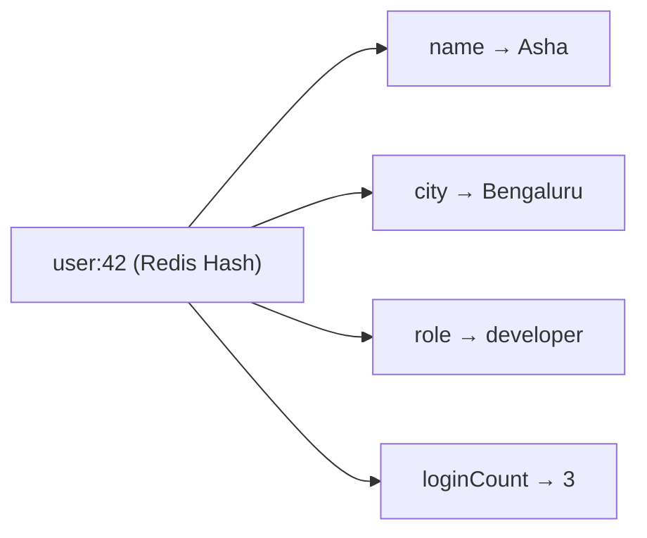
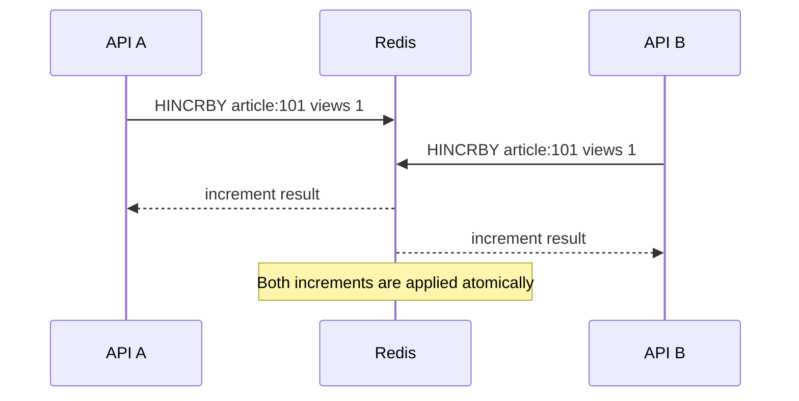
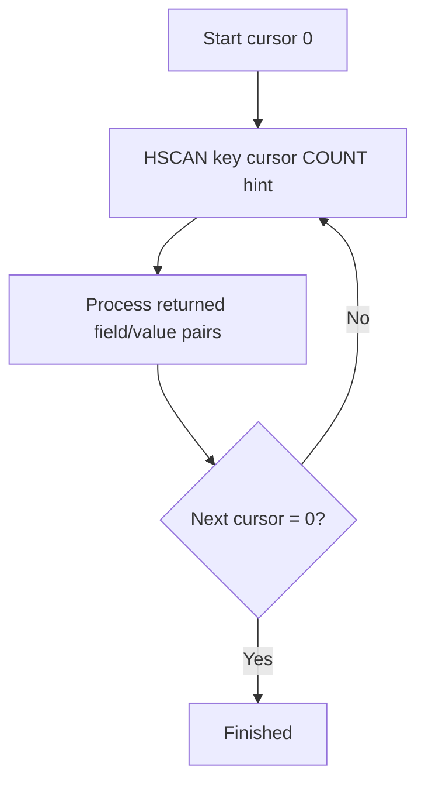

# Lesson 010 — Redis Hashes

> **Section 02: Data Types and Commands** · **Level:** Beginner → Intermediate  
> **Goal:** Understand Redis Hashes, field-level operations, counters, iteration, memory and modeling trade-offs, and how to use them safely from Node.js.
>
> **Prerequisite:** [Lesson 009 — Redis Strings](009-strings.md)

## 1. What is a Redis Hash?

A **Redis Hash** stores multiple **field → value** pairs under one Redis key.

Think of it as a small record:

```text
Redis key: user:42

Field       Value
----------------------
name        Asha
city        Bengaluru
role        developer
loginCount  3
```



A Hash resembles a JavaScript object, but **its field values are stored as binary-safe strings**, not arbitrary nested JavaScript objects. You must serialize nested data yourself or choose another model.

## 2. Why use a Hash instead of a String?

Suppose you cache a user profile as JSON in a String:

```redis
SET user:42 '{"name":"Asha","city":"Bengaluru","loginCount":3}'
```

To update just the city with core String commands, you generally need to read, parse, modify, serialize, and rewrite the whole JSON value. Two concurrent clients may overwrite each other's changes.

With a Hash:

```redis
HSET user:42 name "Asha" city "Bengaluru" loginCount 3
HSET user:42 city "Pune"
HGET user:42 city
```

You can update one field directly.

**Not every object belongs in a Hash.** For a single opaque JSON response that is always read and replaced as a whole, a String may be simpler.

## 3. HSET — create and update fields

```redis
HSET user:42 name "Asha" city "Bengaluru" role "developer"
```

`HSET` returns the **number of newly added fields**, not the total number of fields updated.

Example:

```redis
HSET user:42 city "Hyderabad" country "India"
```

Here, `city` is updated and `country` is newly added, so the result is typically `1`.

You can set multiple fields in one `HSET`. Older examples may use `HMSET`, but `HSET` with multiple field/value pairs is the modern approach.

## 4. HGET, HMGET and HGETALL

### Read one field

```redis
HGET user:42 name
```

Returns `"Asha"` if it exists.

### Read selected fields

```redis
HMGET user:42 name city missingField
```

Returns values in the requested field order, with nil for missing fields.

### Read all fields

```redis
HGETALL user:42
```

Returns all fields and values. The exact CLI presentation varies by mode/version.

**Production consideration:** `HGETALL` is O(N) in the number of fields. Avoid repeatedly returning enormous Hashes when you only need two fields; use `HMGET`.

## 5. HEXISTS, HLEN, HDEL

```redis
HEXISTS user:42 role
HLEN user:42
HDEL user:42 role
HEXISTS user:42 role
```

| Command | Purpose |
| --- | --- |
| `HEXISTS key field` | Check whether a field exists |
| `HLEN key` | Count fields |
| `HDEL key field [field ...]` | Delete selected fields |

### What if you delete the last field?

Redis removes the Hash key when its last field is deleted.

Try in a disposable instance:

```redis
HSET demo:hash a 1
HDEL demo:hash a
EXISTS demo:hash
```

Expected: `0`.

## 6. HKEYS, HVALS and HSTRLEN

```redis
HSET demo:profile name "Asha" city "Pune"
HKEYS demo:profile
HVALS demo:profile
HSTRLEN demo:profile name
```

- `HKEYS` returns all field names.
- `HVALS` returns all field values.
- `HSTRLEN` returns the byte length of a field value.

These are useful for debugging, but `HKEYS` and `HVALS` visit the whole Hash and can be costly for large objects.

## 7. Atomic counters inside Hashes

### HINCRBY

```redis
HSET article:101 views 0 likes 0
HINCRBY article:101 views 1
HINCRBY article:101 views 5
HGET article:101 views
```

Expected final views: `"6"`.

`HINCRBY` atomically increments a numeric field. If the field is absent, Redis treats its initial numeric value as zero for this operation.

### HINCRBYFLOAT

```redis
HSET sensor:room1 temperature 20.5
HINCRBYFLOAT sensor:room1 temperature 0.25
```

Expected new temperature: `"20.75"`.

**Caution:** Do not use floating-point counters for authoritative financial accounting.

### Concurrency example



A single `HINCRBY` is atomic. Combining multiple commands into a business workflow still requires separate correctness analysis.

## 8. HSETNX — create a field only if missing

```redis
HSETNX user:42 preferredLanguage "en"
HSETNX user:42 preferredLanguage "hi"
HGET user:42 preferredLanguage
```

The first call sets the field. The second leaves it unchanged.

Useful for initializing default fields without overwriting an existing preference.

## 9. Expiration: a very important distinction

Traditionally, Redis TTL applies to the **whole key**:

```redis
HSET session:42 userId 42 role user
EXPIRE session:42 1800
TTL session:42
```

All fields are part of the same Hash key, and the key expires together.

### Does HSET remove the key's TTL?

Unlike ordinary `SET` replacing a String value, `HSET` modifies a field within the existing Hash and generally **preserves the Hash key's TTL**.

```redis
HSET demo:expiring name "Asha"
EXPIRE demo:expiring 60
HSET demo:expiring city "Pune"
TTL demo:expiring
```

Expected: a positive TTL.

### What about expiration of individual Hash fields?

Modern Redis versions have introduced **hash-field expiration** commands, such as `HEXPIRE`, in Redis 7.4 and later. Support depends on the server version and distribution.

Do **not** assume field-level expiration is available in Redis 7.0/7.2 or in every hosted deployment. If you need compatibility across older versions, model independently expiring items as separate keys.

```redis
HEXPIRE user:42 60 FIELDS 1 temporaryStatus
```

This is a **version-dependent example**, not a command guaranteed to work in every Redis installation.

## 10. HSCAN — iterate large Hashes

Avoid pulling a huge Hash into application memory with `HGETALL` when you only need to process it in batches.

```redis
HSCAN user:42 0 COUNT 10
```

The result includes a cursor and some field/value pairs. Continue using the returned cursor until it becomes `0`.



Important:
- `COUNT` is a hint, not an exact batch size.
- Duplicates can occur.
- A changing Hash does not produce a guaranteed point-in-time snapshot.
- Small compact Hashes may be returned all at once.
- If your logic cannot tolerate duplicates, deduplicate.

## 11. Hash vs String vs many keys

Suppose you store user profile data.

### Option A — JSON String

```text
user:42 -> '{"name":"Asha","city":"Pune"}'
```

**Pros:** Simple full-object caching, one `GET`.  
**Cons:** Partial updates require whole-value rewrite.

### Option B — Redis Hash

```text
user:42 -> name=Asha, city=Pune
```

**Pros:** Field-level operations and counters.  
**Cons:** No native nested object structure in core Hash values; whole-key TTL is the most widely compatible model.

### Option C — Separate String keys

```text
user:42:name -> Asha
user:42:city -> Pune
```

**Pros:** Independent key TTLs and operations.  
**Cons:** More keys and metadata overhead; multi-field reads/writes become more complex.

| Requirement | JSON String | Hash | Separate String keys |
| --- | --- | --- | --- |
| Read whole object | Simple | `HGETALL` | Multiple reads |
| Update one field | Rewrite object | `HSET` | `SET` |
| Atomic numeric field update | Need special design | `HINCRBY` | `INCR` |
| Whole-object TTL | Yes | Yes | Requires TTL per key |
| Field-level TTL | Not applicable | Version-dependent feature | Each key has TTL |
| Nested objects | Serialize as JSON | Serialize individual fields | Serialize as needed |

## 12. How Redis stores Hashes internally

Redis can use different internal encodings depending on Hash size and field/value characteristics. Small Hashes may use a compact representation; larger ones can use a hash-table-like representation.

**Why it matters:** Memory efficiency and performance can change as a Hash grows.

Inspect in a **disposable local instance**:

```redis
OBJECT ENCODING user:42
MEMORY USAGE user:42
```

Encoding names and thresholds can vary by Redis version/configuration. Avoid building application correctness around an internal encoding.

We will study memory encodings more deeply in Lesson 021.

## 13. Real-world example: CareerLoop dashboard counters

Suppose you track counts by job-application status:

```text
careerloop:user:42:application-counts
  applied    12
  screening   3
  interview   2
  offer       1
```

Initialize:

```redis
HSET careerloop:user:42:application-counts applied 12 screening 3 interview 2 offer 1
HGETALL careerloop:user:42:application-counts
```

When a job application moves from `applied` to `screening`, you might run:

```redis
HINCRBY careerloop:user:42:application-counts applied -1
HINCRBY careerloop:user:42:application-counts screening 1
```

**Critical correctness point:** These are two independent commands. If one succeeds and the other fails, counts become inconsistent. Also, PostgreSQL may be the authoritative source for application statuses.

For production, consider:
- Update the authoritative PostgreSQL record transactionally.
- Invalidate and recompute the cached dashboard counters; **or**
- Use an atomic Redis script/transaction with a robust synchronization strategy.

Redis Hashes are a convenient representation, **not a substitute for cross-system consistency design**.

## 14. Node.js: work with Hashes

Install:

```bash
npm install redis
```

Use an ESM project (`"type": "module"` in `package.json`).

```js
import { createClient } from "redis";

const redis = createClient({
  url: process.env.REDIS_URL ?? "redis://127.0.0.1:6379",
});

redis.on("error", (error) => console.error("Redis error:", error.message));

const key = "careerloop:demo:user:42";

try {
  await redis.connect();

  await redis.hSet(key, {
    name: "Asha",
    city: "Bengaluru",
    loginCount: "0",
  });

  console.log("Name:", await redis.hGet(key, "name"));
  console.log("Profile:", await redis.hGetAll(key));

  await redis.hIncrBy(key, "loginCount", 1);
  console.log("Logins:", await redis.hGet(key, "loginCount"));

  await redis.expire(key, 300);
  console.log("TTL:", await redis.ttl(key));
} catch (error) {
  console.error("Redis operation failed:", error.message);
  process.exitCode = 1;
} finally {
  if (redis.isOpen) await redis.quit();
}
```

**Notice:** Values read from a Hash are typically strings. `"1"` is not the JavaScript number `1`; convert when your application needs numeric types.

### Production considerations

- Reuse a managed Redis connection per process.
- Validate and authorize the user before reading their Hash.
- Avoid caching secrets unnecessarily.
- Decide what happens when Redis is down.
- Track TTL and invalidation when the authoritative data changes.
- Do not assume one Hash key is a full relational data model.

## 15. HGETALL and nested JSON trap

You might write:

```js
await redis.hSet("user:42", {
  name: "Asha",
  preferences: JSON.stringify({ theme: "dark", language: "en" }),
});
```

The `preferences` field is **a JSON string**, not a nested Redis Hash.

When reading:

```js
const data = await redis.hGetAll("user:42");
const preferences = JSON.parse(data.preferences);
```

For complicated nested structures, consider whether serialized JSON, a different key design, or a JSON-capable Redis deployment fits better.

## 16. Common mistakes

1. **Treating a Redis Hash as a JavaScript object with arbitrary nested types.** Fields contain string-like byte values.
2. **Assuming HSET returns the number of fields updated.** It returns newly added field count.
3. **Calling GET on a Hash.** Use `HGET`, `HMGET`, or `HGETALL`.
4. **Using HGETALL on enormous Hashes.** Read selected fields or iterate with `HSCAN`.
5. **Assuming HSET resets key TTL like SET.** It generally preserves the existing key TTL.
6. **Assuming field-level TTL works on every Redis version.** Check version compatibility.
7. **Using two HINCRBY commands as if they were one atomic workflow.** Single-command atomicity does not extend across commands.
8. **Treating Redis Hash counters as the source of truth for financial or transactional records.** Define authoritative storage and recovery.
9. **Assuming HSCAN returns a stable snapshot.** It does not guarantee that under concurrent modification.
10. **Ignoring memory overhead and large Hash sizes.** Measure real usage.

## 17. Practice exercises

Use a disposable Redis instance.

1. Create `student:101` with fields `name`, `city`, `marks`.
2. Update only `city` using `HSET`.
3. Read only `name` and `marks` using `HMGET`.
4. Check if `email` exists with `HEXISTS`.
5. Increment `marks` by 5 using `HINCRBY`.
6. Add a 60-second TTL to the Hash, update a field, and inspect TTL.
7. Delete a field with `HDEL`; inspect `HLEN`.
8. Compare storing the same student as JSON String vs Hash.
9. Write a Node.js function to read a user Hash and convert numeric fields.
10. Explain the consistency risk in decrementing one status counter and incrementing another.

## 18. Interview questions

**Q1. What is a Redis Hash?**  
A Redis data type that stores field-value pairs under one key.

**Q2. How is a Hash different from a JSON String?**  
A Hash supports direct field-level commands; a JSON String is typically read and rewritten as a whole using core String commands.

**Q3. What does HSET return?**  
The number of newly added fields.

**Q4. HGET vs HGETALL?**  
`HGET` reads one field; `HGETALL` reads all fields and values.

**Q5. Is HINCRBY atomic?**  
Yes, as a single Redis command.

**Q6. Does HSET reset the key TTL?**  
Normally no; it modifies the Hash without replacing the key's expiration.

**Q7. Can Hash fields expire individually?**  
Newer Redis versions support hash-field expiration; older versions do not. Check compatibility.

**Q8. Why avoid HGETALL on huge Hashes?**  
It processes and returns all fields, consuming server work, network bandwidth, and client memory.

**Q9. What is HSCAN?**  
A cursor-based way to iterate Hash fields incrementally.

**Q10. Can Hashes replace PostgreSQL user tables?**  
Only if your query, integrity, durability, and operational requirements fit. They are not a general drop-in replacement for relational tables.

## 19. Revision checklist

- [ ] Hash = one key with field-value pairs
- [ ] `HSET`, `HGET`, `HMGET`, `HGETALL`
- [ ] `HEXISTS`, `HLEN`, `HDEL`
- [ ] `HKEYS`, `HVALS`, `HSTRLEN`
- [ ] `HINCRBY`, `HINCRBYFLOAT`
- [ ] `HSETNX`
- [ ] Whole-key TTL and version-dependent field TTL
- [ ] `HSCAN` and large-Hash performance
- [ ] Hash vs JSON String vs separate keys
- [ ] Node.js `hSet` / `hGetAll`
- [ ] Atomic field operations vs multi-command consistency

---

**Previous:** [Lesson 009 — Redis Strings](009-strings.md)  
**Next:** [Lesson 011 — Redis Lists](011-lists.md) (planned)

**Official references:** [Redis Hashes](https://redis.io/docs/latest/develop/data-types/hashes/) · [HSET](https://redis.io/docs/latest/commands/hset/) · [HINCRBY](https://redis.io/docs/latest/commands/hincrby/) · [HSCAN](https://redis.io/docs/latest/commands/hscan/) · [HEXPIRE](https://redis.io/docs/latest/commands/hexpire/)
