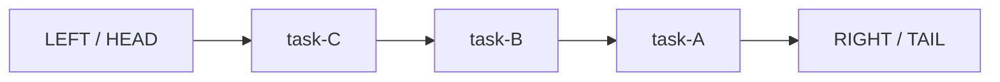
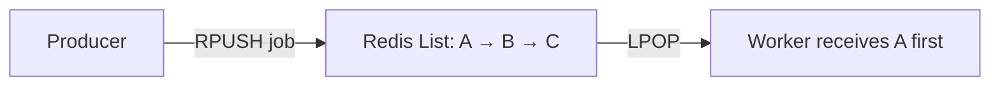
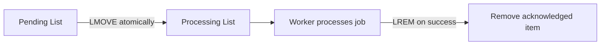

# Lesson 011 — Redis Lists

> **Section 02 — Data Types and Commands** | Beginner → Intermediate  
> **Goal:** Understand how Redis Lists work, their commands, blocking operations, performance, concurrency, and practical use in Node.js.

**Prerequisite:** [Lesson 010 — Redis Hashes](010-hashes.md)

## 1. What is a Redis List?

A Redis **List** is an ordered sequence of string elements. Duplicates are allowed. You can efficiently add or remove items from either end.

Think of a queue of support tickets or a history of recent notifications.



Redis Lists are implemented using internal structures optimized for sequences and operations at the ends; they are **not** JavaScript arrays, and random access deep inside a long List is not generally constant-time.

### When a List is useful

- Recent activity or notifications
- A bounded feed of recent events
- A simple producer–consumer work queue
- A stack (LIFO)
- A queue (FIFO)

**When it is not ideal:** Unique membership (use a Set), rankings (Sorted Set), field-value records (Hash), or durable message processing with acknowledgments and consumer groups (consider Redis Streams or BullMQ).

## 2. Create a List: LPUSH and RPUSH

Start with a clean demo key:

```redis
DEL demo:tasks
LPUSH demo:tasks "task-A"
LPUSH demo:tasks "task-B"
RPUSH demo:tasks "task-C"
LRANGE demo:tasks 0 -1
```

Result, from left to right:

```text
task-B
task-A
task-C
```

Why?

- `LPUSH` adds to the **left/head**.
- `RPUSH` adds to the **right/tail**.
- Both can add multiple values in one command.

```redis
DEL demo:numbers
RPUSH demo:numbers one two three
LRANGE demo:numbers 0 -1
```

Result: `one, two, three`.

**Remember:** `LPUSH key A B C` inserts each argument at the head, resulting in `C, B, A` when the List starts empty.

## 3. Read a List: LRANGE, LINDEX, LLEN

```redis
DEL demo:colors
RPUSH demo:colors red green blue yellow
```

### LRANGE — get a range

```redis
LRANGE demo:colors 0 -1
LRANGE demo:colors 0 1
LRANGE demo:colors -2 -1
```

- Index `0` is the first item.
- Index `-1` is the last item.
- **End index is inclusive**, unlike JavaScript `slice()`.

### LINDEX — read one position

```redis
LINDEX demo:colors 0
LINDEX demo:colors -1
```

### LLEN — count items

```redis
LLEN demo:colors
```

Expected: `4`.

### Complexity

- `LLEN`: O(1).
- `LRANGE`: O(S + N), where S is the distance to the starting element and N is the number returned.
- `LINDEX`: O(N) in general, though accessing elements near the ends is efficient.

**Production warning:** `LRANGE key 0 -1` can return an enormous response. Prefer bounded ranges for large Lists.

## 4. Remove items: LPOP and RPOP

```redis
DEL demo:queue
RPUSH demo:queue A B C
LPOP demo:queue
RPOP demo:queue
LRANGE demo:queue 0 -1
```

Step by step:

```text
Start: [A, B, C]
LPOP -> A, remaining [B, C]
RPOP -> C, remaining [B]
```

Redis also supports count forms in modern versions, such as `LPOP key 2`, to remove several items.

When the last element is removed, the List key disappears.

## 5. Stack vs Queue

A **stack** is LIFO: last in, first out.

```redis
DEL demo:stack
LPUSH demo:stack A
LPUSH demo:stack B
LPUSH demo:stack C
LPOP demo:stack
```

The result is `C`.

A **queue** is FIFO: first in, first out.

```redis
DEL demo:fifo
RPUSH demo:fifo A
RPUSH demo:fifo B
RPUSH demo:fifo C
LPOP demo:fifo
```

The result is `A`.



**Important:** A FIFO ordering of queued elements does not guarantee job completion order when multiple workers run concurrently.

## 6. Blocking operations: BLPOP and BRPOP

A worker polling repeatedly wastes requests:

```text
LPOP jobs -> nil
LPOP jobs -> nil
LPOP jobs -> nil
...
```

A blocking pop waits until an item becomes available:

```redis
BLPOP demo:jobs 0
```

The `0` timeout means wait indefinitely for an item. In another terminal:

```redis
RPUSH demo:jobs "send-email"
```

The waiting client receives the key name and popped value.

### Why this is useful

```mermaid
sequenceDiagram
    participant W as Worker
    participant R as Redis
    participant P as Producer
    W->>R: BLPOP jobs 0
    Note over W,R: Worker waits; Redis serves other clients
    P->>R: RPUSH jobs send-email
    R-->>W: jobs, send-email
```

**Crucial concept:** A blocking List command blocks the **waiting client**, not the entire Redis server.

### Timeouts

```redis
BLPOP demo:jobs 5
```

This waits up to approximately five seconds before returning nil if no item appears.

**Production caution:** Use a **dedicated connection** for blocking operations. Do not let a worker's indefinite `BLPOP` block ordinary application commands on the same client connection.

## 7. LMOVE and BLMOVE: move between Lists

`LMOVE source destination LEFT|RIGHT LEFT|RIGHT` atomically removes an element from one List and pushes it into another.

```redis
DEL demo:pending demo:processing
RPUSH demo:pending job-1 job-2
LMOVE demo:pending demo:processing LEFT RIGHT
LRANGE demo:pending 0 -1
LRANGE demo:processing 0 -1
```

This can be used for a basic **pending → processing** pattern.



`BLMOVE` is the blocking version and can wait for the source List to contain an item.

### Is this a complete reliable queue?

No. Moving an item to a processing List avoids losing it immediately on pop, but you still need:

- Recovery of jobs abandoned when a worker crashes
- Unique job IDs
- Duplicate handling / idempotency
- Retry policy and backoff
- Dead-letter handling
- Monitoring and stalled-job detection
- Acknowledgment and cleanup design

For production background jobs, a mature queue library such as BullMQ or Redis Streams consumer groups is often better. A List alone does **not** provide acknowledgments or automatic retries.

## 8. Edit and trim Lists

### LSET — replace an element at an index

```redis
DEL demo:items
RPUSH demo:items A B C
LSET demo:items 1 X
LRANGE demo:items 0 -1
```

Result: `A, X, C`. Setting an out-of-range index produces an error.

### LINSERT — insert before or after a pivot

```redis
LINSERT demo:items BEFORE X Y
LRANGE demo:items 0 -1
```

Result: `A, Y, X, C`.

### LREM — remove matching elements

```redis
DEL demo:letters
RPUSH demo:letters A B A C A
LREM demo:letters 2 A
LRANGE demo:letters 0 -1
```

Removes the first two `A` values scanning from head to tail.

- Positive count: from head.
- Negative count: from tail.
- Zero: all matching elements.

### LTRIM — keep a range

```redis
RPUSH demo:recent one two three four five
LTRIM demo:recent -3 -1
LRANGE demo:recent 0 -1
```

Only `three, four, five` remain.

**Use case:** Keep only the most recent 100 notifications:

```redis
LPUSH notifications:user:42 "new-notification"
LTRIM notifications:user:42 0 99
```

These are **two commands**, so concurrent producers can interleave. If strict atomicity of append-and-trim matters, use a Redis transaction or script.

## 9. List ordering and duplicates

```redis
DEL demo:duplicate
RPUSH demo:duplicate A A B A
LRANGE demo:duplicate 0 -1
```

Duplicates are preserved. A List is not a Set.

If your business requirement is **unique user IDs**, a Set may be a better fit. If your requirement is **ordered recent events**, a List is often more natural.

## 10. Time complexity and performance

| Command | Typical time complexity | Note |
| --- | --- | --- |
| `LPUSH`, `RPUSH` | O(1) per element | Efficient at ends |
| `LPOP`, `RPOP` | O(1) for one element | Efficient at ends |
| `LLEN` | O(1) | Fast count |
| `LINDEX` | O(N) | Deep random access can be costly |
| `LRANGE` | O(S+N) | Avoid unbounded reads |
| `LSET` | O(N) | Index traversal |
| `LINSERT` | O(N) | Find pivot |
| `LREM` | O(N+M) | Scan and remove |
| `LTRIM` | O(N) for removed elements | Often efficient when trimming a short tail |
| `LMOVE` | O(1) | Move one element between ends |

Complexities are command-level guides; network payloads, allocation, encoding, and element size also affect latency.

## 11. Node.js practical example: recent activity feed

Install:

```bash
npm install redis
```

Use ESM (`"type": "module"`).

```js
import { createClient } from "redis";

const redis = createClient({
  url: process.env.REDIS_URL ?? "redis://127.0.0.1:6379",
});
redis.on("error", (err) => console.error("Redis error:", err));

const activityKey = (userId) => `careerloop:activity:user:\${userId}`;

async function addActivity(userId, event) {
  const key = activityKey(userId);
  const serialized = JSON.stringify(event);

  // Execute both operations as one Redis transaction.
  await redis.multi()
    .lPush(key, serialized)
    .lTrim(key, 0, 99)
    .exec();
}

async function recentActivity(userId, limit = 10) {
  const safeLimit = Math.max(1, Math.min(100, Math.trunc(limit)));
  const items = await redis.lRange(activityKey(userId), 0, safeLimit - 1);
  return items.map((item) => JSON.parse(item));
}

try {
  await redis.connect();

  await addActivity(42, {
    id: "event-1",
    type: "APPLICATION_APPLIED",
    company: "Example Co",
    createdAt: new Date().toISOString(),
  });

  console.log(await recentActivity(42));
} finally {
  if (redis.isOpen) await redis.quit();
}
```

### Why use MULTI here?

It groups the append and trim so other Redis commands do not interleave between them during execution on the server. **This is not a transaction spanning PostgreSQL and Redis.** The authoritative activity history may still belong in your database.

### Security and consistency

- Validate the authenticated user ID, not a freely supplied user ID.
- Avoid storing sensitive personal data unnecessarily.
- Cache may disappear due to TTL, eviction, restart, or failure.
- For an auditable activity history, use a durable primary database.

## 12. Real-world queue example: email notifications

A producer might enqueue:

```redis
RPUSH jobs:email '{"jobId":"mail-101","type":"welcome","userId":42}'
```

A worker might consume:

```redis
BLPOP jobs:email 5
```

But once `BLPOP` returns the job, it is **already removed**. If the worker crashes before sending the email, the job can be lost.

That is why this simple pattern is best for learning or tasks where loss is acceptable. Use a reliable processing pattern for important work.

## 13. Common mistakes

1. **Thinking LPUSH always preserves argument order.** Multi-value `LPUSH` reverses the argument sequence at the head.
2. **Assuming Lists are unique.** They allow duplicates.
3. **Confusing FIFO with LIFO.** Pair `RPUSH` + `LPOP` for FIFO; `LPUSH` + `LPOP` for LIFO.
4. **Using LRANGE 0 -1 on huge Lists.** Limit result sizes.
5. **Assuming BLPOP blocks Redis globally.** It blocks only the waiting client.
6. **Sharing a blocking connection with API requests.** Use dedicated worker connections.
7. **Treating BLPOP as a durable queue.** Popped jobs can be lost on worker crash.
8. **Using List indexes like array indexes for large random-access workloads.** Middle access is not O(1).
9. **Forgetting Lists disappear when emptied.** `EXISTS` returns 0 after the last element is removed.
10. **Treating cached Lists as an authoritative event log.** Use durable storage when auditability matters.

## 14. Hands-on exercises

1. Create a List with `LPUSH` and explain its order.
2. Create a FIFO queue using `RPUSH` and `LPOP`.
3. Create a LIFO stack using `LPUSH` and `LPOP`.
4. Read first, last, and middle elements using `LINDEX`.
5. Keep only the last five items using `LTRIM`.
6. Insert a value before a pivot with `LINSERT`.
7. Remove duplicate entries using `LREM`.
8. Open two terminals and test `BLPOP` and `RPUSH`.
9. Move an item from pending to processing with `LMOVE`.
10. Explain what happens if a worker crashes after `BLPOP`.
11. Build a bounded notification feed in Node.js.
12. Compare Redis Lists, Streams, and BullMQ for email jobs.

## 15. Interview questions

**Q1. What is a Redis List?** An ordered sequence of string elements; duplicates are allowed.

**Q2. LPUSH vs RPUSH?** LPUSH adds at the head, RPUSH at the tail.

**Q3. How do you build a FIFO queue?** RPUSH to enqueue, LPOP to dequeue.

**Q4. How do you build a stack?** LPUSH and LPOP on the same end.

**Q5. What is BLPOP?** A blocking pop that waits for an element or timeout.

**Q6. Does BLPOP block Redis's event loop?** No; it blocks the requesting client while the server can process other commands.

**Q7. What does LRANGE 0 -1 do?** Returns all List elements, which can be expensive for a large List.

**Q8. Why use LMOVE?** To atomically transfer an item from one List to another.

**Q9. Is a List a reliable production job queue by itself?** No; acknowledgment, retry, stalled-job recovery, and monitoring need extra design.

**Q10. List vs Set?** List preserves order and duplicates; Set stores unique members without List-style order.

## 16. Revision checklist

- [ ] Ordered values and duplicates
- [ ] LPUSH / RPUSH
- [ ] LPOP / RPOP
- [ ] LRANGE / LINDEX / LLEN
- [ ] FIFO and LIFO
- [ ] BLPOP / BRPOP and dedicated connections
- [ ] LMOVE / BLMOVE
- [ ] LSET / LINSERT / LREM / LTRIM
- [ ] Complexity and bounded reads
- [ ] Simple queues vs reliable jobs
- [ ] Node.js activity feed and MULTI

---

**Previous:** [Lesson 010 — Redis Hashes](010-hashes.md)  
**Next:** [Lesson 012 — Redis Sets](012-sets.md)

**Official references:** [Redis Lists](https://redis.io/docs/latest/develop/data-types/lists/) · [LPUSH](https://redis.io/docs/latest/commands/lpush/) · [BLPOP](https://redis.io/docs/latest/commands/blpop/) · [LMOVE](https://redis.io/docs/latest/commands/lmove/)
