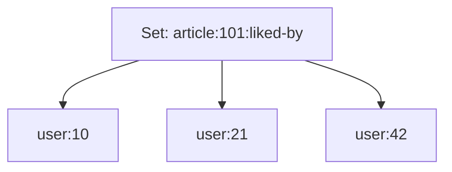
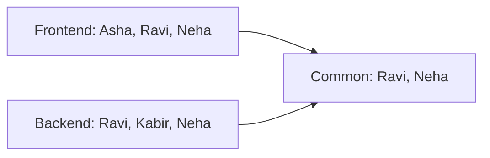
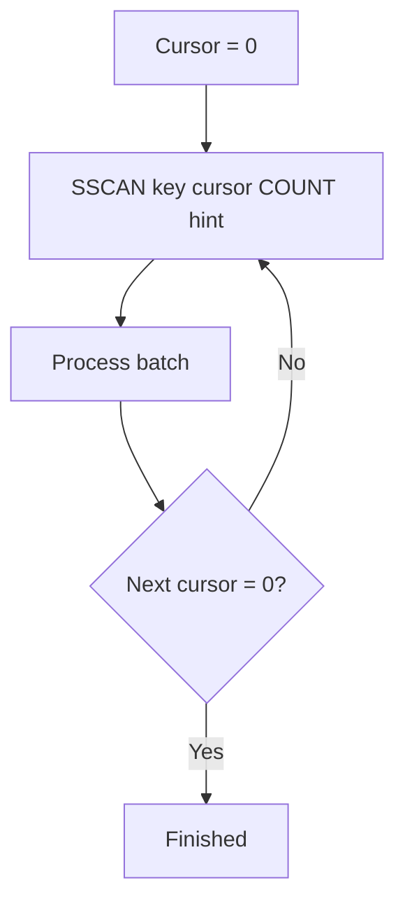
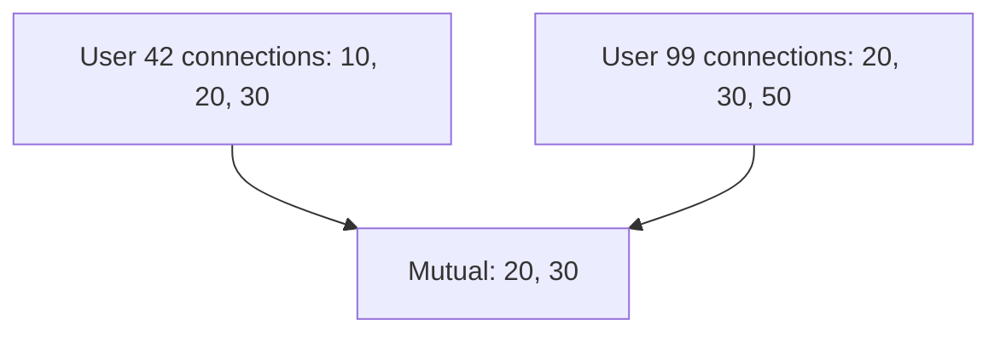

# Lesson 012 — Redis Sets

> **Section 02 — Data Types and Commands** | Beginner → Intermediate  
> **Goal:** Understand unique membership, Redis Set commands, mathematical Set operations, random selection, performance, and real-world Node.js applications.

**Prerequisite:** [Lesson 011 — Redis Lists](011-lists.md)

## 1. What is a Redis Set?

A Redis **Set** is an **unordered collection of unique string members**.



A user ID cannot appear twice in the same Set. Adding it again does not create a duplicate.

### Common use cases

- Unique users who liked a post
- Tags assigned to a product
- Users currently participating in a room
- Feature flags or permissions by membership
- Shared interests between users
- Deduplicating identifiers
- Set-based filtering and recommendations

### Set vs List

| Feature | Redis List | Redis Set |
| --- | --- | --- |
| Order | Ordered sequence | No guaranteed order |
| Duplicates | Allowed | Not allowed |
| Check whether item exists | Often requires scanning | Efficient membership lookup |
| Add at specific end | Yes | No meaningful ends |
| Mathematical union/intersection | Not built in | Yes |

**Important:** Do not depend on the order in which `SMEMBERS` displays results. The iteration order is not a stable business ordering.

## 2. SADD — add unique members

```redis
DEL demo:skills
SADD demo:skills React Node.js Redis
SADD demo:skills React PostgreSQL
SMEMBERS demo:skills
```

Members now include `React`, `Node.js`, `Redis`, and `PostgreSQL`.

The second `SADD` returns `1`, because only `PostgreSQL` is new.

**Key fact:** `SADD` returns the **number of new members added**, not the final Set size.

## 3. SMEMBERS, SISMEMBER, SMISMEMBER

### SMEMBERS — get all members

```redis
SMEMBERS demo:skills
```

The order is not guaranteed.

### SISMEMBER — check one member

```redis
SISMEMBER demo:skills React
SISMEMBER demo:skills Python
```

Results: `1` and `0` respectively.

### SMISMEMBER — check multiple members

```redis
SMISMEMBER demo:skills React Python Redis
```

Returns membership flags in the same order as the supplied members. This command requires a Redis version that supports it (introduced in Redis 6.2).

### Why membership is powerful

Instead of fetching every member and checking in JavaScript, you can ask Redis directly:

```redis
SISMEMBER article:101:liked-by user:42
```

This is efficient and avoids transferring the full Set.

## 4. SCARD — count unique members

```redis
SCARD demo:skills
```

Returns `4` for the example above.

Real-world example: Count unique users who liked a post.

```redis
SADD post:101:liked-by user:10 user:20 user:10
SCARD post:101:liked-by
```

Expected: `2`.

**Important:** A Set counts unique identifiers, not total actions. If you need every like/unlike event as an audit log, use a different durable data model.

## 5. SREM — remove members

```redis
SREM demo:skills Node.js
SMEMBERS demo:skills
```

`SREM` returns how many members were actually removed.

When the last member is removed, the Set key disappears:

```redis
SADD demo:one only
SREM demo:one only
EXISTS demo:one
```

Expected: `0`.

## 6. Set theory: Union, Intersection, Difference

Redis Set commands implement familiar mathematical operations.

Let:

```redis
DEL team:frontend team:backend
SADD team:frontend Asha Ravi Neha
SADD team:backend Ravi Kabir Neha
```



### SUNION — members in either Set

```redis
SUNION team:frontend team:backend
```

Result members: `Asha, Ravi, Neha, Kabir` (order unspecified).

Mathematically: **A ∪ B**.

### SINTER — members in both Sets

```redis
SINTER team:frontend team:backend
```

Result members: `Ravi, Neha`.

Mathematically: **A ∩ B**.

### SDIFF — members in first Set but not second

```redis
SDIFF team:frontend team:backend
```

Result: `Asha`.

Mathematically: **A − B**.

Reverse the arguments:

```redis
SDIFF team:backend team:frontend
```

Result: `Kabir`.

**Remember:** Set difference is **directional**.

## 7. Store results: SUNIONSTORE, SINTERSTORE, SDIFFSTORE

Instead of only returning a result, you can save it:

```redis
SINTERSTORE team:fullstack team:frontend team:backend
SMEMBERS team:fullstack
```

The destination key is replaced with the result. If the result is empty, the destination key may be removed.

Other commands:

```redis
SUNIONSTORE team:all team:frontend team:backend
SDIFFSTORE team:frontend-only team:frontend team:backend
```

**Production warning:** These commands can create large result Sets and consume substantial CPU and memory. In Redis Cluster, multi-key operations must obey hash-slot restrictions.

## 8. SINTERCARD — count common members without returning them

If you only need the **number** of shared members, a command such as `SINTERCARD` can avoid transferring all matching members.

```redis
SINTERCARD 2 team:frontend team:backend
```

Expected: `2`.

It is supported in Redis 7.0 and later. Check your deployment's version before using it.

Why useful? Suppose two large groups have thousands of overlapping users. Returning the entire intersection is unnecessary when your UI only needs a count.

## 9. Random selection: SRANDMEMBER and SPOP

### SRANDMEMBER — sample without removing

```redis
SRANDMEMBER demo:skills
```

Returns a random member while leaving the Set unchanged.

With a positive count, Redis returns up to that many **distinct** random members. With a negative count, the result can contain duplicates.

### SPOP — remove random members

```redis
SPOP demo:skills
```

This removes and returns a random member.

**Example use:** Randomly select an item for a noncritical demo. Do **not** assume `SRANDMEMBER` or `SPOP` provides cryptographically secure randomness for prizes, authentication, or security-sensitive decisions.

## 10. SMOVE — move membership atomically

```redis
DEL team:waiting team:active
SADD team:waiting user:42 user:99
SMOVE team:waiting team:active user:42
SMEMBERS team:waiting
SMEMBERS team:active
```

`SMOVE` atomically removes a member from one Set and adds it to another when the source contains the member.

Use case: Move a user from a waiting group to an active group.

**Caution:** This only updates Redis Sets. It does not automatically synchronize a PostgreSQL record or another external system.

## 11. SSCAN — iterate a large Set

```redis
SSCAN demo:skills 0 COUNT 10
```

The response includes a cursor and members. Continue until the cursor becomes `0`.



Important:

- `COUNT` is a hint, not an exact page size.
- A batch can be empty before iteration completes.
- Members may appear more than once during iteration.
- Concurrent modifications affect what a scan sees.
- A scan is not a consistent snapshot.
- Small compact Sets may be returned in one call.

**Never use SSCAN cursor values as permanent user-facing pagination tokens** without understanding these semantics.

## 12. Expiration of a Set

TTL applies to the **whole Set key**:

```redis
SADD online:room:42 user:1 user:2
EXPIRE online:room:42 60
TTL online:room:42
```

Adding or removing members with `SADD` / `SREM` generally preserves the key's existing TTL.

**Important limitation:** Set members do not have independent per-member TTLs in the normal Redis Set model.

For **online presence**, simply putting all users in a Set with one TTL is often insufficient: one stale user can remain while others refresh the Set. A robust presence design may use individual expiring keys, Sorted Sets with timestamps, or other cleanup logic.

## 13. Real-world example: post likes

Suppose users can like an article.

```redis
SADD article:101:liked-by user:42
SADD article:101:liked-by user:99
SADD article:101:liked-by user:42
SCARD article:101:liked-by
SISMEMBER article:101:liked-by user:42
```

Expected:

- Unique likes: `2`.
- User 42 liked it: `1`.

Unlike:

```redis
SREM article:101:liked-by user:42
```

### Concurrency advantage

Two duplicate `SADD` requests for the same member do not create duplicate membership.

### What a Set does *not* solve

- Who is authorized to like?
- Can a user like their own post?
- Should likes be durable after Redis loss?
- What happens if PostgreSQL and Redis disagree?
- How are likes audited?

Use Redis as a cache or specialized data structure when appropriate; design the authoritative data model separately.

## 14. Real-world example: mutual connections in CodeBuddy

Suppose a developer networking app stores cached connection IDs:

```redis
SADD connections:user:42 user:10 user:20 user:30
SADD connections:user:99 user:20 user:30 user:50
SINTER connections:user:42 connections:user:99
```

Result: `user:20` and `user:30` are mutual connections.



This is useful for recommendation features. For very large social graphs, consider cost, partitioning, authorization, and whether to precompute results.

## 15. Node.js example: membership and mutual connections

Install:

```bash
npm install redis
```

Use ESM (`"type": "module"`).

```js
import { createClient } from "redis";

const redis = createClient({
  url: process.env.REDIS_URL ?? "redis://127.0.0.1:6379",
});
redis.on("error", (err) => console.error("Redis error:", err));

const connectionKey = (userId) => `codebuddy:connections:user:\${userId}`;

async function addConnection(userId, connectedUserId) {
  return redis.sAdd(connectionKey(userId), String(connectedUserId));
}

async function hasConnection(userId, connectedUserId) {
  return redis.sIsMember(connectionKey(userId), String(connectedUserId));
}

async function getMutualConnections(userA, userB) {
  return redis.sInter([connectionKey(userA), connectionKey(userB)]);
}

try {
  await redis.connect();

  await addConnection(42, 20);
  await addConnection(42, 30);
  await addConnection(99, 30);
  await addConnection(99, 50);

  console.log("Connected?", await hasConnection(42, 20));
  console.log("Mutual:", await getMutualConnections(42, 99));
} catch (error) {
  console.error("Redis operation failed:", error.message);
  process.exitCode = 1;
} finally {
  if (redis.isOpen) await redis.quit();
}
```

### Production design notes

- Authenticate and authorize the requesting user before exposing connections.
- Do not trust a client-supplied user ID as proof of identity.
- Define how Redis cache is populated and invalidated after database changes.
- Avoid unbounded intersections on huge Sets in latency-sensitive requests.
- Redis Cluster may reject cross-slot multi-key Set operations; use a deliberate hash-slot strategy or another approach.
- Reuse managed Redis connections.

## 16. Performance and complexity

| Command | Typical complexity | Explanation |
| --- | --- | --- |
| `SADD` | O(N) for N added members | Membership insertion is efficient per member |
| `SREM` | O(N) for N removed members | Efficient per member |
| `SISMEMBER` | O(1) average | Fast membership lookup |
| `SCARD` | O(1) | Count unique members |
| `SMEMBERS` | O(N) | Returns entire Set |
| `SINTER` | Depends on Set sizes and count | May be expensive for large inputs |
| `SUNION` | Depends on total input members | May create large output |
| `SDIFF` | Depends on input sizes | Direction matters |
| `SSCAN` | Incremental per call | Full iteration still requires work |

**Important:** Complexity is not the only cost. Network transfer, memory allocation, cluster placement, and response size also matter.

## 17. Set vs Sorted Set vs HyperLogLog

| Requirement | Choose | Why |
| --- | --- | --- |
| Exact unique members and membership checks | Set | Stores identifiable unique members |
| Ordered ranking by score | Sorted Set | Score-based ordering |
| Approximate distinct count at low memory cost | HyperLogLog | Does not store exact membership for querying |
| Ordered events with duplicates | List or Stream | Preserves sequence |
| Tags or permissions | Set | Fast unique membership |

**Example:** If you need to know exactly *which* users liked a post, use a Set (or durable database). If you only need an approximate count of millions of unique visitors, HyperLogLog may use much less memory.

## 18. Common mistakes

1. **Assuming Set iteration order is stable.** Redis Sets are unordered.
2. **Using a List when unique membership is required.** Sets automatically deduplicate.
3. **Using SMEMBERS on massive Sets in API endpoints.** Fetching all members can be expensive.
4. **Assuming SADD returns total Set size.** It returns newly added member count.
5. **Confusing SUNION with SINTER.** Union means either; intersection means both.
6. **Forgetting SDIFF direction.** A − B differs from B − A.
7. **Assuming each Set member has a TTL.** Normal Set TTL is key-level.
8. **Using Set membership as authorization without verifying identity and permissions.**
9. **Assuming Redis Set operations span PostgreSQL transactions.** They do not.
10. **Using random Set selection for security-sensitive randomness.**
11. **Ignoring Redis Cluster cross-slot restrictions.**
12. **Assuming SSCAN gives a consistent snapshot or perfect pagination.**

## 19. Hands-on exercises

Use a disposable local Redis instance.

1. Add five skills to a Set, including a duplicate. Check `SCARD`.
2. Use `SISMEMBER` to test present and absent skills.
3. Remove a skill using `SREM`.
4. Create two groups and calculate union, intersection, and both differences.
5. Save their intersection using `SINTERSTORE`.
6. Use `SRANDMEMBER` and verify the Set size does not change.
7. Use `SPOP` and verify the Set size decreases.
8. Move a user between Sets with `SMOVE`.
9. Set a TTL on a Set, add another member, and inspect whether the TTL remains.
10. Iterate a Set using `SSCAN`.
11. Build the post-like feature using Node.js.
12. Explain why a Set alone is insufficient for reliable online-presence expiry.

## 20. Interview questions

**Q1. What is a Redis Set?** An unordered collection of unique string members.

**Q2. Does SADD create duplicates?** No. Existing members remain single entries.

**Q3. What does SADD return?** Number of newly added members.

**Q4. SISMEMBER vs SMEMBERS?** SISMEMBER checks one member; SMEMBERS returns the whole Set.

**Q5. SUNION vs SINTER?** Union returns members in any input Set; intersection returns members common to all.

**Q6. Is SDIFF directional?** Yes. The first Set is the starting set from which other members are excluded.

**Q7. SRANDMEMBER vs SPOP?** SRANDMEMBER samples without removing; SPOP removes.

**Q8. How do you count unique members exactly?** `SCARD` on a Set that stores those members.

**Q9. Can Set members have independent TTLs?** Not in the standard Set model; TTL applies to the whole key.

**Q10. Why might a large SINTER be expensive?** It must examine input membership and potentially return a large result.

**Q11. When choose a Sorted Set?** When members need score-based ranking or ordered range queries.

**Q12. What is a limitation of SSCAN?** Iteration can include duplicates and is not a consistent snapshot under concurrent modification.

## 21. Revision checklist

- [ ] Unique unordered membership
- [ ] `SADD`, `SREM`, `SCARD`
- [ ] `SISMEMBER`, `SMISMEMBER`
- [ ] `SMEMBERS` vs `SSCAN`
- [ ] `SUNION`, `SINTER`, `SDIFF`
- [ ] `SUNIONSTORE`, `SINTERSTORE`, `SDIFFSTORE`
- [ ] `SINTERCARD` and version compatibility
- [ ] `SRANDMEMBER` vs `SPOP`
- [ ] `SMOVE`
- [ ] Whole-key TTL
- [ ] Node.js membership and mutual connections
- [ ] Set vs List vs Sorted Set vs HyperLogLog

---

**Previous:** [Lesson 011 — Redis Lists](011-lists.md)  
**Next:** [Lesson 013 — Redis Sorted Sets](013-sorted-sets.md) (planned)

**Official references:** [Redis Sets](https://redis.io/docs/latest/develop/data-types/sets/) · [SADD](https://redis.io/docs/latest/commands/sadd/) · [SINTER](https://redis.io/docs/latest/commands/sinter/) · [SSCAN](https://redis.io/docs/latest/commands/sscan/) · [SINTERCARD](https://redis.io/docs/latest/commands/sintercard/)
