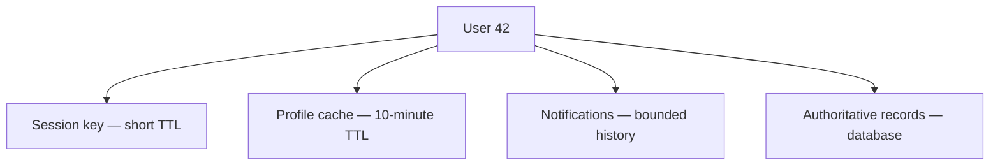
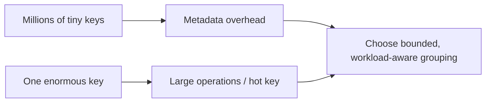
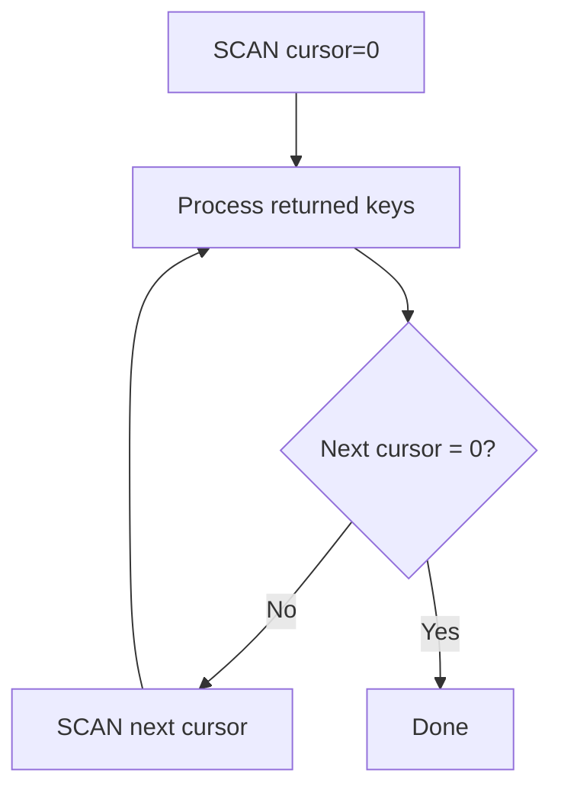
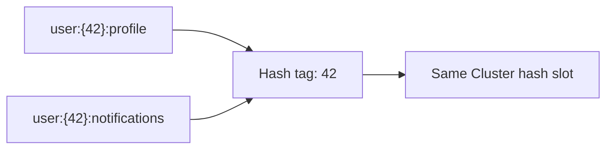

# Lesson 019 — Redis Key Design

> **Section 03 — Keys, Memory and Internals** | Beginner → Advanced  
> **Goal:** Design predictable, safe, maintainable Redis keys for production applications.

**Previous:** [Lesson 018 — Choosing the Right Redis Data Type](../02-data-types/018-data-type-selection.md)  
**Next:** [Lesson 020 — TTL and Eviction](020-ttl-eviction.md)

## 1. Why key design matters

A Redis key is more than a label. Its design affects:
- Finding and debugging data.
- Avoiding accidental collisions.
- Data ownership and tenant isolation.
- Expiration and retention.
- Memory consumption.
- Redis Cluster placement.
- Safe deployment and migrations.

Compare:

```text
user42
cache42
abc123
```

with:

```text
app:prod:user:42:profile
app:prod:company:101:cache
app:prod:session:7e3... 
```

The second approach communicates purpose, environment, and identity.

**Rule:** Choose a consistent convention before adding hundreds of keys.

## 2. Redis key fundamentals

Redis is a key-value database. Every key has:
- A **name** (binary-safe String).
- A **type** (String, Hash, List, Set, Sorted Set, Stream, etc.).
- An optional **expiration**.
- A value.

```redis
SET demo:welcome hello
TYPE demo:welcome
EXISTS demo:welcome
TTL demo:welcome
```

Key names are binary-safe, but ordinary applications should use readable, predictable text names. Redis keys can be very long, but long keys increase memory and network overhead.

### Key names vs Hash fields

```redis
HSET user:42 name Asha city Bengaluru
```

Here:
- `user:42` is **one Redis key**.
- `name` and `city` are **fields**, not top-level Redis keys.

That distinction matters for `EXPIRE`, `SCAN`, and key counts.

## 3. A naming convention that scales

A useful pattern:

```text
<app>:<environment>:<domain>:<entity-id>:<purpose>[:<version>]
```

Examples:

```text
careerloop:prod:user:42:dashboard:v1
careerloop:prod:application:981:cache
careerloop:prod:recruiter:27:profile
codebuddy:prod:user:42:connections
codebuddy:prod:chat:room:108:unread
```

You do not need every segment for every key. The important property is **consistency**.

### Why colons?

Colons are a convention for readability, not a special hierarchy built into Redis. Redis treats the whole name as one key.

```text
user:42:profile
```

is not a folder, and Redis does not automatically relate it to `user:42`.

## 4. Designing by access pattern

Start with the question your application asks.

### Requirement A: cache a company profile

```redis
SET careerloop:prod:company:101:profile "{\"name\":\"Example Co\"}" EX 600
```

Read:

```redis
GET careerloop:prod:company:101:profile
```

The key is specific and expires after 10 minutes.

### Requirement B: track a user's saved jobs

```redis
SADD careerloop:prod:user:42:saved-jobs job:101 job:102
SISMEMBER careerloop:prod:user:42:saved-jobs job:101
```

### Requirement C: count API requests in a fixed window

```text
ratelimit:prod:user:42:minute:2026-10-21T09:30
```

Window identity belongs in the key so each time window can expire independently.

**Important:** A counter with `INCR` followed by `EXPIRE` is two commands. If setting the TTL must be race-free, use an appropriate transaction or Lua script.

### Requirement D: event history

```text
orders:prod:events
```

A Stream can hold many events under a single key. Do not create a new Stream key for every event unless your access and retention requirements demand it.

## 5. Keys should reflect ownership and lifecycle

Consider these:

```text
user:42:session
user:42:profile-cache
user:42:notifications
```

They may look related, but their lifetimes differ:

| Key | Typical owner | Retention |
| --- | --- | --- |
| Session | Authentication service | Short-lived |
| Profile cache | Profile service | Minutes |
| Notifications | Notification service | Bounded or persistent |
| Audit records | Primary database | Long-lived and governed |

Do not combine unrelated data with different expiration rules into one value merely because it belongs to the same user.



## 6. Namespaces and environment separation

Use distinct Redis deployments/databases for strong environment isolation when possible.

Namespacing is still useful:

```text
careerloop:dev:company:101:cache
careerloop:staging:company:101:cache
careerloop:prod:company:101:cache
```

**Security warning:** Prefixes are not an authorization boundary. A client with broad access can still read or modify other prefixes. Use network restrictions, Redis ACLs, and separate credentials or instances as appropriate.

### Multi-tenant applications

```text
app:prod:tenant:acme:user:42:cache
app:prod:tenant:globex:user:42:cache
```

Derive tenant identity from trusted authentication context, not from an unchecked request parameter.

Even with tenant-prefixed keys, enforce authorization in the application and Redis permissions.

## 7. Avoid key collisions and type conflicts

A bad design:

```redis
SET user:42 "Asha"
HSET user:42 name Asha
```

The second command fails with `WRONGTYPE` because `user:42` already holds a String.

Prefer purpose-specific names:

```text
user:42:display-name
user:42:profile
user:42:connections
```

### Schema changes and versions

If a cache representation changes:

```text
company:101:summary:v1
company:101:summary:v2
```

Versioned names can prevent old and new deployments from interpreting incompatible cached data.

**Trade-off:** Versioning also creates old keys. Give them TTLs or plan cleanup.

## 8. How long should keys be?

Redis stores key names in memory. For millions of keys, even a few extra bytes per key add up.

```text
Very verbose:
application:careerloop:production:companies:company-id:101:profile-cache

More compact:
cl:prod:company:101:profile
```

Prefer names that are **short enough to be efficient but clear enough to debug**.

Avoid cryptic abbreviations that require a private decoder.

### Approximate memory reasoning

If an unnecessary suffix adds 20 bytes to each of 1,000,000 keys, the raw name bytes alone add approximately 20 MB, before allocator and metadata effects.

Use `MEMORY USAGE` on representative keys to measure real memory, not just character counts.

## 9. High-cardinality keys and key explosion

A design can create too many keys:

```text
analytics:request:<every-request-uuid>
```

One key per request can produce millions of keys, expensive metadata, and operational overhead.

Alternative designs:
- Aggregate counters into Strings.
- Store related fields in a Hash.
- Use Streams for event sequences.
- Use HyperLogLog for approximate distinct counts.
- Retain authoritative event records in a suitable database.

But **do not blindly pack everything into one giant key**: huge collections can cause costly operations and create hot keys.



## 10. Safe key discovery: SCAN vs KEYS

### KEYS

```redis
KEYS careerloop:prod:*
```

`KEYS` scans the keyspace and can block Redis for significant time on a large production dataset.

**Do not use `KEYS` in production request paths.**

### SCAN

```redis
SCAN 0 MATCH careerloop:prod:* COUNT 100
```

Redis returns:
1. A **next cursor**.
2. A batch of matching keys.

Continue with the returned cursor until it becomes `0`.



**Important SCAN rules:**
- `COUNT` is a hint, not an exact batch size.
- A call may return zero matching keys even before iteration finishes.
- Keys can appear more than once; make processing idempotent.
- Concurrent additions/deletions affect results.
- `SCAN` is not a snapshot.
- Avoid expensive processing or mass deletion in one unbounded loop.

### TYPE filter

Modern Redis supports a `TYPE` filter:

```redis
SCAN 0 MATCH careerloop:prod:* TYPE string COUNT 100
```

This filters by Redis top-level data type.

## 11. Safe deletion: DEL vs UNLINK

```redis
DEL demo:welcome
```

`DEL` removes keys synchronously; freeing a very large value can require work.

```redis
UNLINK large:temporary:key
```

`UNLINK` detaches the key and performs memory reclamation asynchronously where possible. It can reduce latency impact for large deletions.

**Important:** `UNLINK` does not make a broad, careless deletion safe. Always verify which keys will be removed.

### Prefix cleanup workflow

1. Identify the exact environment and prefix.
2. Scan matching keys.
3. Review the list and expected count.
4. Delete in small batches, ideally during a safe maintenance window.
5. Monitor latency and memory.

Never use an unchecked user-provided prefix to delete arbitrary Redis keys.

## 12. TTL is part of key design

```redis
SET cache:company:101 "cached-data" EX 600
TTL cache:company:101
PTTL cache:company:101
PERSIST cache:company:101
```

- `TTL`: remaining expiration in seconds.
- `PTTL`: remaining expiration in milliseconds.
- `PERSIST`: remove expiration, making the key persistent unless later changed.

`TTL` returns:
- `-2` when the key does not exist.
- `-1` when it exists without expiration.

### Expiration traps

```redis
SET demo:token abc EX 60
SET demo:token xyz
TTL demo:token
```

The ordinary second `SET` removes the TTL.

To preserve it:

```redis
SET demo:token xyz KEEPTTL
```

**Key point:** Redis TTL generally applies to a whole key, not each List item, Set member, Sorted Set member, or Stream entry. Newer Redis versions have specialized hash-field expiration; verify compatibility.

## 13. Redis Cluster hash slots and hash tags

Redis Cluster partitions keys across **16,384 hash slots**.

Normally, a key's slot is derived from its name.

```text
user:42:profile
user:42:notifications
```

These keys might live in different slots.

Some multi-key commands and transactions require all participating keys to be in the **same slot**.

### Hash tags

Use matching braces to control which part of the key is hashed:

```text
user:{42}:profile
user:{42}:notifications
```

Both use `42` as the hash tag, so they map to the same hash slot.



### Why not tag everything with the same value?

```text
user:{all}:profile:42
user:{all}:profile:99
```

This can concentrate too much traffic and data in one slot, reducing Cluster distribution.

**Rule:** Use hash tags intentionally for required multi-key operations, not as a default for all keys.

### Check the slot

```redis
CLUSTER KEYSLOT user:{42}:profile
CLUSTER KEYSLOT user:{42}:notifications
```

These commands are intended for Cluster-enabled deployments.

## 14. Hot keys and skewed traffic

A **hot key** receives a disproportionate amount of traffic.

Example:

```text
cache:homepage:global
```

Millions of clients reading the same key can stress one Redis shard or network path.

Possible mitigations:
- Application-side caching for suitable data.
- Request coalescing.
- Replicas for read-heavy workloads when consistency permits.
- Controlled sharding or data duplication.
- Avoiding expensive full-value reads.

Do not split keys arbitrarily without measuring workload and understanding consistency implications.

## 15. Security and privacy in key names

Redis key names can appear in:
- Debug output.
- Monitoring tools.
- Logs.
- Operational dashboards.
- Backups.

Avoid embedding secrets or sensitive personal information in names:

```text
Bad:
session:actual-jwt-token
user:person@example.com:reset-password
```

Better:

```text
session:<opaque-random-id>
password-reset:<nonreversible-token-digest>
```

Use appropriately random identifiers and safe token storage practices. Do not assume hashing alone solves every security issue.

## 16. Node.js example: consistent key builders

Install:

```bash
npm install redis
```

Use ESM (`"type": "module"`).

```js
import { createClient } from "redis";

const redis = createClient({
  url: process.env.REDIS_URL ?? "redis://127.0.0.1:6379",
});

redis.on("error", (err) => console.error("Redis error:", err.message));

const APP = "careerloop";
const ENV = process.env.APP_ENV ?? "dev";

function safeId(id) {
  const value = String(id);
  if (!/^[a-zA-Z0-9_-]{1,64}$/.test(value)) {
    throw new Error("Invalid key identifier");
  }
  return value;
}

const keys = {
  companyProfile: (companyId) =>
    `\${APP}:\${ENV}:company:\${safeId(companyId)}:profile:v1`,
  savedJobs: (userId) =>
    `\${APP}:\${ENV}:user:\${safeId(userId)}:saved-jobs`,
};

try {
  await redis.connect();

  const companyKey = keys.companyProfile(101);
  await redis.set(
    companyKey,
    JSON.stringify({ id: 101, name: "Example Co" }),
    { EX: 600 },
  );

  const raw = await redis.get(companyKey);
  console.log("Cached company:", raw ? JSON.parse(raw) : null);

  const savedKey = keys.savedJobs(42);
  await redis.sAdd(savedKey, ["job:101", "job:102"]);
  console.log("Saved?", await redis.sIsMember(savedKey, "job:101"));
} catch (err) {
  console.error("Operation failed:", err.message);
  process.exitCode = 1;
} finally {
  if (redis.isOpen) await redis.quit();
}
```

**Production notes:**
- Validate `APP_ENV` and configuration, not only IDs.
- Derive user and tenant IDs from authenticated context.
- Avoid exposing arbitrary key names through public APIs.
- Document which keys are cache-only and which require recovery.

## 17. Common mistakes

1. Using inconsistent names such as `user42`, `user:42`, and `u-42`.
2. Mixing unrelated data with different TTL requirements in one key.
3. Assuming prefixes provide access control.
4. Forgetting that Hash fields are not separate Redis keys.
5. Creating millions of one-off keys without retention.
6. Creating a single enormous key that becomes a bottleneck.
7. Running `KEYS *` in production request paths.
8. Treating `SCAN` as a consistent snapshot.
9. Deleting huge values synchronously without considering latency.
10. Accidentally clearing TTL with `SET`.
11. Ignoring Redis Cluster hash slots for multi-key operations.
12. Putting all keys into one hash slot.
13. Embedding passwords, tokens, or emails in key names.
14. Forgetting migration cleanup after changing key formats.

## 18. Exercises

1. Design keys for user profiles, sessions, notifications, and saved jobs.
2. Add `dev`, `staging`, and `prod` namespaces.
3. Create a versioned cache key.
4. Compare `TTL` before and after an ordinary `SET`.
5. Repeat using `KEEPTTL`.
6. Scan a demo namespace using cursor iteration.
7. Explain why `KEYS *` is risky in production.
8. Test `UNLINK` on a disposable demo key.
9. Design two Cluster keys that share a hash tag.
10. Explain why all keys should not share one hash tag.
11. Identify personal data leaking through a proposed key name.
12. Build a reusable key-builder module for a Node.js API.

## 19. Interview questions

**Q1. Why does Redis key naming matter?** It affects maintainability, debugging, memory, safety, and Cluster behavior.

**Q2. Are colon-separated keys hierarchical?** No. Colons are a naming convention.

**Q3. Is a Hash field a Redis key?** No. The Hash itself is the key.

**Q4. KEYS vs SCAN?** KEYS can block on large datasets; SCAN supports incremental iteration with caveats.

**Q5. Does SCAN guarantee no duplicates?** No.

**Q6. DEL vs UNLINK?** DEL frees synchronously; UNLINK can reclaim memory asynchronously.

**Q7. What does TTL -1 mean?** The key exists but has no expiration.

**Q8. Why use key versions?** To separate incompatible cache representations during deployments.

**Q9. What are Cluster hash tags?** Brace-delimited portions used to colocate keys in the same hash slot.

**Q10. Are prefixes a security boundary?** No; use Redis ACLs and proper isolation.

## 20. Revision checklist

- [ ] Consistent namespace convention
- [ ] Key ownership and lifecycle
- [ ] Environment and tenant separation
- [ ] Key collisions and type conflicts
- [ ] Key length and cardinality
- [ ] `SCAN` vs `KEYS`
- [ ] `DEL` vs `UNLINK`
- [ ] TTL and `KEEPTTL`
- [ ] Cluster hash tags
- [ ] Hot keys
- [ ] Key-name security
- [ ] Node.js key builders

---

**Official references:** [Redis keyspace](https://redis.io/docs/latest/develop/using-commands/keyspace/) · [SCAN](https://redis.io/docs/latest/commands/scan/) · [UNLINK](https://redis.io/docs/latest/commands/unlink/) · [Redis Cluster specification](https://redis.io/docs/latest/operate/oss_and_stack/reference/cluster-spec/)
