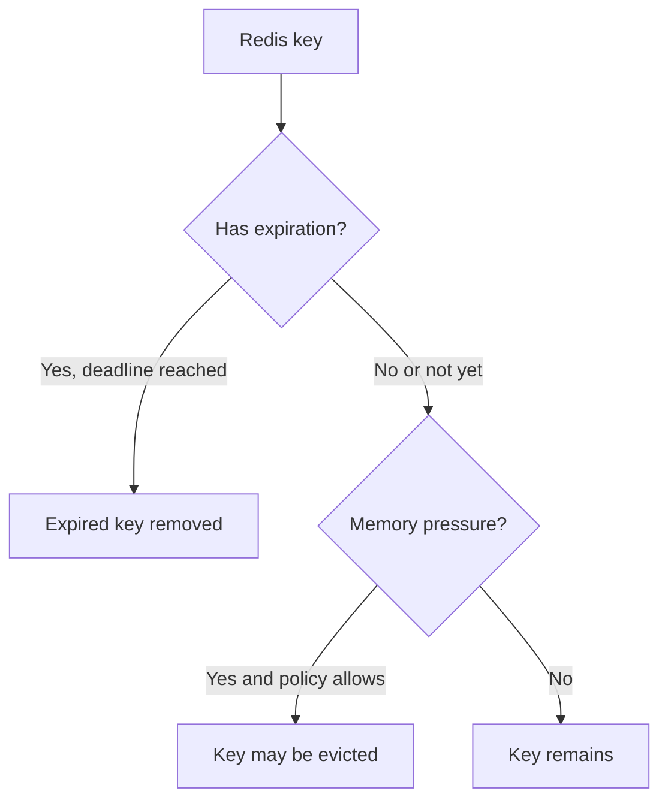
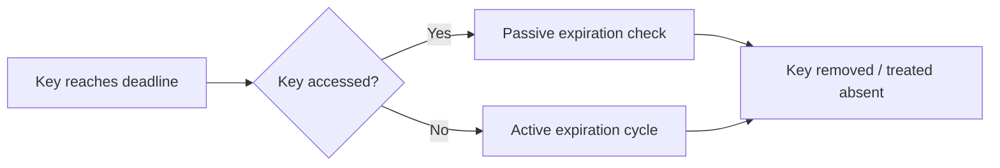
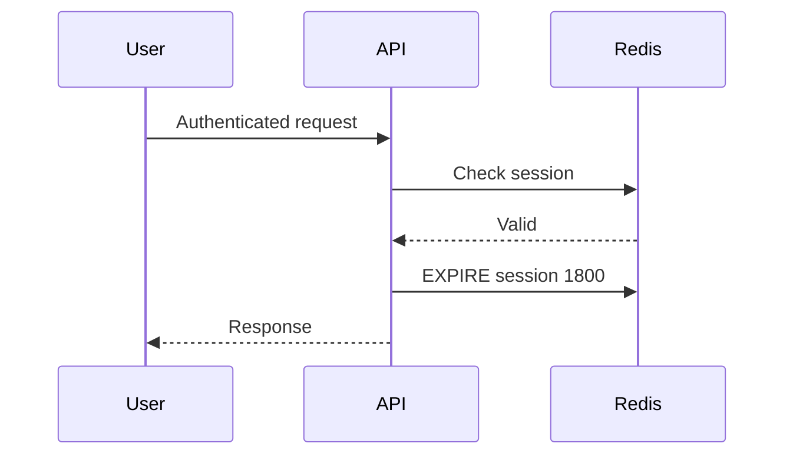
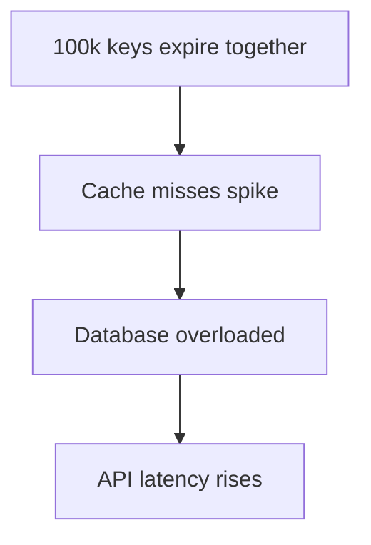
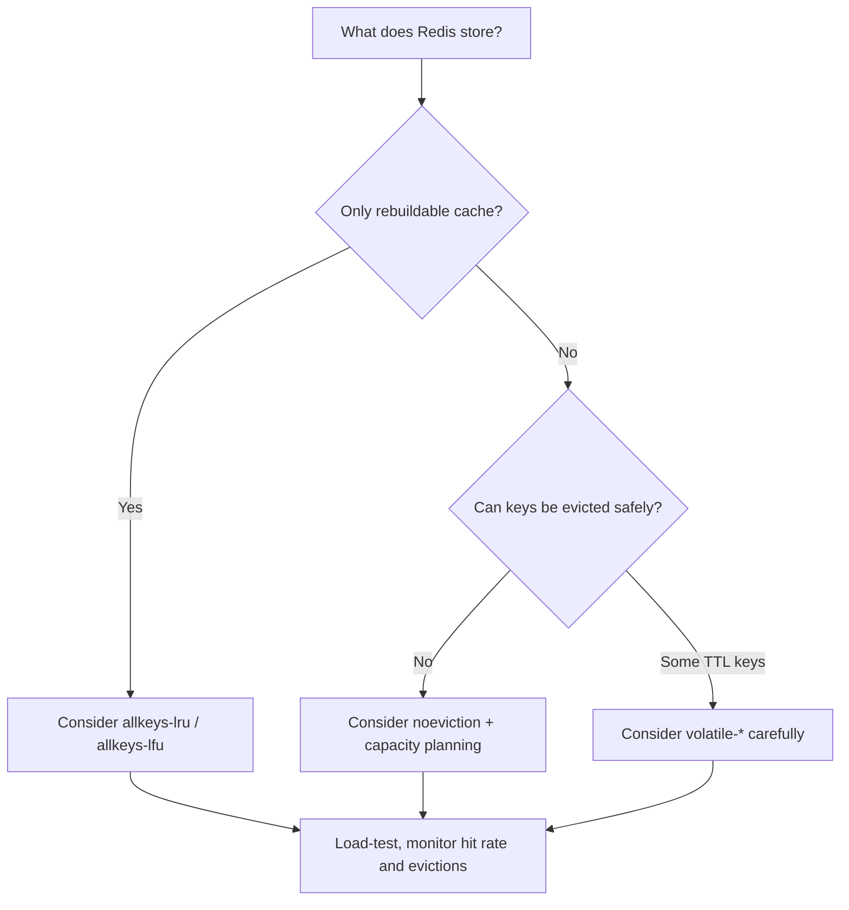
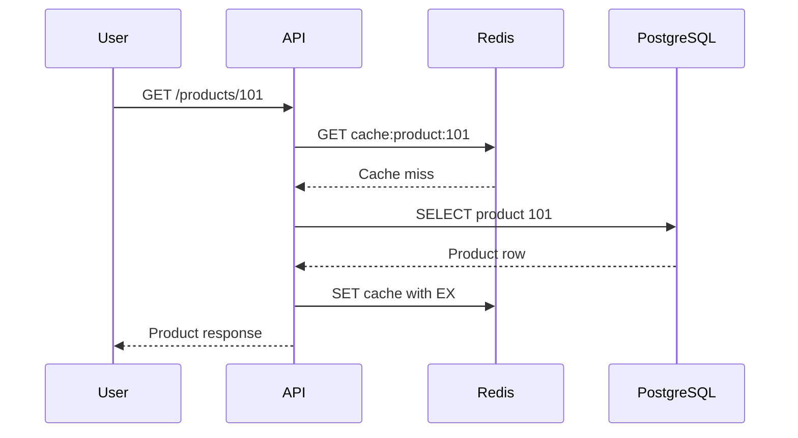

# Lesson 020 — Redis TTL and Eviction

> **Section 03 — Keys, Memory and Internals** | Beginner → Advanced  
> **Goal:** Understand expiration, eviction, memory limits, cache reliability, and how to configure Redis safely in production.

**Previous:** [Lesson 019 — Redis Key Design](019-key-design.md)  
**Next:** [Lesson 021 — Redis Memory Encodings](021-memory-encodings.md)

## 1. TTL and eviction are different concepts

These two mechanisms both remove keys, but for **different reasons**.

**TTL (time to live):** Remove a key after its configured expiration time.

**Eviction:** Remove keys according to a memory policy when Redis needs to free memory to satisfy its configured memory limit.



A key can be:
- **Expired** even if plenty of memory is available.
- **Evicted** before its TTL ends.
- **Persistent** (no TTL) but still evictable under some policies.
- **Protected from eviction** under certain policies, but not immune to Redis crashes or administrative deletion.

**Never assume a cache key exists until its TTL ends.**

## 2. Set a TTL when writing a key

### SET with EX — seconds

```redis
SET cache:product:101 "{\"name\":\"Keyboard\"}" EX 600
```

The key expires after 600 seconds (10 minutes).

### SET with PX — milliseconds

```redis
SET otp:demo:42 "123456" PX 30000
```

The key expires after 30,000 milliseconds (30 seconds).

**Security note:** This OTP is a teaching example. Production OTP handling needs secure generation, rate limits, appropriate storage, verification logic, and abuse protection.

### EXPIRE — set TTL on an existing key

```redis
SET demo:temporary hello
EXPIRE demo:temporary 60
```

### PEXPIRE — milliseconds

```redis
PEXPIRE demo:temporary 1500
```

### Absolute expiration

```redis
EXPIREAT demo:temporary 1893456000
PEXPIREAT demo:temporary 1893456000000
```

These use absolute Unix timestamps in seconds or milliseconds, respectively.

**Important:** Absolute expiry depends on wall-clock time. System clock changes can affect expiration behavior.

## 3. Read TTL and understand return values

```redis
TTL demo:temporary
PTTL demo:temporary
```

- `TTL`: remaining lifetime in seconds.
- `PTTL`: remaining lifetime in milliseconds.

Both use special values:

| Result | Meaning |
| --- | --- |
| Positive integer | Remaining lifetime |
| `-1` | Key exists, but has no expiration |
| `-2` | Key does not exist |

Try:

```redis
DEL demo:missing
TTL demo:missing
SET demo:persistent value
TTL demo:persistent
EXPIRE demo:persistent 60
TTL demo:persistent
```

### Expiration timestamps

Modern Redis supports:

```redis
EXPIRETIME demo:temporary
PEXPIRETIME demo:temporary
```

These return the configured absolute expiration time in seconds or milliseconds, with special values for missing or persistent keys.

## 4. PERSIST — remove a TTL

```redis
SET demo:remember-me yes EX 60
PERSIST demo:remember-me
TTL demo:remember-me
```

Expected TTL: `-1`.

The key now has no expiration.

**Warning:** Removing TTL accidentally from millions of cache keys can cause uncontrolled memory growth.

## 5. A very common trap: SET resets expiration

```redis
SET demo:token abc EX 60
TTL demo:token
SET demo:token xyz
TTL demo:token
```

After the ordinary second `SET`, the key is persistent, so TTL returns `-1`.

### Preserve TTL with KEEPTTL

```redis
SET demo:token abc EX 60
SET demo:token xyz KEEPTTL
TTL demo:token
```

### Overwrite and set a fresh TTL

```redis
SET demo:token xyz EX 60
```

### Updating data without removing key TTL

Commands such as `INCR`, `HSET`, and `LPUSH` normally preserve an existing key expiration. A command that replaces the key's entire value, such as plain `SET`, generally clears it.

**Always test TTL behavior for the exact commands you use.**

## 6. EXPIRE conditions: NX, XX, GT, LT

Modern Redis supports conditional expiration updates.

```redis
SET demo:conditional hello
EXPIRE demo:conditional 60 NX
```

- `NX`: set expiration only if key has no existing expiration.
- `XX`: set expiration only if key already has expiration.
- `GT`: set only if new deadline is later than current deadline.
- `LT`: set only if new deadline is earlier than current deadline.

Examples:

```redis
EXPIRE demo:conditional 120 GT
EXPIRE demo:conditional 30 LT
```

**Subtlety:** For `GT` and `LT`, a key with no TTL is treated as having an infinite expiration deadline. Thus, `GT` does not add an expiration to a persistent key, while `LT` can.

Version support matters: verify your Redis server version before using these options.

## 7. What happens when TTL reaches zero?

Redis does not need to scan every key continuously at every instant.

Redis uses two broad expiration approaches:

### Passive expiration

When a client accesses a key, Redis can check whether it has expired and treat it as absent.

### Active expiration

Redis periodically samples keys with expiration and removes expired ones to reclaim memory even if nobody reads them.



**Important:** The logical expiration deadline is not a promise that memory is reclaimed at the exact millisecond. Expired keys can occupy memory briefly before active cleanup.

## 8. Expiration is key-level, not normally member-level

```redis
SADD saved:jobs job:101 job:102
EXPIRE saved:jobs 60
```

After expiration, the **entire Set** disappears.

Similarly:
- A List's items do not each get independent TTLs.
- A Sorted Set's members do not each get independent TTLs.
- Stream entries do not individually expire because of key TTL.
- Hash fields traditionally share key-level TTL, though newer Redis versions provide hash-field expiration commands; check compatibility.

### Need individual item deadlines?

Options include:
- Separate keys with their own TTL.
- A Sorted Set where scores represent deadlines, plus cleanup logic.
- Specialized field-expiration support where available.
- A database or queue system suited to the requirement.

**A Sorted Set with timestamps does not automatically remove expired members.** You must query and remove them or use a worker.

## 9. TTL patterns in real applications

| Use case | Example TTL | Why |
| --- | --- | --- |
| Public product cache | 5–15 minutes | Balance freshness and database load |
| Dashboard summary | 30–120 seconds | Frequent updates |
| Login session | Based on security policy | Bound session lifetime |
| OTP | Short, security-controlled | Reduce exposure window |
| Rate-limit window | Slightly longer than window | Cleanup old counters |
| Negative cache | Short | Avoid repeated misses without stale long-term absence |
| Feature configuration cache | Depends on update frequency | Avoid excessive reads |

These are **illustrative**, not universal recommendations. TTL must follow the application's correctness, security, and freshness requirements.

## 10. Sliding expiration vs fixed expiration

### Fixed TTL

A key expires a fixed duration after creation.

```redis
SET session:demo active EX 1800
```

Reading it does not automatically extend the TTL.

### Sliding TTL

Every qualifying user activity extends the deadline:

```redis
EXPIRE session:demo 1800
```

This must be done explicitly in application logic.



**Security trade-off:** Sliding expiration can keep a session alive indefinitely if activity continues. Many applications also enforce an **absolute maximum session lifetime**.

**Concurrency note:** Checking a session and refreshing its TTL are separate commands. If session revocation races with refresh, design the desired behavior carefully.

## 11. TTL jitter — avoid synchronized expiration

Suppose 100,000 cache entries are created at deployment and all expire after exactly 600 seconds.

They may expire together, causing many cache misses and a database traffic spike.



Add **TTL jitter**: a small randomized offset.

Example:
- Base TTL: 600 seconds.
- Jitter: 0–120 seconds.
- Effective TTL: 600–720 seconds.

```js
function cacheTtlSeconds(base = 600, jitter = 120) {
  return base + Math.floor(Math.random() * (jitter + 1));
}
```

**Important:** Randomness changes freshness bounds. Choose jitter only if the maximum staleness is acceptable.

TTL jitter reduces synchronized expiry; it does **not** completely solve cache stampedes for a single popular key.

## 12. What is Redis eviction?

Eviction occurs when Redis is configured with a memory limit and a policy that permits removing keys to make room.

The central configuration is:

```text
maxmemory
maxmemory-policy
```

Inspect:

```redis
CONFIG GET maxmemory
CONFIG GET maxmemory-policy
INFO memory
INFO stats
```

**Important:** `maxmemory` is a Redis-managed memory threshold, not a perfect process RSS or container memory cap. Allocator overhead, fragmentation, replication buffers, and other memory can affect actual process usage.

## 13. maxmemory — define the memory limit

Example configuration:

```conf
maxmemory 512mb
maxmemory-policy allkeys-lru
```

This tells Redis to target a 512 MB limit for eviction decisions and to choose eviction candidates using the allkeys-lru policy.

### Production caution

Do **not** blindly run:

```redis
CONFIG SET maxmemory 512mb
```

against a production instance. Changing the limit may immediately trigger heavy eviction or cause writes to fail, depending on the policy and workload.

For learning, use a disposable local Redis instance or container.

### Container sizing

If a container has a 1 GB memory limit, setting `maxmemory 1gb` is risky because Redis needs memory beyond the dataset for internal structures and buffers.

Reserve headroom based on measured workload, fragmentation, persistence, replication, and operational behavior.

## 14. Redis eviction policies explained

| Policy | Eligible keys | How candidates are chosen |
| --- | --- | --- |
| `noeviction` | None | Writes that need additional memory can fail |
| `allkeys-lru` | All keys | Approximate least recently used |
| `volatile-lru` | Keys with TTL | Approximate least recently used |
| `allkeys-lfu` | All keys | Approximate least frequently used |
| `volatile-lfu` | Keys with TTL | Approximate least frequently used |
| `allkeys-random` | All keys | Random |
| `volatile-random` | Keys with TTL | Random |
| `volatile-ttl` | Keys with TTL | Prefer keys with shorter remaining TTL |

**Important:** Redis LRU and LFU eviction are approximate algorithms, not exact full rankings of every key.

### noeviction

```conf
maxmemory-policy noeviction
```

Redis does not evict keys to free space. Commands that require more memory may fail with an OOM-related error when the configured limit is reached. Some operations may still be allowed; behavior depends on the command and server state.

**Use when:** Silent loss of keys is unacceptable and the application is prepared to handle rejected writes. It does not replace persistence and backups.

### allkeys-lru

```conf
maxmemory-policy allkeys-lru
```

Redis may evict any key, favoring those estimated to have been used least recently.

**Use when:** The instance primarily stores rebuildable cache data.

### allkeys-lfu

```conf
maxmemory-policy allkeys-lfu
```

Redis estimates access frequency and prefers evicting less frequently used keys.

**Use when:** A cache has consistently hot items and many cold items.

### volatile-lru / volatile-lfu

Only keys with an expiration are eligible.

**Trap:** If most memory is occupied by persistent keys, Redis may have too few eligible keys to free enough memory and writes can fail.

### volatile-ttl

Prefers keys nearer their expiration among TTL-bearing keys.

**Trap:** A key that expires soon is not necessarily the least valuable or cheapest to rebuild.

## 15. Choosing an eviction policy



### Recommended mental model

- **Dedicated cache instance:** `allkeys-lru` or `allkeys-lfu` is often a sensible starting point.
- **Critical application state:** Avoid casual eviction. Evaluate persistence, capacity, and whether Redis should be the authoritative store.
- **Mixed cache and critical data:** Prefer separating workloads into different instances or services when feasible.

**Do not choose `volatile-lru` just because all your cache keys have TTLs.** A dedicated cache may benefit from allkeys policies even if keys also expire naturally.

## 16. LRU vs LFU with a real example

Imagine three cache keys:

| Key | Access history | Interpretation |
| --- | --- | --- |
| A | Accessed 100 times today, not in last minute | Historically popular |
| B | Accessed once 5 seconds ago | Recently used |
| C | Accessed once yesterday | Cold |

**LRU** emphasizes recency: B may be protected because it was recently accessed.

**LFU** emphasizes estimated frequency: A may be protected because it has been accessed often.

Neither is universally best. Workload patterns, cache warm-up, changing popularity, and Redis's approximate algorithms matter.

## 17. Eviction vs expiration vs deletion

| Mechanism | Trigger | Controlled by | May happen before TTL? |
| --- | --- | --- | --- |
| Expiration | Expiration deadline | TTL | Not applicable |
| Eviction | Memory pressure | `maxmemory-policy` | Yes |
| Explicit deletion | Application/admin command | `DEL`, `UNLINK` | Yes |
| Flush | Administrative action | `FLUSHDB`, `FLUSHALL` | Yes |

### Important production principle

An eviction policy is not a data-retention guarantee. If data is important, plan persistence, backups, and recovery separately.

## 18. Observe expiration and eviction

Useful commands:

```redis
INFO memory
INFO stats
INFO keyspace
CONFIG GET maxmemory
CONFIG GET maxmemory-policy
```

Look for:
- `used_memory`
- `used_memory_peak`
- `maxmemory`
- `mem_fragmentation_ratio`
- `evicted_keys`
- `expired_keys`
- `keyspace_hits`
- `keyspace_misses`

**Interpretation:**
- `expired_keys` increases when keys are removed due to expiration.
- `evicted_keys` increases when keys are removed due to memory pressure.
- Cache hits/misses help assess cache effectiveness, but hit rate alone does not measure all application performance.

### Approximate hit-rate formula

```text
hitRate = keyspace_hits / (keyspace_hits + keyspace_misses)
```

This is meaningful only when the denominator is positive. It reflects Redis keyspace access counters, not necessarily your business-level cache hit rate.

## 19. Keyspace notifications

Redis can publish notifications about certain key events, including expiration, if configured.

Example configuration for expired-key events:

```conf
notify-keyspace-events Ex
```

A subscriber may listen to:

```redis
PSUBSCRIBE __keyevent@0__:expired
```

**Critical:** These are Pub/Sub-style notifications, not durable events. They can be missed during disconnection, and expiration notifications are not guaranteed to arrive at the exact expiration deadline.

**Never use expired-key notifications as the sole reliable scheduler for payments, reminders, or critical jobs.** Use a durable scheduling design.

## 20. Node.js practical: cache with TTL and jitter

Install:

```bash
npm install redis
```

Use ESM (`"type": "module"`).

```js
import { createClient } from "redis";

const redis = createClient({
  url: process.env.REDIS_URL ?? "redis://127.0.0.1:6379",
});

redis.on("error", (error) => console.error("Redis:", error.message));

function ttlWithJitter(baseSeconds = 600, jitterSeconds = 120) {
  return baseSeconds + Math.floor(Math.random() * (jitterSeconds + 1));
}

async function cacheCompany(companyId, company) {
  const key = `careerloop:dev:company:\${companyId}:cache`;
  const ttl = ttlWithJitter();

  await redis.set(key, JSON.stringify(company), { EX: ttl });
  return { key, ttl };
}

async function readCompanyCache(companyId) {
  const key = `careerloop:dev:company:\${companyId}:cache`;
  const raw = await redis.get(key);
  return raw === null ? null : JSON.parse(raw);
}

try {
  await redis.connect();

  const saved = await cacheCompany(101, {
    id: 101,
    name: "Example Co",
  });

  console.log("Stored:", saved);
  console.log("Remaining TTL:", await redis.ttl(saved.key));
  console.log("Cached company:", await readCompanyCache(101));
} catch (error) {
  console.error("Cache operation failed:", error.message);
  process.exitCode = 1;
} finally {
  if (redis.isOpen) await redis.quit();
}
```

### What this example does not solve

- Cache invalidation when the database changes.
- Cache stampede on hot-key expiration.
- Redis outages and fallback to the database.
- Authorization of cached records.
- Serialization/schema migration.
- Stale data beyond acceptable freshness bounds.

We will address these in the caching section.

## 21. Real-world scenario: cache eviction in an e-commerce API

Suppose:
- PostgreSQL stores product records.
- Redis caches product JSON.
- Redis has `maxmemory` and `allkeys-lru`.
- A popular product key expires or gets evicted.



**Important:** The API must remain correct even when Redis misses. A cache miss should generally trigger a safe source-of-truth lookup, not an incorrect “product does not exist” response.

## 22. Common mistakes

1. Confusing TTL expiration with memory eviction.
2. Assuming a key survives until TTL ends.
3. Assuming expired-key memory is reclaimed at the exact deadline.
4. Forgetting ordinary `SET` clears existing TTL.
5. Using sliding TTL without an absolute session lifetime.
6. Assigning the same TTL to huge numbers of keys, causing synchronized misses.
7. Assuming TTL applies independently to Set members or Stream entries.
8. Treating `maxmemory` as an exact process memory cap.
9. Choosing `volatile-*` without ensuring enough keys have TTLs.
10. Assuming Redis LRU/LFU are exact algorithms.
11. Using expired-key Pub/Sub notifications as a durable job scheduler.
12. Storing irreplaceable data under an eviction policy without a recovery plan.
13. Changing production memory settings without capacity analysis.
14. Ignoring eviction metrics and cache miss rates.

## 23. Hands-on exercises

Use a disposable local Redis instance.

1. Set a key with `EX 60`.
2. Compare `TTL` and `PTTL`.
3. Inspect `TTL` for a missing key.
4. Inspect `TTL` for a persistent key.
5. Remove expiration using `PERSIST`.
6. Demonstrate that ordinary `SET` clears TTL.
7. Repeat using `KEEPTTL`.
8. Test `EXPIRE NX`, `XX`, `GT`, and `LT`.
9. Design a 30-minute sliding session with a 24-hour absolute lifetime.
10. Add TTL jitter to a Node.js cache helper.
11. Inspect `INFO stats` for expired and evicted keys.
12. Compare `allkeys-lru` and `allkeys-lfu` conceptually.
13. Explain why `volatile-lru` can fail when most keys have no TTL.
14. Explain why expired-key notifications cannot guarantee a reminder is sent.

## 24. Interview questions

**Q1. TTL vs eviction?** TTL removes keys based on time; eviction removes keys under memory pressure according to policy.

**Q2. What does TTL -1 mean?** The key exists without expiration.

**Q3. What does TTL -2 mean?** The key does not exist.

**Q4. Does GET refresh TTL?** No, not automatically.

**Q5. Does SET preserve TTL?** Ordinary SET clears it; use KEEPTTL or set a new TTL.

**Q6. What is passive expiration?** Expiration checked when a key is accessed.

**Q7. What is active expiration?** Redis periodically samples and removes expired keys.

**Q8. What is noeviction?** Redis does not evict keys to make space; memory-increasing writes may fail.

**Q9. allkeys-lru vs volatile-lru?** All keys are eligible under the former; only TTL-bearing keys under the latter.

**Q10. LRU vs LFU?** Recency of use vs estimated frequency of use.

**Q11. What is TTL jitter?** Random variation added to expiration times to reduce synchronized cache misses.

**Q12. Are expired-key notifications reliable for scheduling?** No; they are ephemeral and timing is not exact.

## 25. Revision checklist

- [ ] TTL vs eviction
- [ ] `EX`, `PX`, `EXPIRE`, `PEXPIRE`
- [ ] `EXPIREAT`, `PEXPIREAT`
- [ ] `TTL`, `PTTL`, `PERSIST`
- [ ] `KEEPTTL`
- [ ] `EXPIRE NX/XX/GT/LT`
- [ ] Passive and active expiration
- [ ] Key-level expiration limitations
- [ ] Fixed vs sliding TTL
- [ ] TTL jitter
- [ ] `maxmemory` and headroom
- [ ] All major eviction policies
- [ ] LRU vs LFU
- [ ] `INFO` metrics
- [ ] Keyspace notification limitations
- [ ] Node.js cache implementation

---

**Official references:** [EXPIRE](https://redis.io/docs/latest/commands/expire/) · [TTL](https://redis.io/docs/latest/commands/ttl/) · [SET](https://redis.io/docs/latest/commands/set/) · [Redis eviction](https://redis.io/docs/latest/develop/reference/eviction/) · [Redis keyspace notifications](https://redis.io/docs/latest/develop/pubsub/keyspace-notifications/)
