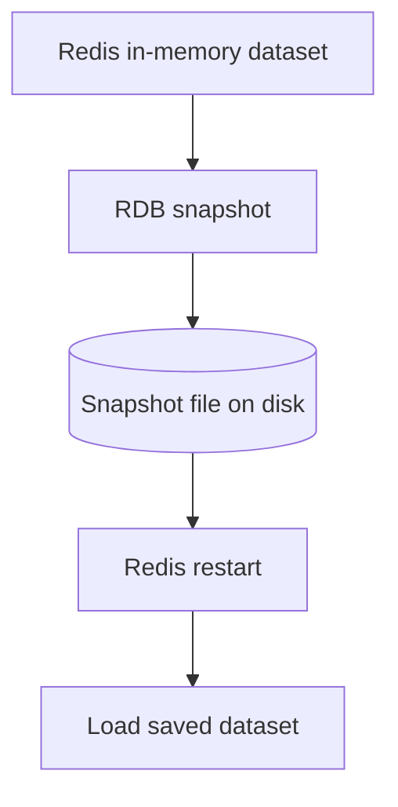
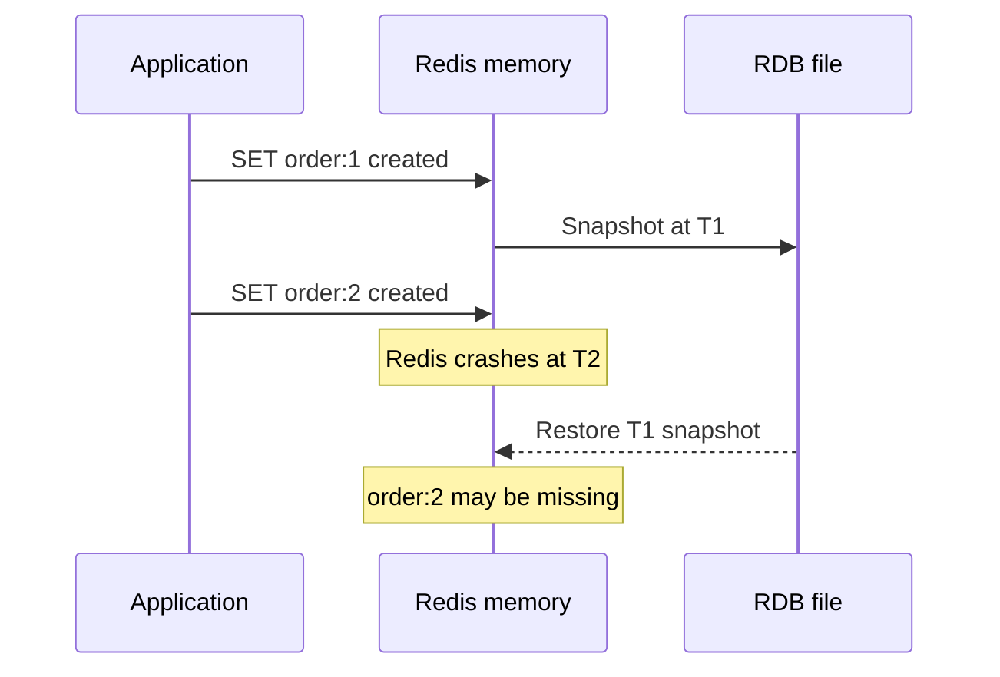
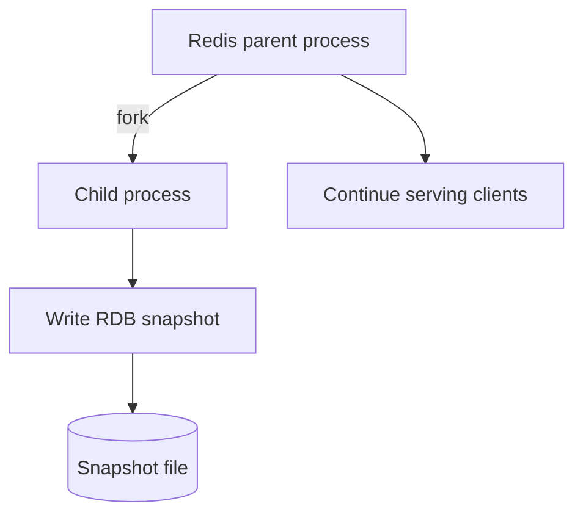
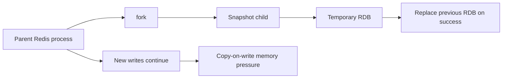
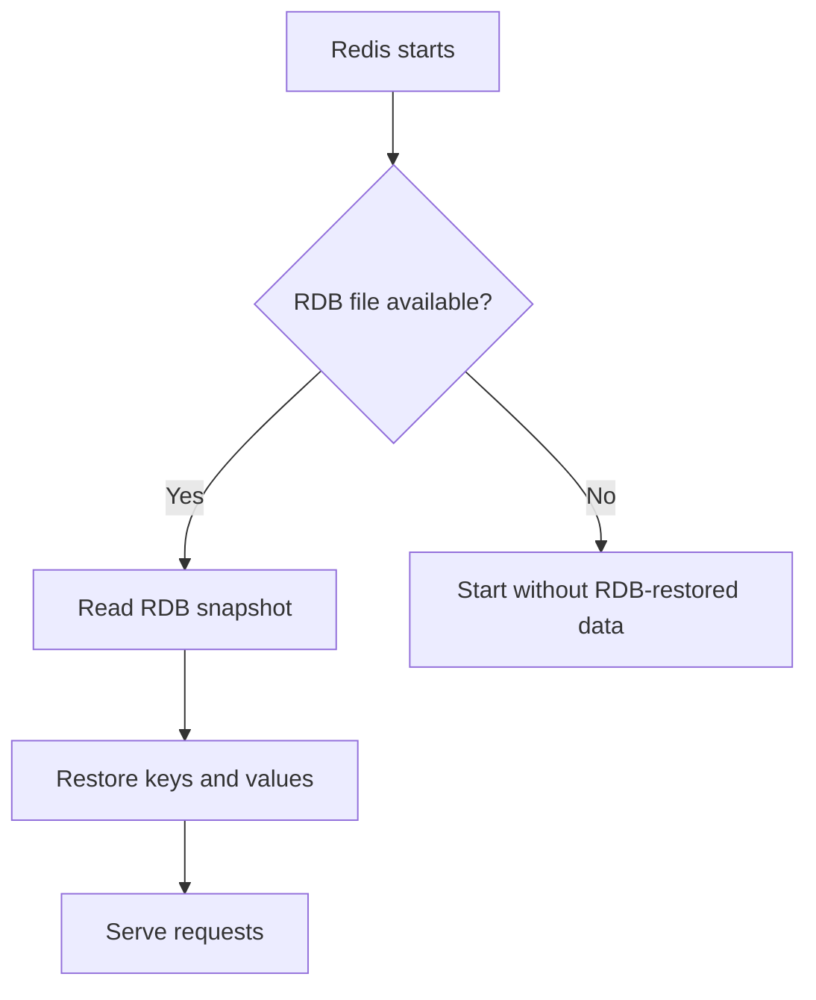
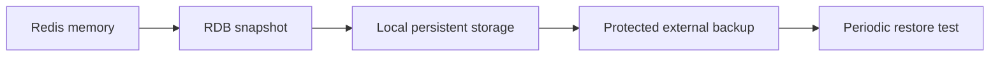
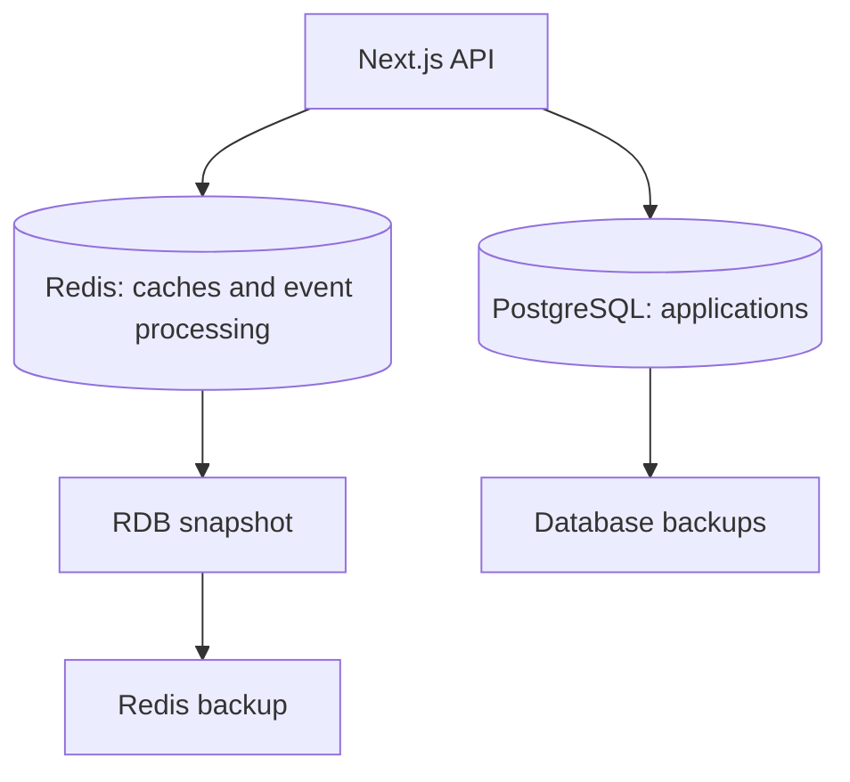

# Lesson 022 — Redis RDB Persistence

> **Section 03 — Keys, Memory and Internals** | Intermediate → Advanced  
> **Goal:** Understand Redis RDB snapshots, background saving, crash recovery, configuration, operational trade-offs, and how to verify backups.

**Previous:** [Lesson 021 — Redis Memory Encodings](021-memory-encodings.md)  
**Next:** [Lesson 023 — AOF Persistence](023-aof.md)

## 1. Why persistence matters

Redis keeps its working dataset primarily in memory. Memory is fast, but a process crash or server restart can destroy data that was not saved durably.

Imagine Redis stores:
- Product caches.
- User sessions.
- Job progress.
- Payment-related state.

If Redis restarts, what should happen?

For a **rebuildable cache**, losing Redis keys may be acceptable if the application can refill them from a database.

For **critical state**, data loss can be much more serious. You must plan persistence, replication, backups, and recovery.

Redis supports two major persistence mechanisms:

1. **RDB (Redis Database snapshots):** Point-in-time snapshots.
2. **AOF (Append Only File):** A log of write operations that can be replayed.

This lesson focuses on **RDB**. The next lesson covers AOF.



## 2. What exactly is RDB?

**RDB** stands for **Redis Database**. It is Redis's compact binary snapshot format.

A snapshot represents the dataset at a particular point in time. Redis can write it to disk and later load it during startup.

Example:

```text
10:00  Redis contains A, B, C
10:05  RDB snapshot saved
10:07  Redis contains A, B, C, D
10:08  Redis crashes
10:09  Redis loads the 10:05 snapshot
```

If no more recent durable state exists, **D can be lost**.

**Critical:** RDB is not a continuous transaction log. It saves a snapshot, not every write after that snapshot.

## 3. RDB mental model: a photograph of memory

Imagine taking a photo of a whiteboard:

- The photo preserves what was written when it was taken.
- You can restore the whiteboard from the photo.
- Changes written **after** the photo are not included.

That is the key idea behind RDB snapshots.



## 4. SAVE vs BGSAVE

Redis exposes two commands for creating RDB snapshots.

### SAVE — synchronous snapshot

```redis
SAVE
```

`SAVE` blocks the Redis server while it performs the snapshot.

**Production warning:** Avoid manually using `SAVE` on a busy production instance. A large dataset can cause significant service interruption.

### BGSAVE — background snapshot

```redis
BGSAVE
```

On supported operating systems, Redis typically forks a child process to write the RDB snapshot while the parent continues serving commands.



**Important:** “Background” does not mean “zero impact.” Forking and copy-on-write memory can create CPU, latency, and memory pressure.

## 5. How BGSAVE works internally

A simplified sequence:

1. Redis receives `BGSAVE` or triggers an automatic save.
2. Redis forks a child process on supported platforms.
3. The child serializes the snapshot dataset to a temporary RDB file.
4. The parent continues processing client requests.
5. If the parent modifies memory pages during the snapshot, **copy-on-write** may require extra memory.
6. On successful completion, Redis replaces the previous snapshot file atomically using its normal persistence workflow.



### What is copy-on-write?

After `fork`, parent and child can initially share memory pages. When the parent changes a shared page, the operating system may create a separate copy so the child sees the original snapshot view.

**Why it matters:** During heavy writes, extra memory usage can be substantial.

For example:
- Dataset in Redis: 4 GB.
- Background save starts.
- Application modifies many pages.
- Additional copy-on-write memory is needed.

You **cannot** safely assume that 4 GB of Redis data requires only 4 GB of physical memory during a snapshot.

The actual overhead depends on modified pages, allocator behavior, OS, and workload.

## 6. Automatic snapshots: save rules

Redis can create snapshots automatically when configured conditions are met.

Example `redis.conf`:

```conf
save 900 1
save 300 10
save 60 10000
```

Each rule has the form:

```text
save <seconds> <number-of-changes>
```

Interpretation:

- `save 900 1`: after at least 900 seconds, if at least one relevant change occurred.
- `save 300 10`: after at least 300 seconds, if at least 10 changes occurred.
- `save 60 10000`: after at least 60 seconds, if at least 10,000 changes occurred.

These are **OR conditions**: satisfying any enabled rule can trigger a snapshot, subject to Redis's scheduling and operational state.

**Version note:** Redis's default persistence configuration can vary across versions and deployment packages. Inspect your actual server instead of assuming these example rules are enabled.

### Inspect configuration

```redis
CONFIG GET save
CONFIG GET dbfilename
CONFIG GET dir
```

## 7. Where is the RDB file stored?

Two important configuration options:

```conf
dbfilename dump.rdb
dir /var/lib/redis
```

The snapshot file path is determined by the directory and filename.

Example:

```text
/var/lib/redis/dump.rdb
```

The actual path depends on your Redis installation, OS, container configuration, and server configuration.

### Why file location matters

- The Redis process must have write permission.
- The disk must have enough free space.
- The storage should survive container recreation if persistence is required.
- Backups must include the correct file.
- Access to snapshot files must be protected because they may contain sensitive application data.

## 8. How to inspect snapshot status

```redis
INFO persistence
```

Useful fields may include:

| Field | Meaning |
| --- | --- |
| `rdb_bgsave_in_progress` | Whether an RDB background save is running |
| `rdb_last_save_time` | Timestamp of last successful save |
| `rdb_last_bgsave_status` | Result of last background save |
| `rdb_changes_since_last_save` | Changes since the last save |
| `rdb_last_cow_size` | Copy-on-write memory observed in a recent save, when available |

```redis
LASTSAVE
```

`LASTSAVE` returns a Unix timestamp for the last successful RDB save.

**Important:** A successful snapshot does not prove that an offsite backup exists or that your restoration procedure works.

## 9. RDB recovery: what happens on restart?

When Redis starts with persistence enabled, it can load saved data from its persistence files.

Simplified RDB-only startup:



**Important:** If AOF is also enabled, Redis generally prefers AOF for restoring the dataset because it may contain more recent data. We will cover this in Lesson 023.

### What happens to TTLs?

RDB stores expiration information. Keys that have already expired by the time the snapshot is loaded are not restored as live keys.

Example:

```redis
SET demo:session active EX 60
BGSAVE
```

If Redis restarts after the session's expiration deadline, that session should not reappear as valid merely because it existed in the snapshot.

**Security implication:** Do not rely on a restored snapshot to extend expired authentication sessions.

## 10. How much data can RDB lose?

Suppose the latest successful snapshot is at 10:00 and Redis crashes at 10:04.

Writes after the snapshot may be lost if they were not saved through another durable mechanism.

```text
10:00  Successful RDB snapshot
10:01  New order event
10:02  Session updated
10:03  Counter incremented
10:04  Crash
10:05  Restart from 10:00 snapshot
```

The potential data-loss window depends on **when the last successful snapshot happened**, not just the configured save interval.

### RPO and RTO

Two important disaster-recovery terms:

- **RPO (Recovery Point Objective):** Maximum acceptable data loss measured in time.
- **RTO (Recovery Time Objective):** Maximum acceptable time to restore service.

Example:
- RPO = 5 minutes: losing up to 5 minutes of updates is acceptable.
- RTO = 10 minutes: service should recover within 10 minutes.

RDB-only persistence may be suitable for some workloads but not for others. Snapshot frequency, backup procedures, dataset size, and restore time all affect recovery.

## 11. RDB vs no persistence

### Cache-only Redis

If every key can be rebuilt from PostgreSQL or another authoritative store, you may choose not to persist cache data.

Benefits:
- Less persistence disk I/O.
- No snapshot fork overhead for that instance.

Trade-offs:
- Cold cache after restart.
- Higher database load during warm-up.
- Potential cache stampede.

### Redis holding important state

If Redis contains sessions, queue state, or application data that cannot easily be rebuilt, persistence and recovery become more important.

**Important:** Neither RDB nor AOF automatically provides the same guarantees as a properly designed authoritative database with transactional consistency and tested backups.

## 12. RDB vs AOF — first comparison

| Topic | RDB | AOF |
| --- | --- | --- |
| Main idea | Snapshot of dataset | Record write operations |
| Data-loss window | Since last successful snapshot | Depends on fsync policy and failures |
| File characteristics | Compact binary snapshot | Append-only persistence files |
| Recovery | Load snapshot | Replay/reconstruct from AOF |
| Background maintenance | BGSAVE | AOF rewrite and fsync |
| Typical advantage | Compact backups and fast loading | Potentially better durability |
| Typical drawback | Larger loss window between snapshots | Additional I/O and persistence management |

Redis can use **both** mechanisms together, depending on configuration and requirements.

Do not interpret “AOF is more durable” as “AOF can never lose data.” That depends on fsync policy, disk behavior, failure modes, and deployment.

## 13. Backup is not the same as persistence

A local `dump.rdb` helps Redis recover from some failures, but it does not protect against every incident.

What if:
- The entire VM is deleted?
- The disk fails?
- A destructive command runs before the snapshot?
- Ransomware or operator error deletes local files?
- A corrupted snapshot is copied to the backup location?

A real backup strategy should consider:
1. Consistent snapshot creation.
2. Copying to separate durable storage.
3. Encryption and access controls.
4. Retention policy.
5. Restore testing.
6. Recovery documentation.



**Critical:** A snapshot is not proven usable until you test restoring it.

## 14. Docker: persist RDB files with a volume

A minimal learning example:

```yaml
services:
  redis:
    image: redis:7
    command:
      - redis-server
      - --save
      - "60"
      - "1"
      - --appendonly
      - "no"
      - --dir
      - /data
    volumes:
      - redis_data:/data
    ports:
      - "127.0.0.1:6379:6379"

volumes:
  redis_data:
```

Save this as `compose.yaml`.

Start:

```bash
docker compose up -d
```

Create test data:

```bash
docker compose exec redis redis-cli SET demo:persist "hello"
docker compose exec redis redis-cli BGSAVE
docker compose exec redis redis-cli LASTSAVE
```

Wait until `INFO persistence` shows the background save completed successfully before testing restart.

Restart the container:

```bash
docker compose restart redis
docker compose exec redis redis-cli GET demo:persist
```

The value should be restored from the saved dataset.

### Important Docker cautions

- The named volume preserves `/data` across container restarts and recreation.
- `docker compose down -v` deletes named volumes declared by the Compose project and can destroy your saved data.
- The example binds port 6379 to **localhost**; it is for local learning, not public exposure.
- Production requires authentication, network controls, capacity planning, and backups.
- The image tag is an example; pin a tested version or digest in production.

## 15. Safe snapshot exercise with redis-cli

On a disposable local Redis instance:

```redis
SET demo:rdb:1 hello
SET demo:rdb:2 world
BGSAVE
INFO persistence
LASTSAVE
```

Look for a successful completion status.

### What not to do

Do not restart Redis immediately after requesting `BGSAVE` without confirming it finished. The background save is asynchronous.

Do not copy an RDB file while Redis is writing it unless you use a supported safe backup procedure.

Do not manually delete or overwrite production snapshot files while Redis is running.

## 16. Performance considerations

### Fork overhead

Forking a large Redis process can cause latency spikes, especially on constrained or heavily loaded systems.

### Copy-on-write memory

Heavy writes during `BGSAVE` can require substantial additional memory.

### Disk I/O

Writing a large snapshot competes with other disk activity.

### Snapshot size and recovery time

Larger datasets may take longer to write and restore.

### Persistence failures

Disk-full conditions, permissions, or storage errors can prevent successful snapshots. Depending on configuration, Redis may reject writes when background saves fail.

A relevant setting is:

```conf
stop-writes-on-bgsave-error yes
```

This behavior helps prevent silent operation under certain persistence failures, but it can affect application availability. Understand the setting before changing it.

## 17. Monitoring RDB in production

Monitor at least:

- Time since last successful snapshot.
- `rdb_last_bgsave_status`.
- `rdb_bgsave_in_progress`.
- Snapshot duration.
- Copy-on-write memory.
- Disk free space.
- Disk I/O latency.
- Redis process memory and RSS.
- Backup freshness.
- Restore test results.

```redis
INFO persistence
INFO memory
LASTSAVE
```

### Example alerting logic

If your recovery objective requires a recent snapshot, alert when:

```text
now - last_successful_snapshot_time > allowed_snapshot_age
```

But remember that a local snapshot alone may not satisfy an offsite-backup requirement.

## 18. Real-world architecture: CareerLoop

Suppose CareerLoop uses:
- PostgreSQL as the source of truth for job applications.
- Redis for cached dashboard data.
- Redis Streams for background processing.



### What should be authoritative?

- Application status: PostgreSQL.
- Interview dates: PostgreSQL.
- Cached dashboard summary: Redis, rebuildable.
- Stream messages: reliability depends on retention, persistence, consumer design, and possibly a transactional outbox.

**Lesson:** RDB can help Redis restart faster with previous data, but it does not replace PostgreSQL transactions or durable business records.

## 19. Common mistakes

1. Assuming Redis automatically saves every write to disk.
2. Treating RDB as continuous persistence.
3. Using `SAVE` on a busy production server.
4. Assuming `BGSAVE` has no latency or memory overhead.
5. Forgetting copy-on-write memory during background snapshots.
6. Restarting before `BGSAVE` completes.
7. Assuming snapshot configuration is identical across Redis versions.
8. Forgetting Docker volumes for persistent data.
9. Running `docker compose down -v` on a valuable Redis volume.
10. Assuming a local snapshot is a complete backup strategy.
11. Never testing restore procedures.
12. Ignoring snapshot errors, disk space, or file permissions.
13. Assuming RDB preserves every write after the last snapshot.
14. Assuming TTLs restart from their original duration after restore.
15. Ignoring RPO and RTO requirements.

## 20. Hands-on exercises

1. Explain the difference between in-memory data and persisted data.
2. Create test keys and run `BGSAVE`.
3. Inspect `INFO persistence`.
4. Check `LASTSAVE`.
5. Inspect `CONFIG GET save`.
6. Find the configured `dir` and `dbfilename`.
7. Explain the meaning of `save 300 10`.
8. Draw the parent/child `BGSAVE` workflow.
9. Explain copy-on-write using a 2 GB dataset example.
10. Create a disposable Docker Redis with a named volume.
11. Save data, wait for snapshot completion, restart, and verify restoration.
12. Explain what data may be lost if Redis crashes between snapshots.
13. Propose RPO and RTO for a cache-only instance.
14. Explain why a local RDB file is not enough for disaster recovery.
15. Design a backup verification checklist.

## 21. Interview questions

**Q1. What is RDB?** Redis's binary point-in-time snapshot persistence format.

**Q2. SAVE vs BGSAVE?** SAVE blocks the server; BGSAVE normally snapshots in a background child process.

**Q3. Does BGSAVE block all Redis requests?** No, the parent generally continues serving clients, though fork and memory pressure can affect latency.

**Q4. What is copy-on-write?** A mechanism where modified shared memory pages are copied so the child retains a consistent snapshot view.

**Q5. What does `save 300 10` mean?** Trigger a snapshot when at least 300 seconds have passed and at least 10 changes occurred, subject to server scheduling.

**Q6. Can RDB lose recent writes?** Yes, writes after the last successful snapshot may be lost.

**Q7. Where is RDB stored?** In the configured `dir` using `dbfilename`.

**Q8. How do you check snapshot status?** `INFO persistence` and `LASTSAVE`.

**Q9. What happens to expired keys during restore?** Keys whose expiration deadlines have passed are not restored as live data.

**Q10. Is RDB a backup?** It can be a backup artifact, but a complete backup strategy also needs separate storage, protection, retention, and restore testing.

**Q11. RDB vs AOF?** Snapshot-based persistence vs write-log-based persistence.

**Q12. Why can BGSAVE increase memory usage?** Copy-on-write pages during concurrent writes.

## 22. Revision checklist

- [ ] Why persistence is needed
- [ ] RDB snapshot mental model
- [ ] `SAVE` vs `BGSAVE`
- [ ] Fork and copy-on-write
- [ ] Automatic save rules
- [ ] `dir` and `dbfilename`
- [ ] `INFO persistence` and `LASTSAVE`
- [ ] Restart and recovery
- [ ] TTL after restore
- [ ] RPO and RTO
- [ ] RDB vs AOF
- [ ] Persistence vs backups
- [ ] Docker volumes
- [ ] Performance and memory costs
- [ ] Snapshot failure monitoring
- [ ] Real-world architecture

---

**Official references:** [Redis persistence](https://redis.io/docs/latest/operate/oss_and_stack/management/persistence/) · [BGSAVE](https://redis.io/docs/latest/commands/bgsave/) · [SAVE](https://redis.io/docs/latest/commands/save/) · [LASTSAVE](https://redis.io/docs/latest/commands/lastsave/) · [INFO](https://redis.io/docs/latest/commands/info/)
