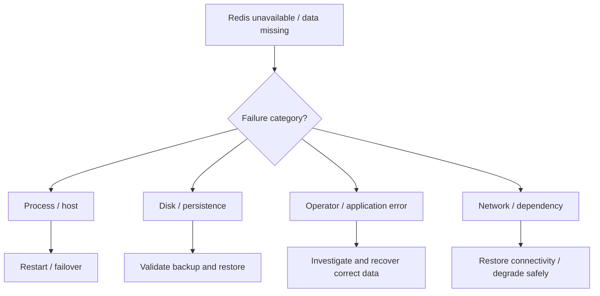
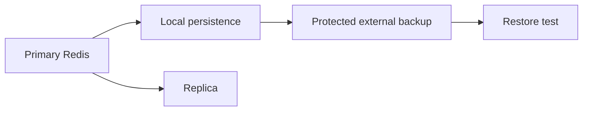
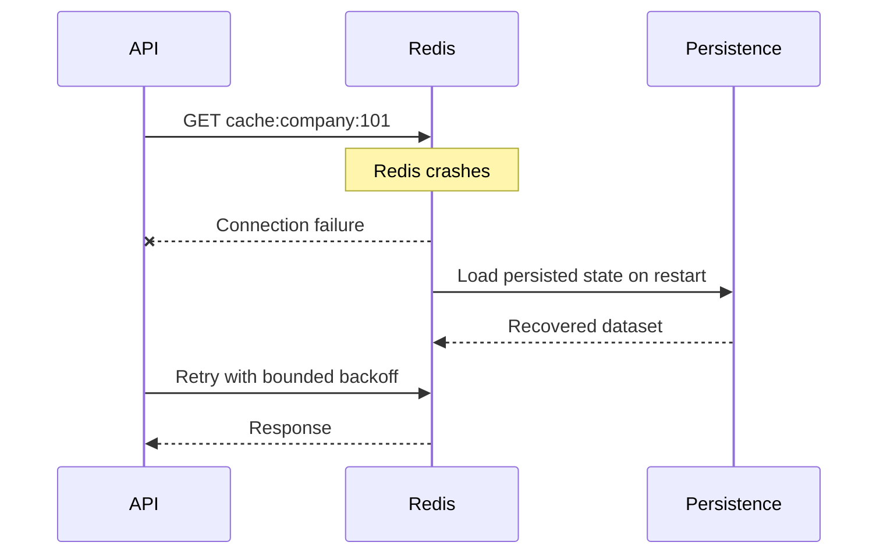
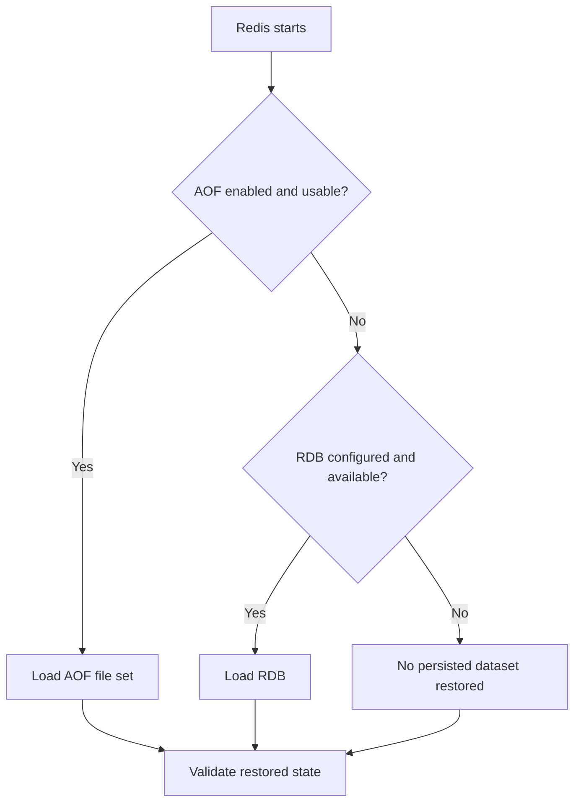
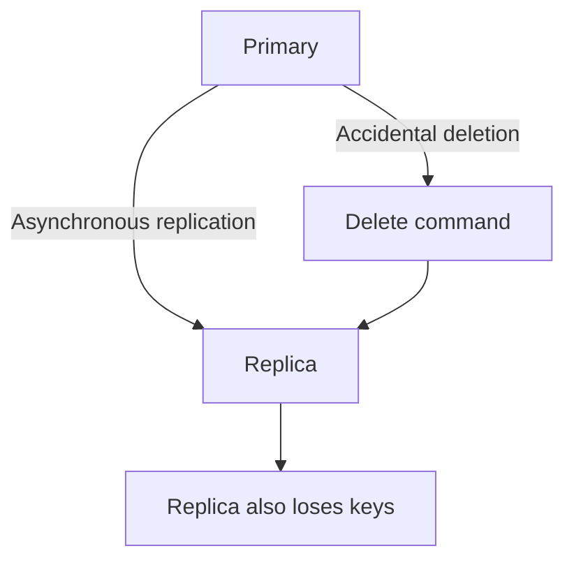
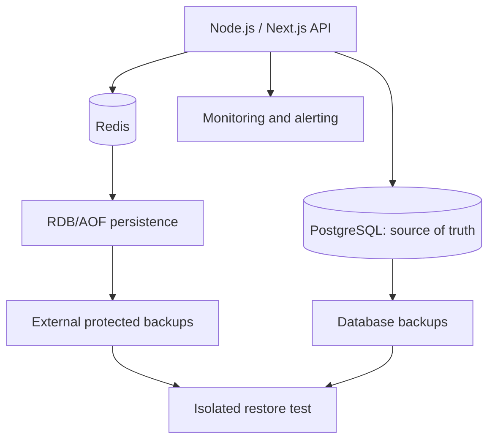
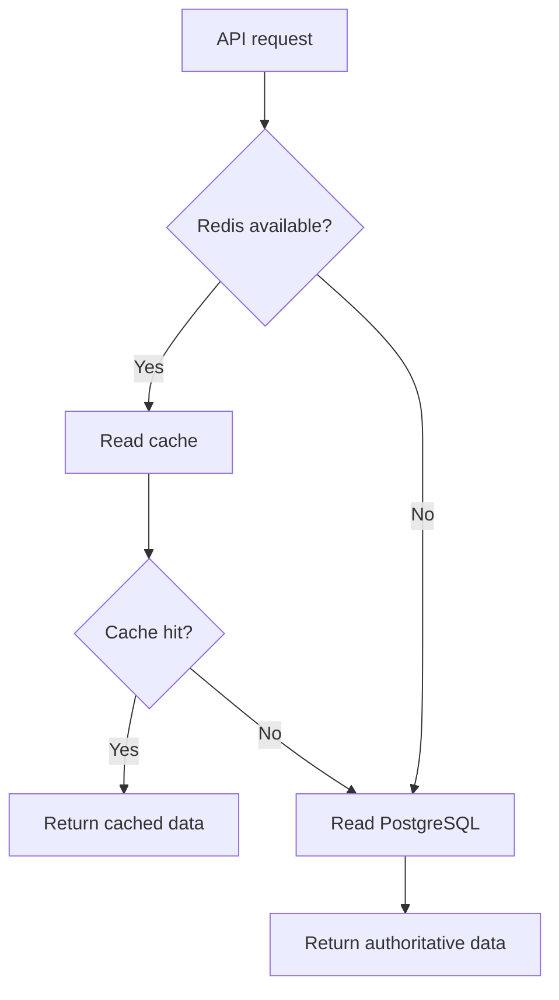

# Lesson 024 — Redis Recovery and Disaster Planning

> **Section 03 — Keys, Memory and Internals** | Intermediate → Advanced  
> **Goal:** Understand what happens after Redis failures and design safe, testable recovery procedures using RDB, AOF, backups, and application-level safeguards.

**Previous:** [Lesson 023 — AOF Persistence](023-aof.md)  
**Next:** [Lesson 025 — Redis Pipelining](025-pipelining.md)

## 1. Recovery is more than restarting Redis

Imagine your Redis server suddenly becomes unavailable.

Possible causes:
- Process crash.
- Container restart.
- VM or host failure.
- Disk full.
- Corrupted persistence files.
- Accidental `FLUSHALL`.
- Network partition.
- Credential/configuration mistake.
- Data eviction.
- Entire region unavailable.

The right recovery procedure depends on **what failed** and **what data Redis was responsible for**.



**Critical:** A Redis process restarting successfully does not prove that your application data is correct or complete.

## 2. Three separate concepts

### Persistence

Save Redis data to disk so it can be loaded after restart.

Examples:
- RDB.
- AOF.

### Replication / high availability

Keep one or more copies of Redis state on other nodes so service may continue after certain node failures.

Replication does not automatically prevent every data-loss scenario. A destructive command can replicate, and asynchronous replication can lose recent acknowledged writes.

### Backups

Preserve recoverable copies of data, ideally outside the failure domain of the primary server.



**Persistence, replication, and backups solve different problems.** Mature systems may need all three.

## 3. Start with the source of truth

Before planning recovery, classify the data.

| Data | Example | Recovery strategy |
| --- | --- | --- |
| Rebuildable cache | Cached company profile | Refill from PostgreSQL |
| Temporary coordination | Rate-limit counter | Accept bounded reset or rebuild depending on risk |
| Session state | Login session | Restore if safe, otherwise force reauthentication |
| Durable business record | Payment/order | Use authoritative transactional database |
| Background work | Redis Stream / queue | Recover from persistence and/or durable outbox |
| Derived leaderboard | Weekly points | Recompute from authoritative events if possible |

**Best design principle:** If data is critical, decide explicitly where its authoritative copy lives and how it can be reconstructed.

## 4. RPO and RTO: two recovery goals

### RPO — Recovery Point Objective

How much data loss is acceptable?

Example:
- RPO of 5 minutes means losing the most recent 5 minutes of changes may be tolerable.
- RPO near zero requires stronger architecture and careful validation.

### RTO — Recovery Time Objective

How quickly must service return?

Example:
- RTO of 10 minutes means the system should recover within 10 minutes.


**Important:** An RPO/RTO target is not a guarantee provided automatically by selecting RDB or AOF. You must test the whole system.

## 5. Failure scenario A: Redis process crash

Suppose Redis crashes but the disk remains intact.

Possible sequence:
1. Supervisor or orchestration system restarts Redis.
2. Redis loads the applicable persistence files.
3. The service starts accepting connections.
4. Applications reconnect.
5. Health checks and data verification run.



**Do not retry indefinitely inside HTTP requests.** Use bounded timeouts, backoff, circuit breakers, and safe fallbacks where appropriate.

### Cache-only fallback

If Redis is only a cache, the API can read from PostgreSQL when Redis is unavailable, with protection against overwhelming the database.

## 6. Failure scenario B: host or disk loss

If the entire machine or disk is lost, local RDB and AOF files may be unavailable.

Recovery needs:
- A replacement host or managed Redis instance.
- A protected external backup.
- Compatible Redis version/configuration.
- A documented restore procedure.
- Verification that the restored data is correct.

**A local Docker volume is not an offsite backup.** If the host storage disappears, the volume may disappear too.

## 7. Failure scenario C: accidental deletion

Suppose someone executes:

```redis
FLUSHALL
```

This removes all keys in the Redis instance. Depending on replication and persistence timing, the deletion can propagate or become persisted.

**Never execute `FLUSHALL` as a recovery experiment against production.**

Possible response:
1. Stop the damaging automation or credential.
2. Preserve logs and available backups.
3. Determine the last known good restore point.
4. Restore into an **isolated** Redis instance.
5. Verify data and business consistency.
6. Plan a controlled cutover.

**Why isolated restore?** Restoring directly over a live production instance can overwrite newer correct data and make the incident worse.

## 8. Failure scenario D: corrupted RDB or AOF

Symptoms may include:
- Redis failing to start.
- Persistence load errors.
- Incomplete or corrupted file warnings.
- Unexpectedly missing data.

### Safer response

1. Preserve the original persistence files and manifests.
2. Check disk and filesystem health.
3. Identify the exact Redis version.
4. Read startup logs and error messages.
5. Validate a copy with version-compatible tools.
6. Attempt repair only on copies, after understanding possible data loss.
7. Restore into an isolated instance and verify results.

Tools include:

```bash
redis-check-rdb --help
redis-check-aof --help
```

**Warning:** Repair tools may discard damaged or truncated portions. Never modify your only backup without preserving it first.

## 9. What does Redis load on restart?

A simplified model:



**Nuance:** This is a conceptual diagram, not a promise that Redis automatically falls back to RDB whenever AOF is corrupt. When AOF is enabled, Redis generally prefers it, and an AOF load failure may prevent startup until you intervene. Actual behavior depends on version and configuration.

## 10. Expiration after restore

TTL information is stored with persisted data.

Example:

```redis
SET demo:session active EX 60
BGSAVE
```

If you restore after the expiration deadline, the session does not become valid again merely because it existed in the snapshot.

**Security principle:** A restored Redis snapshot must not bypass session expiration or revocation requirements. For high-security sessions, maintain an authoritative revocation strategy where needed.

## 11. AOF everysec and the data-loss window

With:

```conf
appendonly yes
appendfsync everysec
```

Redis requests fsync approximately once per second. In a typical crash, the most recent second of writes may be at risk.

But:
- Storage stalls can increase the practical loss window.
- Hardware may not honor durability assumptions perfectly.
- AOF is not a cross-system transaction.
- AOF rewrite and recovery still need validation.

Do not promise “exactly one second maximum data loss” under every failure mode.

## 12. Replication is not a backup

Imagine:

```text
Primary Redis -> Replica Redis
```

If the primary receives an accidental `DEL` or `FLUSHALL`, the change can be replicated.

If the primary crashes before a write reaches the replica, a promoted replica may not contain that write.



**Important:** High availability reduces downtime for some failures; backups protect against a different class of failures.

Replication and failover are covered in Section 07.

## 13. Disaster recovery architecture

A practical architecture for a Node.js application:



For critical Redis-backed jobs, also consider:
- Transactional outbox.
- Idempotent consumers.
- Retry policies.
- Dead-letter handling.
- Replay/reconciliation processes.

## 14. Recovery runbook: step by step

A **runbook** is a written procedure that operators can follow during an incident.

### Phase 1 — Detect and classify

Check:
- Is Redis unreachable, or is data missing?
- Is the issue limited to one application?
- Is the disk full?
- Is persistence failing?
- Is there a network problem?
- Is there an ongoing destructive command?

Useful diagnostics, if Redis is reachable:

```redis
PING
INFO server
INFO persistence
INFO memory
INFO replication
```

Do not expose sensitive configuration or credentials in incident logs.

### Phase 2 — Stabilize

- Stop harmful jobs or deployments.
- Limit retry storms.
- Preserve available persistence files and logs.
- Avoid writing new data into a potentially damaged instance until the recovery plan is clear.

### Phase 3 — Choose recovery source

Possible sources:
- Current healthy Redis replica, if appropriate.
- Valid local persistence files.
- Protected external snapshot.
- Authoritative database for rebuildable cache data.

Choose based on **correctness and recoverability**, not only which source is fastest.

### Phase 4 — Restore in isolation

- Use a separate host, container, or managed instance.
- Use the compatible Redis version.
- Restore the complete required file set.
- Start Redis with appropriate configuration.
- Keep the restored instance inaccessible to untrusted clients.

### Phase 5 — Validate

Check:
- Expected key count and types.
- Representative records.
- TTL behavior.
- Application-specific invariants.
- Stream/queue pending state if relevant.
- Source-of-truth consistency.

### Phase 6 — Cut over

- Plan application reconnection.
- Avoid split-brain or dual-writer situations.
- Monitor error rates and latency.
- Keep rollback options.

### Phase 7 — Post-incident review

Document:
- Root cause.
- Actual data-loss window.
- Recovery time.
- Which alerts helped.
- What procedures failed.
- Follow-up fixes.

## 15. Docker lab: practice recovery safely

Create a local Compose file:

```yaml
services:
  redis:
    image: redis:7
    command:
      - redis-server
      - --appendonly
      - "yes"
      - --appendfsync
      - everysec
      - --dir
      - /data
    ports:
      - "127.0.0.1:6379:6379"
    volumes:
      - redis_recovery_lab:/data

volumes:
  redis_recovery_lab:
```

Start:

```bash
docker compose up -d
docker compose exec redis redis-cli SET demo:recovery "hello"
docker compose exec redis redis-cli INFO persistence
```

Restart:

```bash
docker compose restart redis
docker compose exec redis redis-cli GET demo:recovery
```

Expected: `hello`.

### What this lab proves

It verifies a basic persistent-volume restart.

### What it does not prove

- Recovery after a host-disk failure.
- Recovery from corrupted persistence files.
- Backup restoration from separate storage.
- Zero data loss during sudden power failure.
- Multi-node failover.

**Do not use `docker compose down -v` if you want to preserve the volume.**

## 16. Backup verification strategy

A backup is only useful if it can be restored.

### Minimum checklist

1. Is the backup stored separately from the primary Redis host?
2. Is it encrypted at rest and in transit?
3. Are access permissions restricted?
4. Is the file set complete for the Redis version?
5. Is the backup recent enough for the RPO?
6. Can an isolated Redis instance load it?
7. Do representative keys and application invariants match?
8. Can the application connect to the restored instance?
9. Is the restore fast enough for the RTO?
10. Is the restore process documented and rehearsed?

### Test schedule

For example:
- Daily: verify backup creation and age.
- Weekly: automated isolated restore.
- Quarterly: full recovery drill with application checks.

These are illustrative cadences. Adjust them to the system's risk and compliance requirements.

## 17. Application resilience: Redis is unavailable

For a cache-only use case:



**Important:** A fallback can overload PostgreSQL if thousands of requests suddenly bypass Redis. Use bounded concurrency, circuit breakers, and request coalescing where appropriate.

For critical queues or distributed locks, **silently ignoring Redis failures can be unsafe**. The correct fallback may be to reject or delay work rather than proceed without coordination.

## 18. Node.js example: cache fallback

Install:

```bash
npm install redis
```

ESM example:

```js
import { createClient } from "redis";

const redis = createClient({
  url: process.env.REDIS_URL ?? "redis://127.0.0.1:6379",
  socket: {
    connectTimeout: 1000,
    reconnectStrategy: (retries) =>
      retries > 3 ? false : Math.min(retries * 100, 500),
  },
});

redis.on("error", (err) => {
  console.error("Redis error:", err.message);
});

async function loadCompanyFromDatabase(companyId) {
  // Replace with a real PostgreSQL query.
  return { id: companyId, name: "Example Co" };
}

async function getCompany(companyId) {
  const key = `cache:company:\${companyId}`;

  if (redis.isReady) {
    try {
      const raw = await redis.get(key);
      if (raw !== null) return JSON.parse(raw);
    } catch (err) {
      console.warn("Cache read failed:", err.message);
    }
  }

  const company = await loadCompanyFromDatabase(companyId);

  if (redis.isReady) {
    try {
      await redis.set(key, JSON.stringify(company), { EX: 300 });
    } catch (err) {
      console.warn("Cache write failed:", err.message);
    }
  }

  return company;
}

try {
  try {
    await redis.connect();
  } catch (err) {
    console.warn("Redis unavailable; database fallback active");
  }

  console.log(await getCompany(101));
} catch (err) {
  console.error("Request failed:", err.message);
  process.exitCode = 1;
} finally {
  if (redis.isOpen) await redis.quit();
}
```

**Production note:** This is a teaching example. Configure client command timeouts and offline-queue behavior appropriately for your library version, and protect the database from overload. A database fallback is suitable for rebuildable cache data, not automatically for locks, rate-limit enforcement, or payment coordination.

## 19. Recovery for Streams and background jobs

Suppose a worker processes an order event:

```text
1. Read event from Redis Stream.
2. Send email.
3. Acknowledge event.
```

If the worker crashes between steps 2 and 3, the email may be sent twice after recovery.

If Redis loses the event before step 2, the email may never be sent.

### Improve reliability

- Keep durable business events in an authoritative database/outbox when required.
- Use Redis persistence suited to your RPO.
- Use consumer groups and pending-message recovery.
- Make business side effects idempotent.
- Track retry attempts and failures.
- Reconcile expected vs completed work.

**Exactly-once business effects are not automatic.**

## 20. Common mistakes

1. Treating persistence, replication, and backup as interchangeable.
2. Assuming a restart means recovery is complete.
3. Assuming a replica is protected from accidental deletion.
4. Restoring over a live production instance without validation.
5. Forgetting to preserve original corrupted files.
6. Using a mismatched Redis version for recovery.
7. Copying only one multipart AOF fragment.
8. Treating Docker volumes as offsite backups.
9. Assuming `appendfsync everysec` is a universal hard one-second guarantee.
10. Ignoring session expiry after restore.
11. Never testing backups.
12. Allowing retry storms to overwhelm PostgreSQL.
13. Silently proceeding without critical locks or rate limits.
14. Forgetting job deduplication and reconciliation.
15. Measuring only uptime instead of data correctness and recovery objectives.

## 21. Hands-on exercises

1. Define RPO and RTO for a Redis cache.
2. Define stricter recovery goals for critical queue state.
3. Compare process crash vs host-disk loss.
4. Explain why replication is not a backup.
5. Draw a recovery flow for an AOF-enabled instance.
6. Start the Docker recovery lab and test restart.
7. Identify which files and volumes need backup.
8. Draft an incident runbook for accidental `FLUSHALL`.
9. List checks for validating a restored instance.
10. Explain why Redis should not be your only record of completed payments.
11. Design a PostgreSQL fallback for a cached endpoint.
12. Explain why Redis-backed locks need special outage handling.
13. Describe how to recover a pending Stream message.
14. Propose a monthly recovery drill for a production system.

## 22. Interview questions

**Q1. Persistence vs backup?** Persistence supports restart recovery; backups are protected copies for disaster recovery.

**Q2. Is replication a backup?** No. Deletions and corruption can propagate, and replication may lag.

**Q3. What is RPO?** Maximum acceptable data-loss window.

**Q4. What is RTO?** Maximum acceptable time to restore service.

**Q5. Which file does Redis load when both RDB and AOF are enabled?** Redis generally prefers AOF; exact startup behavior depends on configuration and file validity.

**Q6. Can Redis automatically fall back to RDB after any AOF corruption?** No; do not assume automatic fallback.

**Q7. Why restore into an isolated instance?** To validate recovery without overwriting live data.

**Q8. Why are Docker volumes insufficient as backups?** They may be lost with the host and are not necessarily separately protected.

**Q9. What is a recovery runbook?** A documented procedure for diagnosis, restoration, verification, and cutover.

**Q10. How do you handle Redis cache failure?** Use safe database fallback with bounded retries and overload protection.

**Q11. How do you handle Redis lock failure?** Usually fail safely rather than proceed without required coordination.

**Q12. Why is idempotency important after queue recovery?** Messages may be processed again after a crash.

## 23. Revision checklist

- [ ] Persistence vs replication vs backups
- [ ] Data classification and source of truth
- [ ] RPO and RTO
- [ ] Process-crash recovery
- [ ] Host/disk failure recovery
- [ ] Accidental deletion response
- [ ] RDB/AOF corruption precautions
- [ ] Startup recovery behavior
- [ ] TTL after restore
- [ ] Replication limitations
- [ ] Recovery runbook
- [ ] Docker persistence lab
- [ ] Backup verification
- [ ] Application fallback and retry limits
- [ ] Stream recovery and idempotency

---

**Official references:** [Redis persistence](https://redis.io/docs/latest/operate/oss_and_stack/management/persistence/) · [Redis replication](https://redis.io/docs/latest/operate/oss_and_stack/management/replication/) · [Redis Streams](https://redis.io/docs/latest/develop/data-types/streams/) · [INFO](https://redis.io/docs/latest/commands/info/)
