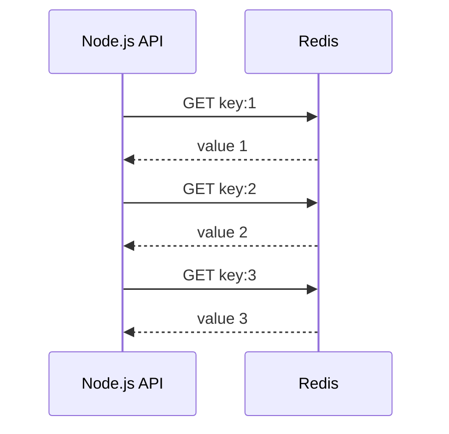
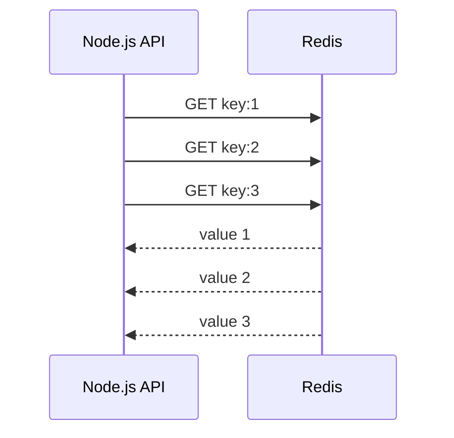
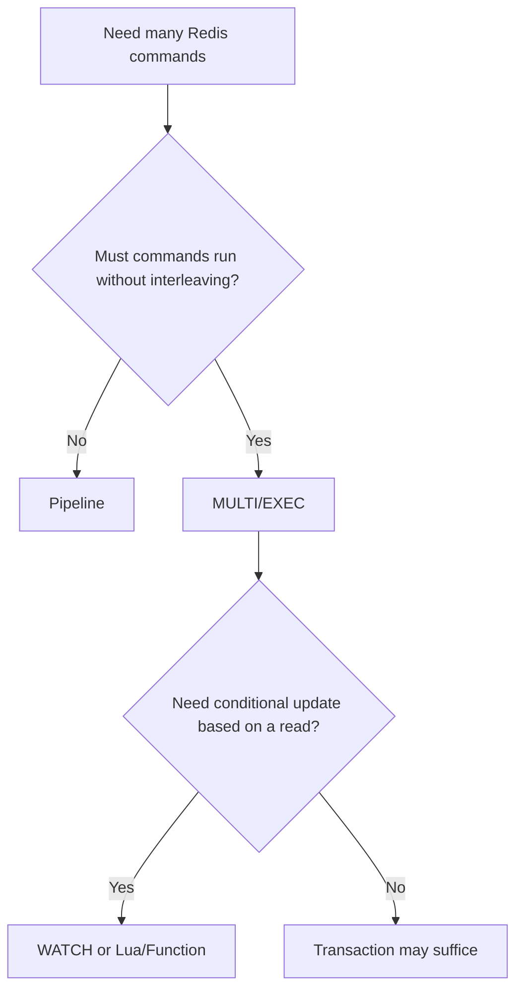
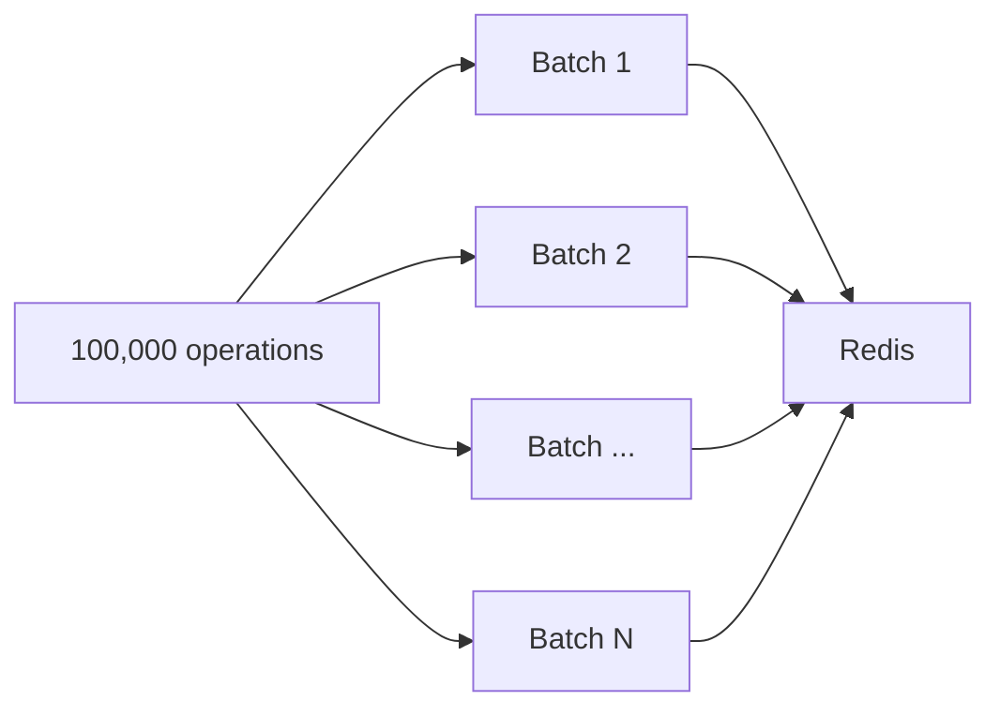

# Lesson 025 — Redis Pipelining

> **Section 03 — Keys, Memory and Internals** | Beginner → Advanced  
> **Goal:** Understand network round trips, pipelining, batching, Node.js implementation, performance, and why pipelining is not a transaction.

**Previous:** [Lesson 024 — Recovery](024-recovery.md)  
**Next:** [Lesson 026 — Transactions](026-transactions.md)

## 1. The problem: network round trips

Suppose your Node.js API needs 100 independent Redis values.

A simple loop can send one command, wait for its reply, and then send the next:

```text
GET key:1 -> wait
GET key:2 -> wait
...
GET key:100 -> wait
```

Even when Redis executes each command quickly, network round-trip time (RTT) accumulates.

If one sequential request/response takes roughly 2 ms, 100 commands can take roughly 200 ms **just from round-trip delays**. This is an illustration, not a Redis performance guarantee.



## 2. What is pipelining?

**Pipelining** means sending multiple Redis commands without waiting for each individual response first. Redis processes commands and returns replies in the corresponding order on the connection.



The benefit comes primarily from **reducing round-trip waiting** and improving throughput, not from making every Redis command internally faster.

## 3. Pipelining is not parallel execution

Redis commands in a pipeline are still executed according to Redis's normal command processing rules.

- The client sends several commands efficiently.
- Redis executes them and produces replies.
- The application receives replies corresponding to those commands.
- A pipeline does **not** automatically make command execution concurrent or parallel inside Redis.

**Mental model:** A waiter carries ten orders to the kitchen at once instead of walking back and forth for every order. The kitchen still needs to prepare the orders.

## 4. Basic example

Without pipelining:

```redis
SET product:101:name Keyboard
SET product:102:name Mouse
GET product:101:name
GET product:102:name
```

If sent through separate sequential network requests, each command can require another round trip.

With pipelining, the client sends all four commands together or without waiting between them.

The logical results are unchanged. Only the communication pattern differs.

## 5. Node.js: sequential commands vs pipelining

Install:

```bash
npm install redis
```

Use ESM with `"type": "module"`.

### Sequential version

```js
import { createClient } from "redis";

const redis = createClient();
redis.on("error", console.error);

await redis.connect();

try {
  for (let i = 1; i <= 100; i++) {
    await redis.set(`demo:sequential:\${i}`, String(i));
  }
} finally {
  await redis.quit();
}
```

Each `await` waits before the next command is issued.

### Auto-pipelining in node-redis

Modern `redis` (node-redis) can automatically pipeline commands issued in the same event-loop tick.

```js
import { createClient } from "redis";

const redis = createClient();
redis.on("error", console.error);

await redis.connect();

try {
  const operations = [];

  for (let i = 1; i <= 100; i++) {
    operations.push(
      redis.set(`demo:pipeline:\${i}`, String(i)),
    );
  }

  await Promise.all(operations);
  console.log("100 writes completed");
} finally {
  await redis.quit();
}
```

Here the commands are issued before awaiting their results, enabling node-redis auto-pipelining when they are scheduled in the same tick.

**Important:** `Promise.all` itself is not a Redis transaction, nor does it guarantee that every Redis client library pipelines commands the same way. Check your installed client version.

## 6. Explicit non-transactional batching with node-redis

For a sequence of commands without transaction semantics, modern node-redis supports `multi().execAsPipeline()`.

```js
import { createClient } from "redis";

const redis = createClient();
redis.on("error", console.error);

await redis.connect();

try {
  const results = await redis
    .multi()
    .set("demo:batch:a", "10")
    .set("demo:batch:b", "20")
    .get("demo:batch:a")
    .get("demo:batch:b")
    .execAsPipeline();

  console.log(results);
} finally {
  await redis.quit();
}
```

**Do not confuse**:
- `execAsPipeline()`: batch commands **without** `MULTI/EXEC` transaction semantics.
- `exec()`: execute a `MULTI/EXEC` transaction.

API names can vary by client major version. Check your installed node-redis documentation.

## 7. Pipelining vs MGET/MSET

Redis already has commands that work with multiple keys.

```redis
MSET product:101:name Keyboard product:102:name Mouse
MGET product:101:name product:102:name
```

If you only need multiple String reads or writes, `MGET`/`MSET` may be simpler than sending many individual `GET`/`SET` commands.

| Requirement | Useful approach |
| --- | --- |
| Read many String keys | `MGET` |
| Write many String keys | `MSET` |
| Execute different command types efficiently | Pipeline |
| All-or-nothing execution grouping | Transaction, with caveats |
| Conditional multi-step logic | WATCH or Lua/Redis Functions |

**Cluster note:** Multi-key commands can have hash-slot restrictions in Redis Cluster. A pipeline can contain commands targeting different slots when the client supports routing, but this does not make cross-slot multi-key operations valid or atomic.

## 8. Pipelining vs transactions

This is the most important distinction.

| Property | Pipeline | MULTI/EXEC transaction |
| --- | --- | --- |
| Main goal | Reduce network overhead | Execute queued commands as a non-interleaved group |
| Commands grouped for execution | Not necessarily | Yes |
| Other clients may interleave between commands | Yes | No, during EXEC execution |
| Rollback on runtime error | No | No |
| Atomic read-modify-write with conditions | No | Requires WATCH or scripting as appropriate |
| Lower network overhead | Often | Often |



### A pipeline does not prevent race conditions

Suppose two API servers each run:

```text
GET stock
if stock > 0:
    DECR stock
```

Putting `GET` and `DECR` in a pipeline does not solve the race: the decision happens in application code and can become stale.

Use a suitable atomic server-side operation or script, with correct inventory invariants.

## 9. Reply ordering and errors

Replies on a single Redis connection correspond to the command order sent on that connection.

If a command fails, the pipeline does **not** automatically undo earlier successful commands.

Example:

```redis
SET demo:mixed hello
INCR demo:mixed
SET demo:after success
```

The `INCR` fails because `hello` is not an integer, but the earlier and later valid commands can still execute.

**Production rule:** Check individual results/errors, not only whether the network operation completed.

## 10. How big should a pipeline be?

A pipeline of 10 commands may reduce network overhead. A pipeline of 1,000,000 commands can create new problems:

- High client memory consumption.
- Large output buffers.
- Long waits for results.
- Pressure on Redis and the network.
- Harder retries and error recovery.

**Use bounded batches**, such as 100–1,000 commands as a starting point for testing, not as a universal optimum.



### Bounded batch example

```js
async function writeInBatches(redis, entries, batchSize = 200) {
  for (let start = 0; start < entries.length; start += batchSize) {
    const batch = entries.slice(start, start + batchSize);

    await Promise.all(
      batch.map(([key, value]) => redis.set(key, value)),
    );
  }
}
```

This limits the number of simultaneously issued commands. Whether the client pipelines them depends on its implementation and scheduling.

## 11. Benchmarking fairly

Measure **throughput and latency**, not only total elapsed time.

Example with Redis's benchmarking tool:

```bash
redis-benchmark -t set,get -n 100000 -c 50 -P 1
redis-benchmark -t set,get -n 100000 -c 50 -P 16
```

- `-n`: total requests.
- `-c`: concurrent clients.
- `-P`: pipeline depth.

These are learning experiments. Use a disposable server; benchmarks write test data and can consume substantial resources.

### Why a benchmark can mislead

- Localhost RTT is very different from remote cloud RTT.
- Large values behave differently from small values.
- CPU, network, and Redis memory can become bottlenecks.
- A pipeline may improve throughput but increase per-request tail latency.
- Different workloads require different batch sizes.

## 12. Pipelining with real applications

### CareerLoop dashboard

Your API needs several independent cached counts:

```text
dashboard:42:applied
dashboard:42:interviews
dashboard:42:offers
dashboard:42:rejections
```

For String values, `MGET` is an excellent starting point.

### CodeBuddy profile page

The API needs:
- Profile Hash fields.
- Follower count.
- Connection status.
- Unread-message count.

A pipeline can reduce round trips for heterogeneous commands.

### Cache warm-up

After deployment, preload many company summaries in bounded batches. Avoid firing tens of thousands of commands at once.

## 13. Pipelining and failure recovery

Imagine a connection drops after a batch was sent but before replies arrive.

The client may not know which commands were executed.

**Important:** Retrying a batch is safe only if the operations are idempotent or have deduplication protection.

| Operation | Retry behavior |
| --- | --- |
| `SET key sameValue` | Often idempotent |
| `DEL key` | Usually idempotent for intended final state |
| `INCR counter` | Not idempotent |
| `LPUSH queue item` | May create duplicates |
| `XADD stream * ...` | May create duplicate events |

For business-critical writes, use stable event IDs, idempotency keys, or a database transaction/outbox as appropriate.

## 14. Common mistakes

1. Believing pipelining makes Redis execute commands in parallel.
2. Confusing pipelining with atomic transactions.
3. Assuming a pipeline automatically rolls back on errors.
4. Using enormous unbounded pipelines.
5. Ignoring individual command errors.
6. Using sequential `await` and expecting auto-pipelining.
7. Assuming `Promise.all` guarantees pipelining in every client.
8. Ignoring Redis Cluster routing and hash slots.
9. Retrying non-idempotent batches blindly.
10. Measuring only throughput while ignoring tail latency.
11. Using a pipeline when `MGET` would be simpler.
12. Assuming network failure means no command executed.

## 15. Exercises

1. Explain RTT and why sequential requests add latency.
2. Draw a sequential vs pipelined request timeline.
3. Write 100 keys with sequential `await`.
4. Repeat using `Promise.all` and node-redis auto-pipelining.
5. Test `execAsPipeline()` in your installed node-redis version.
6. Compare `MGET` with multiple `GET` calls.
7. Demonstrate that one failed command does not roll back other pipeline commands.
8. Use `redis-benchmark` with `-P 1` and `-P 16`.
9. Create bounded batches for 10,000 cache entries.
10. Explain why retrying `INCR` after a timeout can overcount.
11. Design a dashboard read that mixes `HGET`, `SCARD`, and `GET`.
12. Explain why pipelining does not fix a stock decrement race.

## 16. Interview questions

**Q1. What is Redis pipelining?** Sending multiple commands without waiting for each reply.

**Q2. Why is it faster?** It reduces round-trip waiting and improves throughput.

**Q3. Does pipelining run commands in parallel?** No, not inherently.

**Q4. Is pipelining atomic?** No.

**Q5. Pipeline vs MULTI/EXEC?** Network efficiency vs grouped, non-interleaved transaction execution.

**Q6. Pipeline vs MGET?** MGET is one multi-key String read command; a pipeline batches multiple commands.

**Q7. Can one pipeline command fail while others succeed?** Yes.

**Q8. Why avoid giant pipelines?** Memory, buffering, latency, and recovery costs.

**Q9. What is auto-pipelining?** Client-side batching of commands issued in the same scheduling window.

**Q10. What happens if a connection drops before replies?** Execution status can be uncertain; retries need idempotency.

## 17. Revision checklist

- [ ] Network round trips
- [ ] Pipeline request/response flow
- [ ] Pipelining vs parallelism
- [ ] Sequential vs concurrent command issuance
- [ ] node-redis auto-pipelining
- [ ] `execAsPipeline()`
- [ ] `MGET`/`MSET`
- [ ] Pipeline vs transactions
- [ ] Error handling
- [ ] Bounded batches
- [ ] Benchmarking
- [ ] Cluster caveats
- [ ] Idempotency and retries

---

**Official references:** [Redis pipelining](https://redis.io/docs/latest/develop/using-commands/pipelining/) · [Redis transactions](https://redis.io/docs/latest/develop/using-commands/transactions/) · [node-redis](https://github.com/redis/node-redis)
