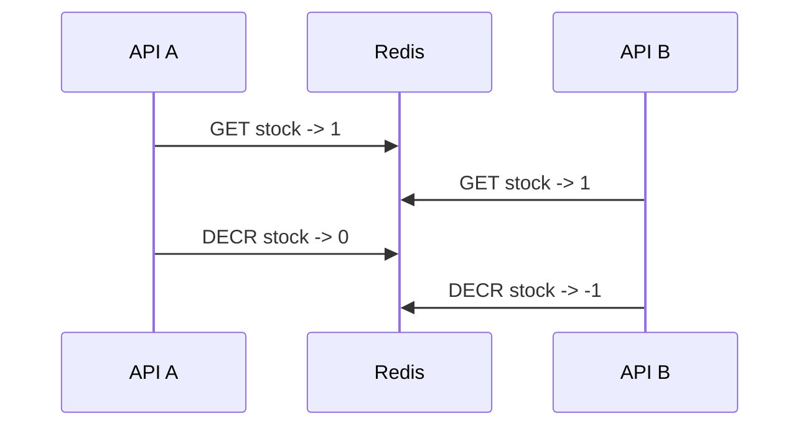
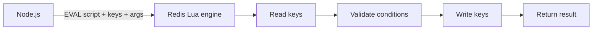
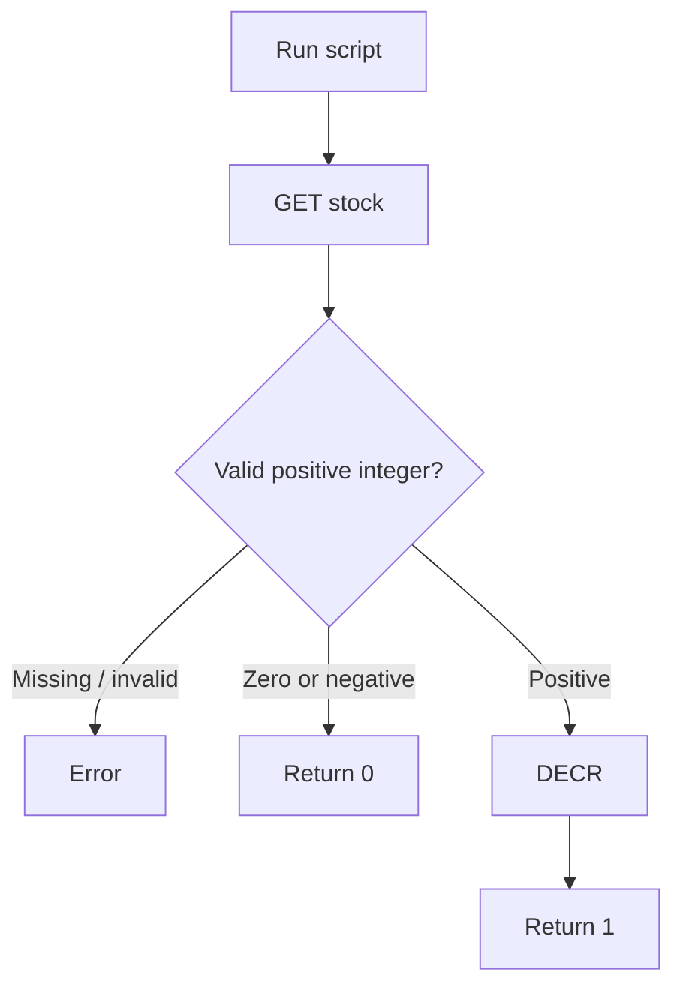
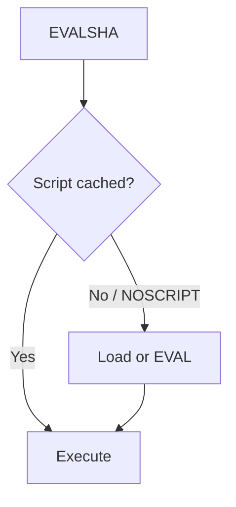
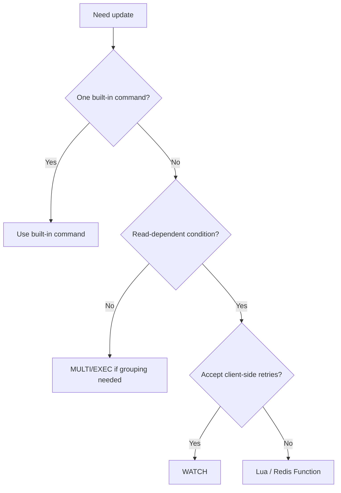

# Lesson 027 — Lua Scripting and Redis Functions

> **Section 03 — Keys, Memory and Internals** | Intermediate → Advanced  
> **Goal:** Execute conditional multi-step logic atomically inside Redis, understand EVAL/EVALSHA and Redis Functions, and recognize performance, Cluster, and security limits.

**Previous:** [Lesson 026 — Transactions](026-transactions.md)  
**Next:** [Lesson 028 — Caching Fundamentals](../04-caching/028-caching-fundamentals.md)

## 1. Why server-side scripting?

Imagine a stock counter with 1 item left. Two Node.js servers both read the value, see 1, and try to reserve it. A client-side GET followed by DECR can oversell.



A Redis Lua script can **check the value and update it within one atomic server-side execution**, without another client's command interleaving.

**Important:** First prefer a single built-in Redis command when possible (`INCR`, `SET NX EX`, `HINCRBY`). Use a script when the logic genuinely requires several dependent operations.

## 2. How Redis scripting works

The application sends Lua source and parameters. Redis executes the script server-side. For normal write-capable scripts, other clients' commands do not interleave during its execution.



Benefits:
- Atomic conditional logic.
- Fewer network round trips.
- Reusable server-side behavior.

Costs:
- Script execution blocks other Redis command processing on the server while it runs.
- Complex scripts are harder to debug.
- Scripts are not general-purpose background jobs.
- Cluster key rules and version compatibility matter.

## 3. EVAL: your first script

Syntax:

```redis
EVAL "return redis.call('GET', KEYS[1])" 1 demo:greeting
```

The number after the script is the count of key arguments.

Try:

```redis
SET demo:greeting hello
EVAL "return redis.call('GET', KEYS[1])" 1 demo:greeting
```

Expected reply: `hello`.

### Understand KEYS and ARGV

```redis
EVAL "return {KEYS[1], ARGV[1], ARGV[2]}" 1 demo:key Asha 42
```

- `KEYS[1]` = `demo:key`.
- `ARGV[1]` = `Asha`.
- `ARGV[2]` = `42`.

**Rule:** Supply all key names as declared key arguments. Do not hide or dynamically construct accessed key names in `ARGV`; this matters especially in Redis Cluster.

## 4. redis.call vs redis.pcall

Lua scripts use Redis commands through these APIs:

```lua
local value = redis.call("GET", KEYS[1])
return value
```

`redis.call` raises a script error when a Redis command fails.

```lua
local result = redis.pcall("INCR", KEYS[1])
return result
```

`redis.pcall` returns an error value that your script can inspect and handle.

**Critical:** A Lua script error does **not** roll back earlier writes already executed by the script. Redis scripting provides non-interleaved execution, not SQL-style rollback.

## 5. Real example: reserve stock without going negative

Create a script named `reserve-stock.lua`:

```lua
local stock = tonumber(redis.call("GET", KEYS[1]))

if stock == nil then
  return redis.error_reply("STOCK_NOT_FOUND_OR_INVALID")
end

if stock <= 0 then
  return 0
end

redis.call("DECR", KEYS[1])
return 1
```

Run it:

```redis
SET demo:stock 2
EVAL "local stock = tonumber(redis.call('GET', KEYS[1])); if stock == nil then return redis.error_reply('STOCK_NOT_FOUND_OR_INVALID') end; if stock <= 0 then return 0 end; redis.call('DECR', KEYS[1]); return 1" 1 demo:stock
```

The script returns:
- `1` if one unit was reserved.
- `0` if no stock remains.
- An error for missing or invalid stock.



### Production improvement

Validate that stock is a **safe, nonnegative integer** before using the script and ensure every writer follows the same invariant. Lua numbers and Redis integer values have different numeric limits; for very large counters, avoid precision-sensitive Lua arithmetic.

**Important:** A successful Redis stock reservation does not atomically commit a PostgreSQL order or a payment. Business-critical inventory still needs authoritative consistency and reconciliation.

## 6. Node.js EVAL example

Install:

```bash
npm install redis
```

Use ESM (`"type": "module"`).

```js
import { createClient } from "redis";

const redis = createClient({
  url: process.env.REDIS_URL ?? "redis://127.0.0.1:6379",
});
redis.on("error", (err) => console.error("Redis:", err.message));

const reserveStock = `
local stock = tonumber(redis.call("GET", KEYS[1]))
if stock == nil then
  return redis.error_reply("STOCK_NOT_FOUND_OR_INVALID")
end
if stock <= 0 then return 0 end
redis.call("DECR", KEYS[1])
return 1
`;

try {
  await redis.connect();
  await redis.set("demo:stock", "2");

  const result = await redis.eval(reserveStock, {
    keys: ["demo:stock"],
    arguments: [],
  });

  console.log("Reserved?", result === 1);
  console.log("Remaining:", await redis.get("demo:stock"));
} finally {
  if (redis.isOpen) await redis.quit();
}
```

The Node.js API shown is for modern node-redis. Check your installed major version.

## 7. A second example: atomic rate-limit counter with TTL

A common requirement is: increment a counter and set an expiration **only on the first request**.

A naive implementation:

```js
await redis.incr(key);
await redis.expire(key, 60);
```

This resets the TTL on every request, accidentally turning a fixed window into a sliding expiration. A failure between the commands can also leave a counter without expiration.

Lua solution:

```lua
local count = redis.call("INCR", KEYS[1])
if count == 1 then
  redis.call("EXPIRE", KEYS[1], tonumber(ARGV[1]))
end
return count
```

Example:

```redis
EVAL "local count = redis.call('INCR', KEYS[1]); if count == 1 then redis.call('EXPIRE', KEYS[1], tonumber(ARGV[1])) end; return count" 1 rate:demo 60
```

This is a **fixed-window counter starting with the first request**.

### Caveats

- The counter and expiration are atomic together.
- A fixed window permits bursts near boundaries.
- Client identity must be derived from trusted authentication/network configuration.
- Limits, reset policy, and failure behavior are business decisions.
- A script error after a write does not roll back that write.

We'll explore rate limiting more deeply in Section 05.

## 8. EVALSHA and the script cache

Sending a long script on every request adds network payload overhead.

Redis can identify scripts by SHA-1:

```redis
SCRIPT LOAD "return redis.call('GET', KEYS[1])"
```

The command returns a script SHA. Then:

```redis
EVALSHA <sha-from-script-load> 1 demo:greeting
```

The Redis server may forget cached scripts after restart, flush, failover, or script-cache eviction behavior depending on version.

### Handle NOSCRIPT

An application using `EVALSHA` should handle `NOSCRIPT` by loading or evaluating the script again.



**Do not treat a script SHA as a durable deployment artifact.**

## 9. SCRIPT commands

Useful commands include:

```redis
SCRIPT LOAD "return 42"
SCRIPT EXISTS <sha>
SCRIPT FLUSH
```

`SCRIPT FLUSH` clears cached scripts. Do not use it casually on a shared production instance.

Other administrative script commands exist; availability and behavior depend on Redis version.

## 10. Lua scripting vs WATCH and MULTI/EXEC

| Approach | Best for | Key limitation |
| --- | --- | --- |
| Single command | Simple atomic operation | Only built-in behavior |
| Pipeline | Independent command batching | Not atomic |
| MULTI/EXEC | Non-interleaved queued operations | No runtime rollback; cannot use queued read result |
| WATCH + MULTI/EXEC | Optimistic read-modify-write | Conflicts require retries |
| Lua / Function | Atomic conditional server-side logic | Blocks Redis during execution; complexity |



## 11. Important limitation: scripts do not roll back

Consider:

```lua
redis.call("SET", KEYS[1], "changed")
redis.call("INCR", KEYS[2])
return 1
```

If `KEYS[2]` contains text rather than an integer, the `INCR` can fail **after** the first `SET` succeeded.

The earlier `SET` remains.

**Production rule:** Validate data and possible failure conditions before mutating keys. Design scripts to avoid partial business effects, and use an authoritative transactional store where true rollback is required.

## 12. Scripts must be short and bounded

While a script executes, Redis cannot normally serve unrelated client commands on that server.

Avoid:
- Unbounded loops.
- Scanning huge collections.
- Complex CPU-heavy computation.
- Calling a script once per record when a simpler command works.
- Attempting network calls or filesystem access from Redis Lua.

Redis has protections for long-running scripts, but operational handling differs by version and script state. Do not rely on automatically killing a script that has already written data.

**Practical rule:** Keep scripts small, deterministic in their key access, and benchmark them under representative load.

## 13. Redis Cluster constraints

A script that accesses multiple keys in Redis Cluster must follow key-slot routing rules. Typically all accessed keys need to belong to the same hash slot.

Example:

```text
stock:{product101}:available
stock:{product101}:reserved
```

Both keys share the `product101` hash tag.

```redis
EVAL "return {redis.call('GET', KEYS[1]), redis.call('GET', KEYS[2])}" 2 stock:{product101}:available stock:{product101}:reserved
```

**Do not use one global hash tag for every user/product.** That can create a hot slot and undermine Cluster scaling.

## 14. Redis Functions: reusable server-side code

Redis 7 introduced **Redis Functions**, which allow named libraries of server-side functions managed by Redis.

Unlike ephemeral script-cache entries, loaded functions are part of Redis's persisted/replicated function state (subject to normal durability and recovery limitations).

### Example library

Save this as `demo-functions.lua`:

```lua
#!lua name=demo_lib

redis.register_function("get_value", function(keys, args)
  return redis.call("GET", keys[1])
end)
```

Load it with a CLI command that supplies the file contents as a single argument, for example:

```bash
redis-cli -x FUNCTION LOAD < demo-functions.lua
```

Call the function:

```redis
SET demo:greeting hello
FCALL get_value 1 demo:greeting
```

### Useful function commands

```redis
FUNCTION LIST
FUNCTION STATS
FUNCTION DUMP
```

Redis also supports function replacement, restore, and deletion workflows. Treat these as deployment operations, not casual production experiments.

## 15. EVAL vs Redis Functions

| Topic | EVAL/EVALSHA | Redis Functions |
| --- | --- | --- |
| Definition | Script source or cached SHA | Named library/function |
| Deployment | Application supplies or loads script | Library loaded to Redis |
| Persistence | Script cache is not a durable deployment guarantee | Function library participates in Redis persistence/replication |
| Invocation | `EVAL`, `EVALSHA` | `FCALL`, `FCALL_RO` |
| Best fit | Small scripts managed by application | Reusable server-side logic with managed deployment |

**Important:** Function deployment, upgrades, backups, and Cluster rollout need operational planning. Function persistence does not eliminate the possibility of data loss from infrastructure failures.

## 16. Read-only scripts and functions

Modern Redis supports read-only variants for appropriate operations, such as:

```redis
EVAL_RO "return redis.call('GET', KEYS[1])" 1 demo:greeting
```

And for read-only registered functions:

```redis
FCALL_RO get_value 1 demo:greeting
```

A read-only invocation cannot perform writes. Use it when appropriate for replica/Cluster routing and operational safety, subject to your Redis version.

## 17. Security and operational boundaries

- Never accept arbitrary Lua source from an untrusted API user.
- Limit who can call script/function management commands using Redis ACLs.
- Avoid exposing Redis directly to the public internet.
- Keep script source versioned in your application repository.
- Review and test scripts before deployment.
- Restrict keys and commands according to least privilege.
- Be aware that server-side code can still be expensive or harmful if badly written.

**Lua is not a replacement for authorization checks in your API.**

## 18. Real-world use cases

### CareerLoop: conditional stage counter

When a job application moves from Applied to Interview, you may need to update two Redis counters. A script can validate and update Redis-side counters together, but the **authoritative application status should remain in PostgreSQL**.

### CodeBuddy: connection request deduplication

`SET key value NX EX ...` may already be sufficient to claim an operation ID. Use Lua only when deduplication must be combined with additional Redis mutations.

### E-commerce: reservation counters

Use a server-side check-and-decrement when Redis is the coordination layer. For orders/payments, persist authoritative state in a transactional database and reconcile failures.

## 19. Common mistakes

1. Using scripts when a single atomic command would suffice.
2. Assuming scripts roll back previous writes on error.
3. Writing unbounded loops that block Redis.
4. Hiding accessed key names inside `ARGV`.
5. Ignoring Redis Cluster hash-slot rules.
6. Treating `EVALSHA` as guaranteed to work after restart.
7. Assuming a successful script also committed PostgreSQL changes.
8. Using Lua for slow background processing.
9. Ignoring numeric precision and integer constraints.
10. Deploying function libraries without versioning and rollback planning.
11. Accepting user-controlled script source.
12. Failing to handle uncertain results after network timeouts.

## 20. Hands-on exercises

1. Run a simple `EVAL` returning a string.
2. Read one key using `KEYS[1]`.
3. Pass an argument using `ARGV[1]`.
4. Write a stock check-and-decrement script.
5. Verify stock never goes below zero under concurrent calls.
6. Write a counter-with-first-expiration script.
7. Compare `redis.call` and `redis.pcall`.
8. Demonstrate that a script error does not undo an earlier write.
9. Load a script and run `EVALSHA`.
10. Explain how to recover from `NOSCRIPT`.
11. Create and call a Redis Function on Redis 7+.
12. Test a read-only script with `EVAL_RO`.
13. Explain the Redis Cluster key-slot constraint.
14. Benchmark a short script against a client-side WATCH loop.

## 21. Interview questions

**Q1. Why use Lua in Redis?** To execute dependent read/write logic atomically server-side.

**Q2. Does a Lua script block Redis?** It occupies the server's command execution path while running, so keep it short.

**Q3. What are KEYS and ARGV?** Explicit key names and non-key arguments.

**Q4. redis.call vs redis.pcall?** The former raises on Redis command errors; the latter returns an error value.

**Q5. Does a script roll back writes on error?** No.

**Q6. What is EVALSHA?** Execute a cached script by its SHA.

**Q7. What is NOSCRIPT?** The requested script SHA is not present in the server's script cache.

**Q8. WATCH vs Lua?** Client-side optimistic retries vs atomic server-side logic.

**Q9. What are Redis Functions?** Persisted named server-side function libraries introduced in Redis 7.

**Q10. Can a Redis script atomically update PostgreSQL too?** No.

## 22. Revision checklist

- [ ] Why server-side scripting
- [ ] EVAL syntax
- [ ] KEYS and ARGV
- [ ] redis.call vs redis.pcall
- [ ] Atomic conditional updates
- [ ] Script errors and no rollback
- [ ] EVALSHA and NOSCRIPT
- [ ] Rate-limit counter + TTL
- [ ] Short bounded scripts
- [ ] Redis Cluster hash slots
- [ ] Redis Functions and FCALL
- [ ] EVAL_RO and FCALL_RO
- [ ] Security, versioning, and deployment
- [ ] Idempotency and cross-system limits

---

**Official references:** [Redis scripting](https://redis.io/docs/latest/develop/programmability/eval-intro/) · [Redis Functions](https://redis.io/docs/latest/develop/programmability/functions-intro/) · [EVAL](https://redis.io/docs/latest/commands/eval/) · [FCALL](https://redis.io/docs/latest/commands/fcall/)
