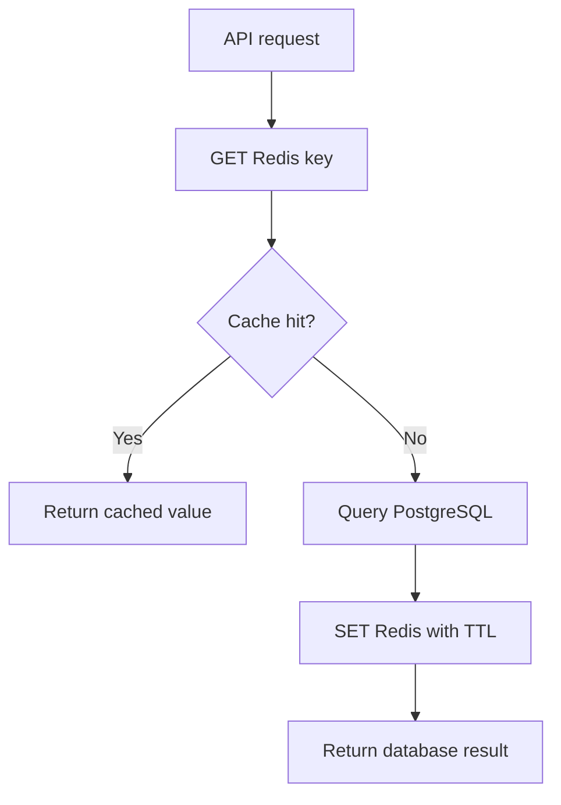
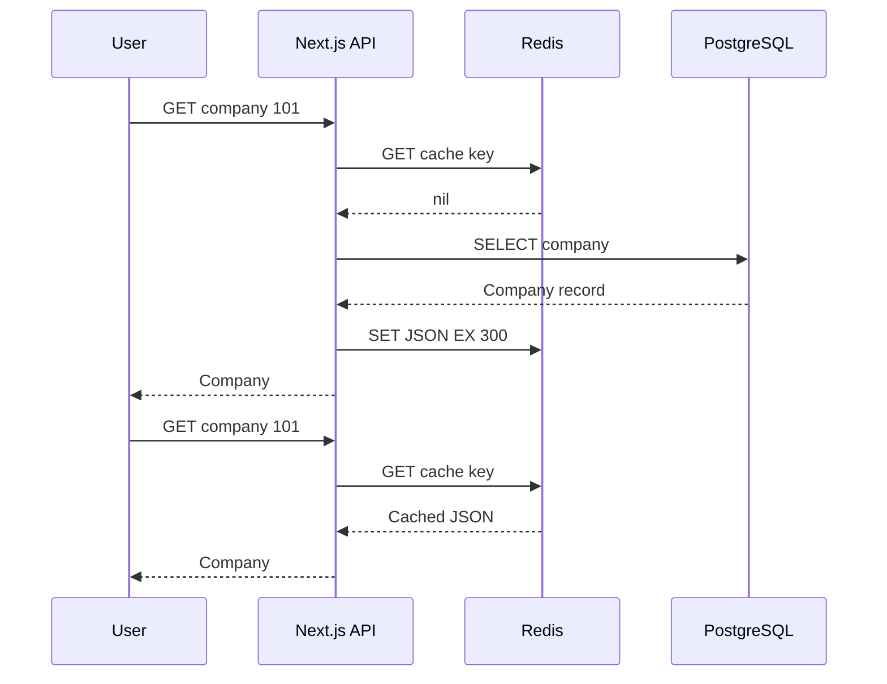
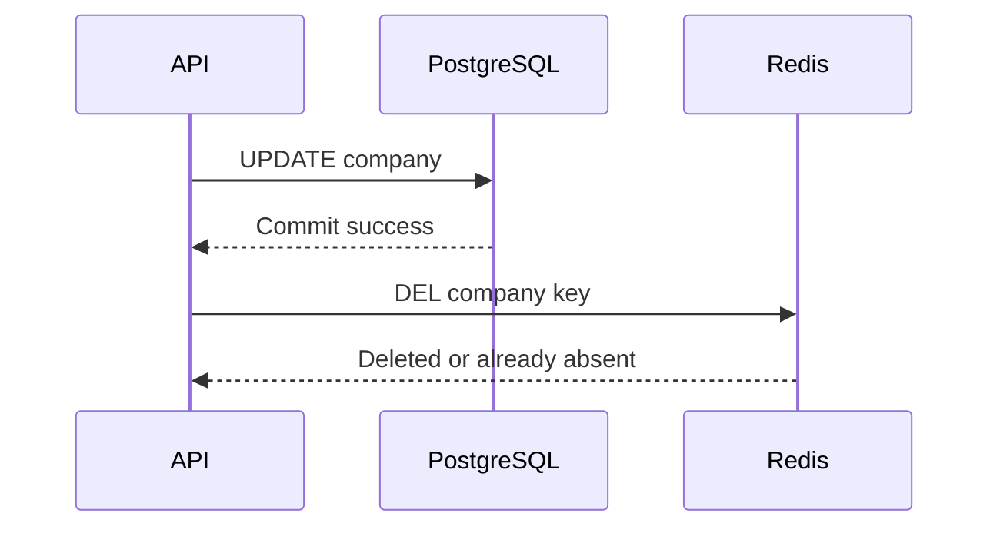
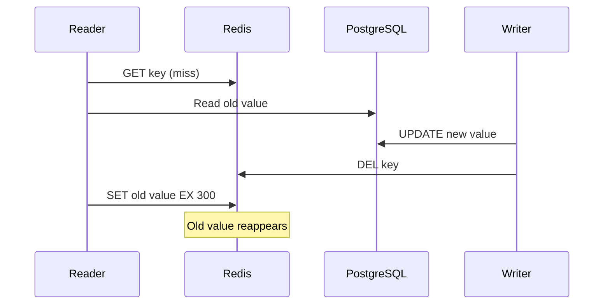
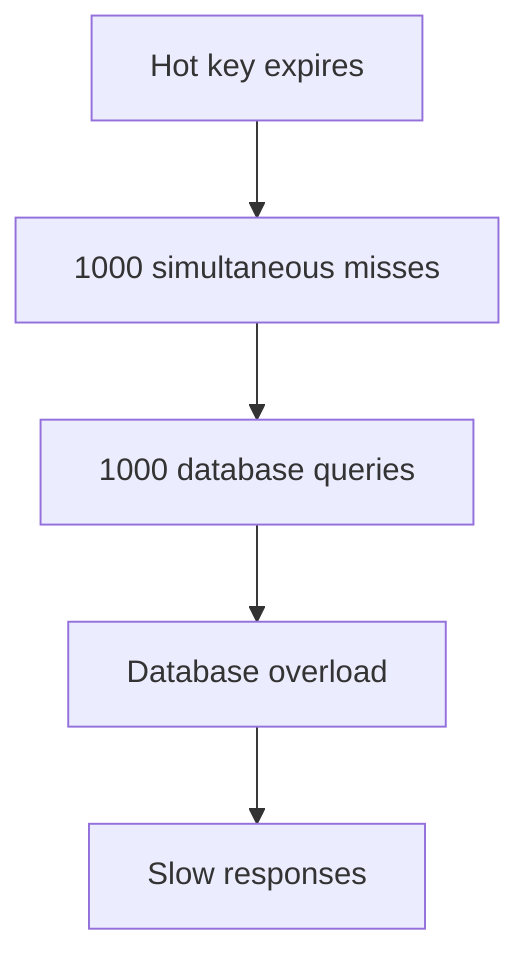

# Lesson 029 — Cache-Aside Pattern

> **Section 04 — Caching in Real Applications** | Beginner → Advanced  
> **Goal:** Learn cache-aside with Redis, Node.js and PostgreSQL, including TTL, invalidation, concurrency, failure handling and production design.

**Previous:** [Lesson 028 — Caching Fundamentals](028-caching-fundamentals.md)  
**Next:** [Lesson 030 — Read-Through and Write-Through Caching](030-read-write-through.md)

## 1. What is cache-aside?

**Cache-aside** (also called **lazy loading**) is a pattern in which the application explicitly reads the cache and populates it after a miss. Redis does not automatically fetch missing data from PostgreSQL.

Steps:
1. Request arrives.
2. Application checks Redis.
3. On a **hit**, return cached data.
4. On a **miss**, read the source of truth.
5. Cache the result with a TTL.
6. Return the result.



## 2. Real example: CareerLoop company page

Imagine an API endpoint `GET /api/companies/101`.

- **Source of truth:** PostgreSQL `companies` table.
- **Redis key:** `careerloop:prod:company:101:v1`.
- **Cached value:** serialized company details.
- **Example TTL:** 300 seconds.



The first request may be slower; later requests can avoid the database until expiration or invalidation.

## 3. Why use cache-aside?

**Benefits:**
- Cache only data that is requested.
- Reduce repeated database work.
- Keep the database authoritative.
- Recover from cache loss by refilling it.
- Control keys, TTL, and invalidation in the application.

**Costs:**
- Cache misses are slower.
- Stale copies can remain after updates.
- Popular expired keys can cause database spikes.
- Additional infrastructure and code need monitoring.
- Failures and races require explicit handling.

## 4. Basic Redis commands

```redis
GET careerloop:dev:company:101:v1
SET careerloop:dev:company:101:v1 '{"id":101,"name":"Acme"}' EX 300
GET careerloop:dev:company:101:v1
TTL careerloop:dev:company:101:v1
DEL careerloop:dev:company:101:v1
```

`GET` returns nil when absent. `SET ... EX` stores a value with expiration. `DEL` invalidates the cached copy.

**Important:** A key can disappear before its TTL because of eviction, deletion, or Redis restart. Handle misses every time.

## 5. Node.js + Redis + PostgreSQL implementation

Install:

```bash
npm install redis pg
```

Use ESM (`"type": "module"`) and configure `REDIS_URL` and `DATABASE_URL`.

```js
import { createClient } from "redis";
import pg from "pg";

const { Pool } = pg;

const pool = new Pool({
  connectionString: process.env.DATABASE_URL,
});

const redis = createClient({
  url: process.env.REDIS_URL ?? "redis://127.0.0.1:6379",
  socket: { connectTimeout: 1000 },
});

redis.on("error", (err) => console.error("Redis:", err.message));

async function findCompanyInDb(id) {
  const result = await pool.query(
    "SELECT id, name, website FROM companies WHERE id = $1",
    [id],
  );
  return result.rows[0] ?? null;
}

async function getCompany(id) {
  const key = "careerloop:dev:company:" + id + ":v1";

  if (redis.isReady) {
    try {
      const cached = await redis.get(key);
      if (cached !== null) return JSON.parse(cached);
    } catch (err) {
      console.warn("Cache read failed:", err.message);
    }
  }

  const company = await findCompanyInDb(id);

  if (company !== null && redis.isReady) {
    try {
      await redis.set(key, JSON.stringify(company), { EX: 300 });
    } catch (err) {
      console.warn("Cache write failed:", err.message);
    }
  }

  return company;
}

try {
  try {
    await redis.connect();
  } catch {
    console.warn("Redis unavailable; database fallback enabled");
  }

  console.log(await getCompany(101));
} finally {
  if (redis.isOpen) await redis.quit();
  await pool.end();
}
```

### Understand the code

- PostgreSQL uses a shared connection pool rather than connecting per request.
- Parameterized SQL protects the query from unsafe interpolation.
- `cached !== null` distinguishes a miss from valid cached JSON.
- Redis errors fall back to the database.
- Database errors are not silently ignored.
- Cached values expire after 300 seconds.
- The demo closes connections; long-running APIs keep them open.

**Production caution:** A reconnecting Redis client can queue commands. Configure appropriate timeouts, offline-queue behavior, circuit breakers, and database concurrency limits for your client version.

## 6. Cache invalidation after updates

When the company name changes, a common strategy is:

1. Update PostgreSQL successfully.
2. Delete the cached key.
3. Allow the next read to refill it.



Example:

```js
async function renameCompany(id, name) {
  const result = await pool.query(
    "UPDATE companies SET name = $1 WHERE id = $2 RETURNING id, name, website",
    [name, id],
  );

  const company = result.rows[0] ?? null;
  if (company === null) return null;

  const key = "careerloop:dev:company:" + id + ":v1";
  if (redis.isReady) {
    try {
      await redis.del(key);
    } catch (err) {
      console.error("Invalidation failed:", err.message);
      // Production: alert or enqueue a reliable retry.
    }
  }

  return company;
}
```

**Important:** If invalidation fails, stale data can remain until TTL. This pattern is simple but does not guarantee strong consistency.

## 7. The stale-write race

Even database-first updates followed by cache deletion can race with concurrent reads.



Possible mitigations:
- Short TTL to bound the stale window.
- Versioned keys and version checks.
- Coordinated invalidation where necessary.
- Read authoritative data for operations requiring strong correctness.

**Neither TTL nor DEL alone completely prevents stale reads.**

## 8. TTL choices

| Data | Example TTL | Why |
| --- | --- | --- |
| Public company profile | 5 minutes | Updates are relatively infrequent |
| Dashboard summary | 30 seconds | Changes more often |
| Public categories | 15 minutes | Mostly read-heavy |
| Not-found result | 30 seconds | Newly created data should appear soon |
| Permission decision | Avoid naive caching | Requires strict security and invalidation |

These values are illustrative. Select TTL based on measured traffic and allowed staleness.

```redis
SET cache:company:101 example EX 300
TTL cache:company:101
```

`GET` does not automatically extend TTL.

## 9. Negative caching

Repeated requests for a nonexistent company can repeatedly hit PostgreSQL.

A short-lived sentinel can represent a missing result.

```js
const NOT_FOUND = "__CACHE_NOT_FOUND__";

async function getCompanyWithNegativeCache(id) {
  const key = "careerloop:dev:company:" + id + ":v1";

  if (redis.isReady) {
    try {
      const cached = await redis.get(key);
      if (cached === NOT_FOUND) return null;
      if (cached !== null) return JSON.parse(cached);
    } catch (err) {
      console.warn("Cache unavailable:", err.message);
    }
  }

  const company = await findCompanyInDb(id);
  const value = company === null ? NOT_FOUND : JSON.stringify(company);
  const ttl = company === null ? 30 : 300;

  if (redis.isReady) {
    try {
      await redis.set(key, value, { EX: ttl });
    } catch (err) {
      console.warn("Cache write failed:", err.message);
    }
  }

  return company;
}
```

**Caution:** Use a sentinel that cannot be confused with legitimate data. Negative caching must respect tenant/user authorization and should expire quickly or be invalidated when the record is created.

## 10. Cache stampede

A popular key expires and many requests miss simultaneously.



Mitigations:
- **Single-flight:** Combine identical in-flight loads in one process.
- **Distributed coordination:** Carefully designed Redis locks or leases for multiple instances.
- **Stale-while-revalidate:** Serve stale values temporarily when acceptable.
- **Prewarming:** Refresh important keys before expiration.
- **Backend protection:** Bound concurrent queries and timeouts.

### Single-flight example

```js
const inFlight = new Map();

async function singleFlight(key, loader) {
  if (inFlight.has(key)) return inFlight.get(key);

  const promise = Promise.resolve().then(loader);
  inFlight.set(key, promise);

  try {
    return await promise;
  } finally {
    if (inFlight.get(key) === promise) {
      inFlight.delete(key);
    }
  }
}

const company = await singleFlight(
  "company:101",
  () => findCompanyInDb(101),
);
```

This works **only within one Node.js process**. Multiple containers need additional coordination if stampedes across instances are a concern.

## 11. TTL jitter and avalanche

When thousands of keys share the same TTL and creation time, they can expire together.

```js
function ttlWithJitter(baseSeconds, maxJitterSeconds) {
  return baseSeconds + Math.floor(Math.random() * (maxJitterSeconds + 1));
}

const ttl = ttlWithJitter(300, 60);
await redis.set("demo:company:101", "value", { EX: ttl });
```

Jitter spreads expiration times and can reduce a **multi-key avalanche**. It does **not** by itself prevent a stampede on one extremely popular key.

## 12. Key design and privacy

Bad:

```text
dashboard:summary
```

Better:

```text
careerloop:prod:tenant:7:user:42:dashboard:interview:v2
```

Include all inputs that affect the response:
- Environment and application.
- Tenant and user.
- Resource ID.
- Filters, pagination, language, and query options.
- Schema/version.

**Never rely on cache key isolation instead of authorization checks.**

## 13. Redis outage strategy

For rebuildable cache data, database fallback can be safe, but it must be bounded.

- Use connection and command timeouts.
- Avoid unlimited retries.
- Protect PostgreSQL from overload.
- Monitor Redis health and fallback rates.
- Apply circuit breakers and load shedding when necessary.

**Do not automatically fail open** for distributed locks, security checks, or enforcement rate limits. The correct behavior may be to reject or delay operations.

## 14. Consistency decisions

| Requirement | Reasonable starting approach |
| --- | --- |
| Slightly stale public data is acceptable | Cache-aside + TTL |
| Occasional writes | Cache-aside + invalidate after commit |
| Very popular expensive result | Single-flight + refresh strategy |
| Strong read-after-write requirement | Authoritative database or stronger versioned design |
| Payment or critical inventory | Transactional source of truth and reconciliation |

The correct design depends on business invariants, not merely speed.

## 15. Monitoring cache-aside

Measure:
- Hits and misses by endpoint.
- Hit rate: `hits / (hits + misses)`.
- Redis latency and error rate.
- Database query rate.
- p50/p95/p99 API latency.
- Evictions and memory.
- Invalidation failures.
- Refresh duration and stampedes.

A high hit rate alone does not prove correctness.

## 16. Cache-aside vs other patterns

| Pattern | Cache population | Write behavior |
| --- | --- | --- |
| Cache-aside | Application loads on miss | Usually database write then invalidate |
| Read-through | Cache abstraction loads on miss | Depends on write strategy |
| Write-through | Coordinated caching layer | Writes source and cache synchronously |
| Write-behind | Cache/queue system | Persists to source asynchronously |
| Write-around | Usually on future read | Writes source, bypassing cache |

The next lesson explores read-through and write-through in detail.

## 17. Common mistakes

1. Treating the cache as authoritative.
2. Forgetting TTL or invalidation.
3. Using the same key across users or tenants.
4. Assuming DEL completely prevents stale-write races.
5. Caching null without a clear representation.
6. Hiding database failures as cache misses.
7. Overloading PostgreSQL during Redis outages.
8. Assuming single-flight coordinates multiple servers.
9. Assigning identical TTLs to all keys without considering avalanches.
10. Caching authorization decisions without a security plan.
11. Ignoring serialization/schema changes.
12. Measuring hit rate without latency and correctness.

## 18. Hands-on exercises

1. Draw the cache hit/miss workflow.
2. Implement a PostgreSQL-backed `getCompany()`.
3. Set and inspect a 300-second TTL.
4. Invalidate a company key after update.
5. Explain and reproduce the stale-write race.
6. Implement negative caching.
7. Create tenant-aware cache keys.
8. Measure cold and warm request latency.
9. Test safe fallback while Redis is unavailable.
10. Add single-flight for one Node.js process.
11. Add TTL jitter to cache warm-up.
12. Choose monitoring metrics for production.

## 19. Interview questions

**Q1. What is cache-aside?** Application-controlled cache lookup and population on misses.

**Q2. Why is it lazy loading?** Only requested data is cached.

**Q3. What happens on a miss?** Fetch from source, optionally cache with TTL, and return.

**Q4. How do writes work?** Often write the database and then invalidate the cache.

**Q5. Does invalidation guarantee consistency?** No; concurrent reads can repopulate stale data.

**Q6. What is a cache stampede?** Many requests recomputing one missing popular value.

**Q7. What is negative caching?** Temporarily caching that a resource does not exist.

**Q8. What is single-flight?** Combining simultaneous identical loads.

**Q9. Why TTL jitter?** To spread expiration times across keys.

**Q10. What if Redis is down?** For rebuildable caches, use bounded database fallback with overload protection.

## 20. Revision checklist

- [ ] Cache-aside and lazy loading
- [ ] Hits and misses
- [ ] PostgreSQL source of truth
- [ ] Node.js implementation
- [ ] TTL choice
- [ ] Database-first invalidation
- [ ] Stale-write race
- [ ] Negative caching
- [ ] Stampede and single-flight
- [ ] TTL jitter and avalanche
- [ ] Cache key security
- [ ] Redis outage behavior
- [ ] Consistency requirements
- [ ] Monitoring

---

**Official references:** [Redis caching](https://redis.io/solutions/caching/) · [Redis SET](https://redis.io/docs/latest/commands/set/) · [Redis EXPIRE](https://redis.io/docs/latest/commands/expire/) · [node-redis](https://github.com/redis/node-redis)
