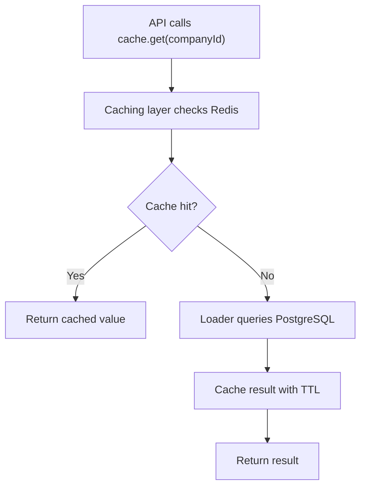
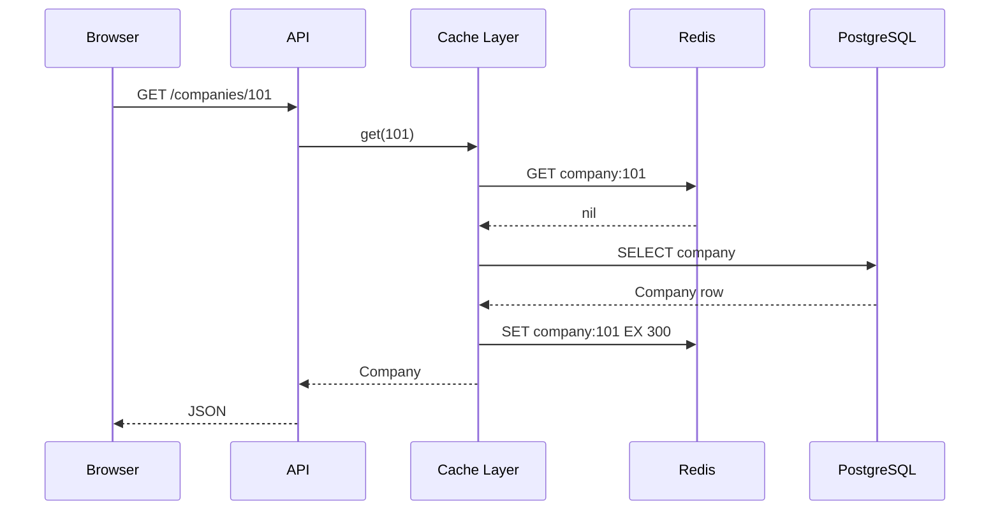
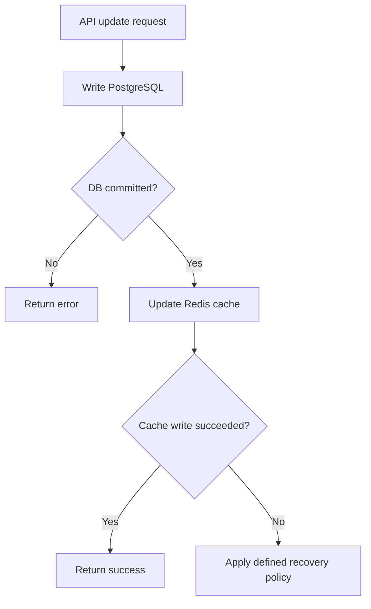
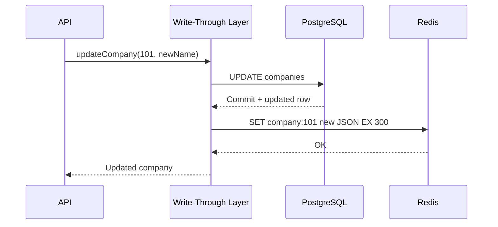
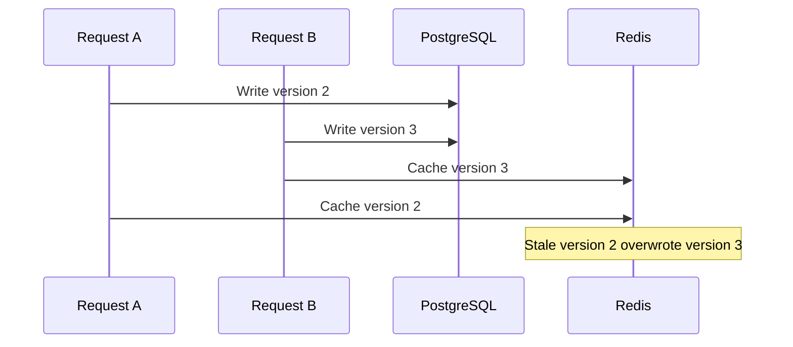
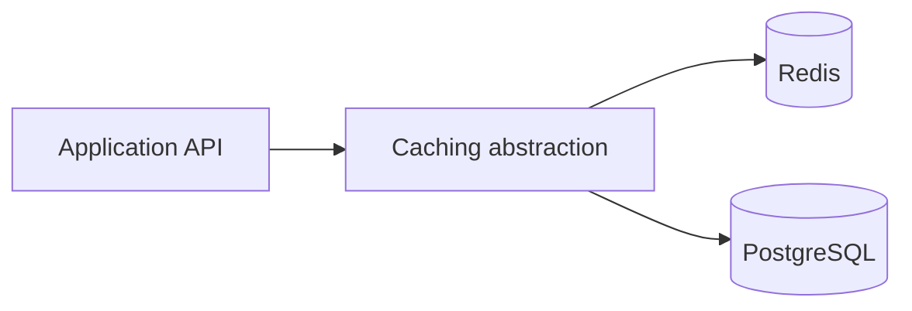

# Lesson 030 — Read-Through and Write-Through Caching

> **Section 04 — Caching in Real Applications** | Intermediate  
> **Goal:** Understand who owns cache loading and writes, implement both patterns in Node.js, and evaluate consistency and failure behavior.

**Previous:** [Lesson 029 — Cache-Aside](029-cache-aside.md)  
**Next:** [Lesson 031 — Write-Behind and Write-Around](031-write-behind-around.md)

## 1. Start with the problem

Your CareerLoop application stores companies in PostgreSQL and wants fast repeated reads through Redis.

In cache-aside, the API explicitly checks Redis and fetches PostgreSQL on a miss. But imagine many services repeating the same cache lookup and loading logic. A **read-through abstraction** can centralize that behavior.

For writes, if you update PostgreSQL but forget to invalidate or refresh Redis, users may receive stale data. A **write-through abstraction** can coordinate the write path.

**Important:** Redis is a fast data store, but it does not automatically connect to PostgreSQL and implement read-through or write-through. Your application or caching library must implement the coordination.

## 2. Read-through caching

**Definition:** The application asks a caching layer for data. On a miss, that layer loads from the authoritative source, caches the result, and returns it.



### Difference from cache-aside

In both patterns, Redis can be populated on demand. The important difference is **where the loading responsibility lives**:

- **Cache-aside:** Business/application code explicitly handles Redis miss and database fetch.
- **Read-through:** A reusable cache layer or provider handles the miss and loading.

This is an architectural distinction. A helper function implementing read-through may internally use cache-aside logic.

### Real-world example

Your API handler should only need:

```js
const company = await companyCache.get(101);
```

The `companyCache` abstraction handles Redis, PostgreSQL, serialization, TTL, and failure policy.

## 3. Read-through request sequence



## 4. Build a reusable read-through layer in Node.js

Install:

```bash
npm install redis pg
```

Assume `redis` is a connected node-redis client and `pool` is an existing PostgreSQL `Pool`.

```js
function createReadThroughCache({ redis, load, prefix, ttlSeconds = 300 }) {
  return {
    async get(id) {
      const key = prefix + ":" + id;

      if (redis.isReady) {
        try {
          const cached = await redis.get(key);
          if (cached !== null) {
            return JSON.parse(cached);
          }
        } catch (error) {
          console.warn("Cache read failed:", error.message);
        }
      }

      const value = await load(id);

      if (value !== null && redis.isReady) {
        try {
          await redis.set(key, JSON.stringify(value), {
            EX: ttlSeconds,
          });
        } catch (error) {
          console.warn("Cache write failed:", error.message);
        }
      }

      return value;
    },
  };
}

const companyCache = createReadThroughCache({
  redis,
  prefix: "careerloop:prod:company:v1",
  ttlSeconds: 300,
  load: async (id) => {
    const result = await pool.query(
      "SELECT id, name, website FROM companies WHERE id = $1",
      [id],
    );
    return result.rows[0] ?? null;
  },
});

const company = await companyCache.get(101);
```

This demonstrates the abstraction. In production, also define negative caching, schema validation, key scoping, timeouts, stampede protection, and authorization boundaries.

## 5. Read-through benefits and trade-offs

**Benefits:**
- API handlers are simpler.
- Cache policy is reusable.
- Consistent TTL and serialization.
- One place to instrument cache hit/miss metrics.

**Trade-offs:**
- Cache loader can become too generic and hide expensive database work.
- Cold reads still query the source.
- Stampedes and stale-data races still exist.
- A caching abstraction does not magically provide consistency.

## 6. Write-through caching

**Definition:** A coordinated write path updates the authoritative store and the cache before reporting the operation complete according to its chosen success policy.

Typical flow:



For a database-backed application, PostgreSQL remains authoritative.

**Critical:** PostgreSQL and Redis do not share an automatic atomic transaction. If the database commits and the Redis write fails, you have a partial cross-system outcome. You must decide whether to return success with an invalidation/retry strategy, or surface degraded status and reconcile. Returning an error does not undo the committed database update.

## 7. Write-through sequence



### Example

```js
async function updateCompanyWriteThrough(id, name) {
  const result = await pool.query(
    "UPDATE companies SET name = $1 WHERE id = $2 RETURNING id, name, website",
    [name, id],
  );

  const company = result.rows[0] ?? null;
  if (company === null) return null;

  const key = "careerloop:prod:company:v1:" + id;

  try {
    await redis.set(key, JSON.stringify(company), { EX: 300 });
  } catch (error) {
    console.error("Cache synchronization failed:", error.message);
    // Production: persist a retry/outbox event or invalidate reliably.
    // The PostgreSQL update has already committed.
  }

  return company;
}
```

This example chooses **database success as authoritative**, even if Redis fails. That is a practical policy for a rebuildable cache, but not the only possible policy.

## 8. Write-through vs database-first invalidation

Two common write paths:

**Update cache:**

```text
UPDATE PostgreSQL -> SET new value in Redis
```

**Invalidate cache:**

```text
UPDATE PostgreSQL -> DEL Redis key
```

Updating Redis may improve subsequent hit rate, but it requires correct serialization and ordering. Invalidating is simpler when many derived keys depend on the same record.

Neither approach alone eliminates all concurrent stale-write races.

## 9. The write-through concurrency race

Two updates can finish out of order across systems.



**Solutions depend on correctness requirements:**
- Versioned cache keys and monotonic version checks.
- Database-generated versions and conditional cache updates.
- Serializing updates per resource where appropriate.
- Invalidation plus TTL for bounded eventual consistency.
- Read the authoritative database for critical decisions.

A plain `SET` does not know that its value is older.

## 10. Read-through + write-through together

A reusable caching layer can own both reads and writes.



Example interface:

```js
const companyStore = {
  get: async (id) => companyCache.get(id),
  update: async (id, name) => updateCompanyWriteThrough(id, name),
};
```

The interface is convenient, but keep authorization and business validation in appropriate layers.

## 11. Read-through vs write-through vs cache-aside

| Feature | Cache-aside | Read-through | Write-through |
| --- | --- | --- | --- |
| Primary operation | Read | Read | Write |
| Who handles cache miss? | Application | Cache layer | Not the main concern |
| When is cache populated? | On miss | On miss | During coordinated write |
| Cache freshness | TTL/invalidation | TTL/invalidation | Depends on write ordering |
| Redis built-in automatic DB loading? | No | No | No |

These patterns are not mutually exclusive: a system may combine read-through reads with write-through writes.

## 12. Failure scenarios

### Redis unavailable during read

For rebuildable data, read directly from PostgreSQL if the database can tolerate fallback traffic. Use timeouts and bounded concurrency.

### PostgreSQL unavailable during write

Do not claim success for a durable database update that never committed.

### PostgreSQL succeeds, Redis fails

The database has changed. Decide how to repair the cache and how the API reports the partial outcome.

### Redis succeeds but response is lost

The client may not know whether the cache write happened. Avoid blindly retrying non-idempotent business operations.

### Cache stampede

Read-through still has the same stampede risk as cache-aside. Centralizing logic makes it easier to add single-flight, but does not solve distributed coordination automatically.

## 13. Real application choices

**CareerLoop company details:** Read-through cache can simplify repeated reads; invalidate after writes if a company affects many cached dashboards.

**CodeBuddy user profiles:** Read-through works for public profile data, but user-specific privacy settings require strict authorization and key scoping.

**E-commerce product price:** Write-through alone does not guarantee correct checkout pricing. The authoritative database or pricing service must validate at checkout.

**Feature flags:** Cache with explicit invalidation/versioning when rollout correctness matters.

## 14. Performance and observability

Track:
- Cache hits/misses and hit rate.
- p50/p95/p99 latency.
- Redis errors and timeouts.
- Database query rate.
- Cache synchronization failures.
- Stale version detection.
- Memory and eviction metrics.

**Don't optimize only for cache hit rate.** Correctness and source-of-truth consistency matter.

## 15. Common mistakes

1. Assuming Redis automatically implements read-through for PostgreSQL.
2. Treating read-through as fundamentally different from cache-aside internally.
3. Forgetting TTL or invalidation.
4. Assuming write-through gives cross-database atomicity.
5. Returning a generic error after PostgreSQL committed without explaining retry risk.
6. Overwriting newer cache data with an older concurrent write.
7. Caching private responses under shared keys.
8. Ignoring stampedes.
9. Allowing unlimited database fallback during Redis outages.
10. Using cached prices or permissions as authoritative business decisions.

## 16. Hands-on exercises

1. Draw a read-through cache-miss flow.
2. Implement `createReadThroughCache()`.
3. Compare its API with explicit cache-aside code.
4. Add a 300-second TTL.
5. Add a hit/miss metric.
6. Write a PostgreSQL-first write-through helper.
7. Simulate Redis failure after DB commit.
8. Explain why an API retry could duplicate a non-idempotent operation.
9. Reproduce the stale concurrent write race.
10. Propose a version-aware cache update.
11. Compare cache update vs invalidation.
12. Design a safe fallback for a company details endpoint.

## 17. Interview questions

**Q1. What is read-through?** A cache abstraction loads data from the source on a miss.

**Q2. Cache-aside vs read-through?** The application explicitly handles misses in cache-aside; a caching layer handles them in read-through.

**Q3. What is write-through?** A coordinated write path updates the source and cache synchronously under a defined success policy.

**Q4. Is write-through atomic across Redis and PostgreSQL?** No.

**Q5. Can read-through cause a stampede?** Yes.

**Q6. Why might invalidation be easier than updating cache?** One DB change may affect many derived keys.

**Q7. How can concurrent writes produce stale cache data?** An older write can reach Redis after a newer write.

**Q8. When should an API bypass cache?** When stronger correctness or freshness is required.

## 18. Revision checklist

- [ ] Read-through definition
- [ ] Cache-aside comparison
- [ ] Read-through Node.js abstraction
- [ ] Write-through definition
- [ ] DB-first write policy
- [ ] Cross-system partial failures
- [ ] Cache update vs invalidation
- [ ] Concurrent stale-write race
- [ ] Key scoping and security
- [ ] Stampede and outages
- [ ] Monitoring and metrics

---

**References:** [Redis caching](https://redis.io/solutions/caching/) · [Redis SET](https://redis.io/docs/latest/commands/set/) · [Redis EXPIRE](https://redis.io/docs/latest/commands/expire/) · [node-redis](https://github.com/redis/node-redis)
