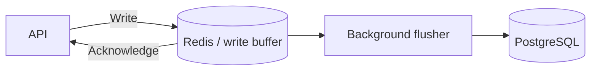
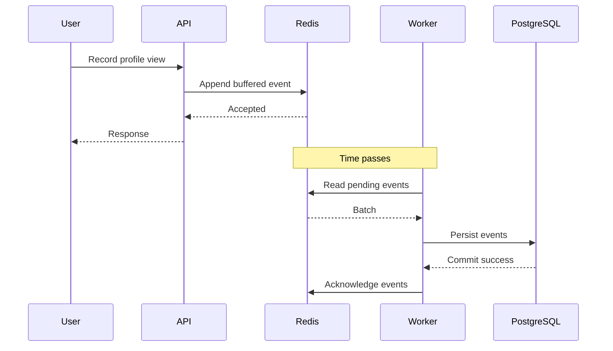
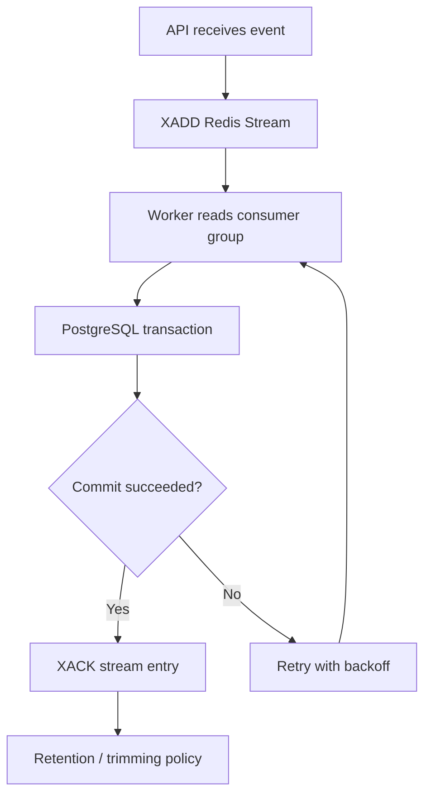
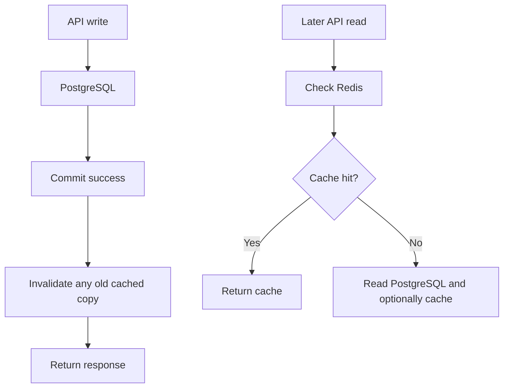
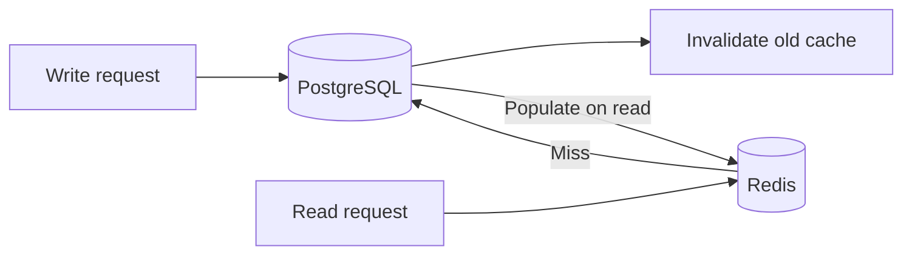

# Lesson 031 — Write-Behind and Write-Around Caching

> **Section 04 — Caching in Real Applications** | Intermediate → Advanced  
> **Goal:** Understand asynchronous cache-to-database writes, write-around caching, durability, ordering, idempotency, and production trade-offs.

**Previous:** [Lesson 030 — Read-Through and Write-Through](030-read-write-through.md)  
**Next:** [Lesson 032 — Cache Invalidation](032-invalidation.md)

## 1. The problem: not all writes need the same path

Suppose your application receives thousands of page-view events every second. Writing each event synchronously to a relational database can be expensive.

But for an order payment, you generally **must not** acknowledge success before the authoritative durable transaction is committed.

Different workloads need different caching patterns.

Two patterns to understand:

- **Write-behind (write-back):** Accept writes into a caching/buffering layer and propagate them to the durable database later.
- **Write-around:** Write directly to the database and avoid populating the cache on the write path.

These are architectural patterns, not automatic features enabled by storing values in Redis.

## 2. What is write-behind caching?

**Write-behind** means the application writes to a cache or intermediate write buffer first. A background worker persists changes to the authoritative database asynchronously.



The main benefit is lower perceived write latency and the ability to batch database writes.

**Critical trade-off:** Acknowledging a write before it reaches durable storage creates a data-loss window.

## 3. Example: analytics counters

Imagine CodeBuddy tracks profile views.

Without buffering:

```text
Each view -> PostgreSQL UPDATE -> response
```

With write-behind:

```text
Each view -> Redis INCR -> response
Worker periodically aggregates -> PostgreSQL UPDATE
```

Redis command:

```redis
INCR analytics:profile:101:views
```

The worker can flush counts periodically, but correctness depends on how it claims and acknowledges batches.

**Warning:** A naive sequence of `GET counter`, `UPDATE database`, `DEL counter` can lose increments arriving between the read and delete. You need an atomic rotation/claim mechanism, a durable event log, or another carefully designed approach.

## 4. Write-behind request sequence



This diagram describes a robust **buffered event** approach, not merely overwriting a cached value.

## 5. Write-behind vs write-through

| Property | Write-through | Write-behind |
| --- | --- | --- |
| Source write timing | During request | Later, asynchronously |
| User-visible write latency | Includes source write | May be lower |
| Data-loss window | Smaller if source commits before acknowledgment | Larger if buffer is not durable |
| Complexity | Moderate | Higher |
| Ordering/retries | Simpler | Requires explicit design |
| Suitable for payments? | Database-first can be appropriate | Generally not for authoritative payment state |

Write-behind is useful only when the durability and consistency trade-offs are acceptable.

## 6. Why a plain Redis String is not enough

Consider:

```redis
SET pending:order:101 '{"status":"paid"}'
```

If you return success and Redis loses this key before PostgreSQL is updated, the business event may be lost.

Other problems:
- How does a worker discover pending keys safely?
- What if a value changes while the worker processes it?
- How do you retry failed writes?
- How do you avoid processing the same event twice?
- How do you preserve ordering?

A **queue or event log** is often a better intermediate structure than a plain cache key.

## 7. Redis Streams for buffered writes

Redis Streams support append-only entries, consumer groups, acknowledgments, and pending-entry recovery.

Create a stream and add an event:

```redis
XADD analytics:events * type profile_view profileId 101 eventId view-001
```

Create a consumer group:

```redis
XGROUP CREATE analytics:events analytics-workers 0 MKSTREAM
```

Read pending new events:

```redis
XREADGROUP GROUP analytics-workers worker-1 COUNT 10 STREAMS analytics:events >
```

After PostgreSQL successfully commits, acknowledge an entry:

```redis
XACK analytics:events analytics-workers <entry-id>
```

Replace `<entry-id>` with the actual stream entry ID returned by Redis.

**Important:** Consumer groups provide at-least-once processing patterns when recovery is correctly implemented. Acknowledgment does not automatically delete entries from the stream; retention/trimming requires separate planning.

## 8. Durable write-behind architecture



### Key rules

1. Do not acknowledge before database commit.
2. Give each event a stable idempotency ID.
3. Handle worker crashes and pending entries.
4. Retry transient errors with limits and backoff.
5. Move permanently failing events to a review/dead-letter workflow.
6. Monitor pending-event count and oldest-event age.
7. Size Redis persistence and replication for the acceptable RPO.
8. Consider a transactional outbox in the database when the source event originates from an authoritative DB transaction.

**Redis Streams alone do not guarantee zero loss under every infrastructure failure.**

## 9. Idempotency: avoid double writes

Suppose a worker commits an event to PostgreSQL, crashes before `XACK`, and then another worker retries it.

Without idempotency, the profile-view count may increase twice.

A PostgreSQL table can record processed event IDs.

```sql
CREATE TABLE processed_events (
  event_id TEXT PRIMARY KEY,
  processed_at TIMESTAMPTZ NOT NULL DEFAULT now()
);
```

Inside **one PostgreSQL transaction**, first claim the event ID and only apply the business update if the claim is new.

```sql
BEGIN;

INSERT INTO processed_events (event_id)
VALUES ('view-001')
ON CONFLICT DO NOTHING
RETURNING event_id;

-- If one row was returned, apply the corresponding
-- business update inside this same transaction.
-- If no row was returned, it was already processed.

COMMIT;
```

This SQL is an illustrative workflow; the application must check the `RETURNING` result and perform the actual update before committing.

## 10. Ordering and batching

A worker may batch events to reduce database overhead.

Example:

```text
Read 100 events
Validate each event
Write to PostgreSQL transaction(s)
Commit
Acknowledge only committed events
```

**Ordering challenge:** Multiple workers may process events for the same entity out of order. For additive counters this may be harmless; for status transitions it can be incorrect.

Possible strategies:
- Per-entity sequence numbers.
- Database version checks.
- Partitioning by entity.
- Idempotent and commutative operations.
- Restricting concurrency for order-sensitive workflows.

Do not assume Redis Streams consumer groups automatically enforce application-level ordering across all workers.

## 11. Backpressure

If the API produces events faster than workers can persist them, the Redis buffer grows.


Monitor:
- Stream length.
- Pending entries.
- Oldest unprocessed event age.
- Worker throughput.
- PostgreSQL commit latency.
- Redis memory.
- Retry and dead-letter counts.

**Do not trim unprocessed events just to reduce memory.** Choose a retention and acknowledgment policy that preserves required data.

## 12. Redis failure and persistence

Write-behind durability depends on more than your worker code.

- Redis RDB may lose writes since the last snapshot.
- AOF with `appendfsync everysec` reduces, but does not eliminate, loss windows.
- Replication may lag.
- Failover can lose recent writes.
- A Redis outage can stop accepting new buffered events.

For critical business data, a transactional database/outbox or a purpose-built durable messaging system may be more suitable.

## 13. What is write-around caching?

**Write-around** means writes bypass the cache and go directly to the authoritative store.



The key idea: **Do not eagerly cache newly written data that might never be read again.**

## 14. Why write-around can help

Imagine your application ingests 100,000 unique log records. Most are never individually requested.

Write-through would populate Redis with many cold values.

Write-around stores them in the database without filling Redis. Only later reads of popular records may populate the cache.

**Benefit:** Less cache pollution and lower cache memory pressure.

**Cost:** The first read after a write is usually a cache miss.

## 15. Write-around Node.js example

Assume `pool` and `redis` are initialized as in Lesson 030.

```js
async function createCompanyWriteAround(company) {
  const result = await pool.query(
    "INSERT INTO companies (name, website) VALUES ($1, $2) RETURNING id, name, website",
    [company.name, company.website],
  );

  const created = result.rows[0];

  // Do not populate Redis here.
  return created;
}

async function updateCompanyWriteAround(id, name) {
  const result = await pool.query(
    "UPDATE companies SET name = $1 WHERE id = $2 RETURNING id, name, website",
    [name, id],
  );

  const updated = result.rows[0] ?? null;
  if (updated === null) return null;

  // Remove any stale cached copy after DB commit.
  const key = "careerloop:prod:company:v1:" + id;

  if (redis.isReady) {
    try {
      await redis.del(key);
    } catch (error) {
      console.error("Cache invalidation failed:", error.message);
      // Production: alert/retry; TTL limits stale exposure.
    }
  }

  return updated;
}
```

### Why invalidate on update?

Write-around does **not** mean “never touch Redis.” If an older cached value exists, an update must account for it. Otherwise readers may keep seeing stale data.

## 16. Write-around vs cache-aside

These patterns often work together:

- **Write path:** Write-around → PostgreSQL first; invalidate old cache.
- **Read path:** Cache-aside → Redis first; load PostgreSQL on miss.



This combination is common because it avoids caching every new write while still accelerating popular reads.

## 17. Comparing all major patterns

| Pattern | Read behavior | Write behavior | Main trade-off |
| --- | --- | --- | --- |
| Cache-aside | Application loads on miss | Usually DB write + invalidation | Application owns cache logic |
| Read-through | Cache layer loads on miss | Depends on write path | Abstraction complexity |
| Write-through | Reads can use cache | Source and cache updated synchronously | Cross-system partial failure |
| Write-behind | Reads may use cache | Buffer first, DB later | Durability/ordering risk |
| Write-around | Cache on later read | DB first, avoid cache population | First read may miss |

## 18. When should you choose each?

**CareerLoop company profile updates:** Write-around + cache-aside is a reasonable simple default. Update PostgreSQL and invalidate the cached profile.

**CodeBuddy view counters:** Buffered aggregation can be useful if approximate/late counts are acceptable and the pipeline has durability and idempotency safeguards.

**E-commerce order payment:** Commit authoritative payment/order state transactionally. Do not use Redis write-behind as the sole record of successful payment.

**Bulk import of rarely accessed records:** Write-around avoids filling Redis with cold data.

**Frequently read, frequently updated configuration:** Consider coordinated write-through or version-aware invalidation if freshness requirements justify the complexity.

## 19. Common mistakes

1. Assuming Redis automatically persists write-behind updates to PostgreSQL.
2. Acknowledging critical writes before durable storage without accepting the loss risk.
3. Using GET/DEL counter flushing without handling concurrent increments.
4. Acknowledging Stream entries before PostgreSQL commit.
5. Forgetting worker crash recovery and pending messages.
6. Applying the same event twice after a retry.
7. Ignoring event ordering.
8. Trimming unprocessed events.
9. Ignoring backlog growth and backpressure.
10. Treating Redis replication as a guaranteed durable backup.
11. Confusing write-around with “never invalidate cache.”
12. Caching every bulk-import record even when no one reads it.
13. Using write-behind for authoritative payment state without appropriate durability architecture.
14. Assuming asynchronous write acknowledgment means the database already contains the data.

## 20. Hands-on exercises

1. Draw a write-behind flow.
2. Explain the difference between accepting and persisting a write.
3. Use `XADD` to append an analytics event.
4. Create a consumer group with `XGROUP CREATE`.
5. Read a Stream entry with `XREADGROUP`.
6. Describe when to send `XACK`.
7. Simulate a worker crash after DB commit but before acknowledgment.
8. Design an idempotency table in PostgreSQL.
9. Explain the GET/DEL counter-flush race.
10. Define metrics for backlog and backpressure.
11. Implement a write-around company creation endpoint.
12. Invalidate a cached company after update.
13. Compare write-around + cache-aside with write-through.
14. Choose a safe pattern for payments, profile views, and bulk imports.

## 21. Interview questions

**Q1. What is write-behind?** Writes are accepted by a cache/buffer and persisted to the source asynchronously.

**Q2. Why use it?** To reduce request-path write latency and batch source writes.

**Q3. Biggest risk?** Buffered data may be lost before durable persistence.

**Q4. Why use idempotency?** Workers can retry events after uncertain completion.

**Q5. What is backpressure?** Producers create work faster than consumers can process it.

**Q6. What is write-around?** Write directly to the database without eagerly populating cache.

**Q7. Why can write-around improve cache efficiency?** It avoids filling cache with rarely read data.

**Q8. Does write-around eliminate invalidation?** No; existing cached values may still need deletion.

**Q9. Why not write-behind for payments?** The acknowledged event may not yet be durably committed.

**Q10. What is a common pattern combination?** Write-around on writes and cache-aside on reads.

## 22. Revision checklist

- [ ] Write-behind definition
- [ ] Async flush pipeline
- [ ] Durability window
- [ ] Streams and consumer groups
- [ ] Acknowledgment after commit
- [ ] Idempotency and retries
- [ ] Ordering
- [ ] Backpressure
- [ ] Persistence limitations
- [ ] Write-around definition
- [ ] Cache pollution
- [ ] Invalidation on updates
- [ ] Pattern comparison
- [ ] Production use-case selection

---

**Official references:** [Redis Streams](https://redis.io/docs/latest/develop/data-types/streams/) · [XREADGROUP](https://redis.io/docs/latest/commands/xreadgroup/) · [XACK](https://redis.io/docs/latest/commands/xack/) · [Redis persistence](https://redis.io/docs/latest/operate/oss_and_stack/management/persistence/) · [Redis caching](https://redis.io/solutions/caching/)
